# Лабораторная работа № 2 — Наблюдаемость HTTP-сервиса

> Шаблон отчёта: факты и скриншоты внесены, объяснения нужно раскрыть самостоятельно. Перед сдачей заполнить поля «Дополнить» и убрать эту заметку.

**Автор:** [ФИО]
**Группа:** [группа]
**Дата:** [дата сдачи]

Задание: [lab.md](lab.md). Исходный материал лекции: [lecture.md](lecture.md).

Запуск собранного стека для команды: [scripts/setup-observability.sh](scripts/setup-observability.sh). Требования, параметры и подключение метрик следующих лабораторных описаны в [scripts/README.md](scripts/README.md).

```bash
bash scripts/setup-observability.sh
```

## 1. Цель работы

Развернуть в Kubernetes стек наблюдаемости для HTTP API: метрики, логи, трассировки и уведомления о критических состояниях. Проверить его на искусственно вызванных ошибках, задержках и недоступности.

**Дополнить:** какие вопросы об API позволяют решать метрики, логи и трассы; зачем использовать их совместно.

## 2. Окружение и архитектура

Кластер — kind `observability`, контекст — `kind-observability`, namespace — `observability`. Компоненты приложения и мониторинга развёрнуты через Helm. Docker Compose не используется как окружение сдаваемой лабораторной.

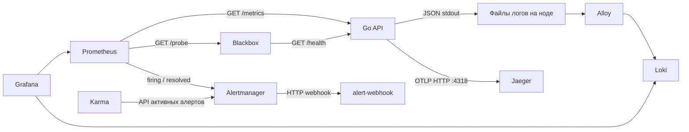

**Дополнить:** объяснить направления запросов, роль Service/DNS и отличие сборщика от хранилища.

| Компонент | Конфигурация |
| --- | --- |
| API | [Helm chart](helm/api/Chart.yaml), [values](helm/api/values.yaml), [Deployment](helm/api/templates/deployment.yaml), [Service](helm/api/templates/service.yaml) |
| Prometheus и Alertmanager | [prometheus-values.yaml](helm/prometheus-values.yaml) |
| Grafana | [grafana-values.yaml](helm/grafana-values.yaml) |
| Loki | [loki-values.yaml](helm/loki-values.yaml) |
| Alloy | [alloy-values.yaml](helm/alloy-values.yaml) |
| Jaeger | [jaeger-values.yaml](helm/jaeger-values.yaml) |
| Blackbox exporter | [blackbox-values.yaml](helm/blackbox-values.yaml) |
| Karma | [karma-values.yaml](helm/karma-values.yaml) |
| Получатель webhook | [Helm chart](helm/webhook/Chart.yaml), [Deployment и Service](helm/webhook/templates/resources.yaml) |

Фактические версии проверены по установленным релизам 11.10.2026: Kubernetes `v1.37.0`, runtime ноды `containerd 2.3.4`, архитектура `arm64`.

| Релиз | Helm chart | Версия приложения из metadata chart |
| --- | --- | --- |
| api | lab-api 0.1.0 | образ lab-api:0.1 |
| prometheus | prometheus 29.35.0 | v3.15.0 |
| grafana | grafana 13.3.1 | 13.2.3 |
| loki | loki 18.15.0 | 3.7.8 |
| alloy | alloy 1.13.1 | v1.20.1 |
| jaeger | jaeger 4.14.1 | 2.21.0 |
| alert-webhook | alert-webhook 0.1.0 | образ mendhak/http-https-echo:42 |
| karma | karma 2.13.1 | v0.131 |
| blackbox | prometheus-blackbox-exporter 11.20.0 | v0.29.0 |

**Дополнить:** почему для повторяемого развёртывания важны версии charts и образов. Список релизов:

```bash
helm list --kube-context kind-observability -n observability
```

## 3. Развёртывание

Образ API `lab-api:0.1` загружен в kind. API и мониторинг установлены в одном namespace. Для доступа к интерфейсам с компьютера используется `kubectl port-forward`.

Команды ниже восстановлены из шагов этой лабораторной и сгруппированы по назначению. Файлы values сейчас содержат итоговую конфигурацию; в ходе работы они дополнялись поэтапно. Повторные установки и обновления приведены там, где менялась конфигурация. Это справочник отдельных шагов, а не один автоматически выполняемый скрипт.

**Дополнить:** объяснить порядок и зависимости компонентов, причины выбора параметров и результаты проверок.

### 3.1. Кластер, образ и загрузка в kind

Начальная подготовка окружения и загрузка образа API в runtime ноды.

```bash
brew install kind
kind create cluster --name observability --wait 120s
```

```bash
kubectl --context kind-observability get nodes
kubectl --context kind-observability get pods -n kube-system
```

```bash
cd /Users/timur/Documents/ITMO/containerization-and-orchestration/lecture-2-observability

docker build -t lab-api:0.1 ./api
kind load docker-image lab-api:0.1 --name observability
```

### 3.2. Локальный Helm chart API

Проверка шаблонов и создание namespace при первой установке API.

```bash
helm lint ./helm/api
helm template api ./helm/api
```

```bash
helm upgrade --install api ./helm/api \
  --kube-context kind-observability \
  --namespace observability \
  --create-namespace \
  --wait \
  --timeout 2m
```

### 3.3. Prometheus и Grafana

Добавление repositories и первые установки. Итоговые правила Alertmanager входят в values Prometheus.

```bash
helm repo add prometheus-community https://prometheus-community.github.io/helm-charts
helm repo update

helm upgrade --install prometheus prometheus-community/prometheus \
  --version 29.35.0 \
  --kube-context kind-observability \
  --namespace observability \
  -f ./helm/prometheus-values.yaml \
  --wait --timeout 5m
```

```bash
helm repo add grafana-community https://grafana-community.github.io/helm-charts
helm repo update

helm upgrade --install grafana grafana-community/grafana \
  --version 13.3.1 \
  --kube-context kind-observability \
  --namespace observability \
  -f ./helm/grafana-values.yaml \
  --wait --timeout 5m
```

### 3.4. Loki, Alloy и datasource Loki

Установка хранилища и сборщика; повторное применение values Grafana после добавления Loki.

```bash
helm upgrade --install loki grafana-community/loki \
  --version 18.15.0 \
  --kube-context kind-observability \
  --namespace observability \
  -f helm/loki-values.yaml \
  --wait --timeout 5m
```

```bash
helm repo add grafana https://grafana.github.io/helm-charts
helm repo update grafana
```

```bash
helm upgrade --install alloy grafana/alloy \
  --version 1.13.1 \
  --kube-context kind-observability \
  --namespace observability \
  -f helm/alloy-values.yaml \
  --wait --timeout 5m
```

```bash
helm upgrade --install grafana grafana-community/grafana \
  --version 13.3.1 \
  --kube-context kind-observability \
  --namespace observability \
  -f helm/grafana-values.yaml \
  --wait --timeout 5m
```

### 3.5. Jaeger и экспорт трасс API

Установка Jaeger и обновление API после настройки OTLP endpoint.

```bash
helm repo add jaegertracing https://jaegertracing.github.io/helm-charts
helm repo update jaegertracing
```

```bash
helm upgrade --install jaeger jaegertracing/jaeger \
  --version 4.14.1 \
  --kube-context kind-observability \
  --namespace observability \
  -f helm/jaeger-values.yaml \
  --wait --timeout 5m
```

```bash
helm upgrade --install api ./helm/api \
  --kube-context kind-observability \
  --namespace observability \
  --wait --timeout 2m
```

### 3.6. Получатель уведомлений, Karma и blackbox

Проверка локального chart webhook, установка компонентов и обновление Prometheus с правилами и probe job.

```bash
helm lint ./helm/webhook
helm template alert-webhook ./helm/webhook --namespace observability
```

```bash
helm install alert-webhook ./helm/webhook \
  --kube-context kind-observability \
  --namespace observability \
  --wait
```

```bash
helm repo add wiremind https://wiremind.github.io/wiremind-helm-charts
helm repo update wiremind
```

```bash
helm install karma wiremind/karma \
  --kube-context kind-observability \
  --namespace observability \
  --version 2.13.1 \
  -f helm/karma-values.yaml \
  --wait
```

```bash
helm upgrade --install blackbox prometheus-community/prometheus-blackbox-exporter \
  --kube-context kind-observability \
  --namespace observability \
  --version 11.20.0 \
  -f helm/blackbox-values.yaml \
  --wait
```

```bash
helm upgrade prometheus prometheus-community/prometheus \
  --kube-context kind-observability \
  --namespace observability \
  --version 29.35.0 \
  -f helm/prometheus-values.yaml \
  --wait
```

### 3.7. Проверка ресурсов API и сети Service

Состояние Deployment/Pod, Service, EndpointSlice и HTTP запрос внутри кластера.

```bash
kubectl --context kind-observability -n observability get deployments,pods
```

```bash
kubectl --context kind-observability -n observability get service api

kubectl --context kind-observability -n observability \
  get endpointslices -l kubernetes.io/service-name=api
```

```bash
kubectl --context kind-observability -n observability \
  exec deployment/api -- wget -qO- http://api:8080/health
```

Дополнительная сводная проверка объектов и хранилищ, использованная при финальной проверке:

```bash
kubectl --context kind-observability -n observability get services,deployments,statefulsets,daemonsets
kubectl --context kind-observability -n observability get pods,pvc
kubectl --context kind-observability get nodes -o wide
helm list --kube-context kind-observability -n observability -o json
```

### 3.8. Доступ к интерфейсам

Каждый port-forward запускается в отдельном терминале и остаётся работать. В итоговой схеме API использует `18081`, Karma — `18080`.

```bash
kubectl --context kind-observability -n observability \
  port-forward service/api 18081:8080
```

```bash
kubectl --context kind-observability -n observability \
  port-forward service/prometheus-server 19090:80
```

```bash
kubectl --context kind-observability -n observability \
  port-forward service/grafana 13000:80
```

```bash
kubectl --context kind-observability -n observability \
  port-forward svc/jaeger 17686:16686
```

```bash
kubectl --context kind-observability -n observability \
  port-forward svc/prometheus-alertmanager 19093:9093
```

```bash
kubectl --context kind-observability -n observability \
  port-forward svc/karma 18080:80
```

В повторных шагах использовались также короткие варианты с `svc`. Они эквивалентны соответствующим командам выше и заменяют их, а не запускаются параллельно на тех же портах:

```bash
kubectl --context kind-observability -n observability \
  port-forward svc/grafana 13000:80
```

```bash
kubectl --context kind-observability -n observability \
  port-forward svc/prometheus-server 19090:80
```

### 3.9. Вход в Grafana

Команда выводит пароль администратора локальной Grafana. Сам пароль в отчёт не включается. Флаг `base64 -D` использован на macOS.

```bash
kubectl --context kind-observability -n observability \
  get secret grafana -o jsonpath='{.data.admin-password}' | base64 -D
```

| Интерфейс | Локальный адрес |
| --- | --- |
| Grafana | http://localhost:13000 |
| Prometheus | http://localhost:19090 |
| Alertmanager | http://localhost:19093 |
| Jaeger | http://localhost:17686 |
| Karma | http://localhost:18080 |
| API для последних проверок | http://localhost:18081 |

Адреса доступны при работающих соответствующих port-forward.

## 4. Сервис под наблюдением

Сервис написан на Go. Исходники и описание: [api/](api/README.md), сборка образа: [Dockerfile](api/Dockerfile).

| Endpoint | Назначение |
| --- | --- |
| `/health` | HTTP 200, ответ `ok` |
| `/fail` | HTTP 500, JSON лог уровня ERROR и ошибочный span |
| `/slow` | Пауза 1–3 секунды во вложенном span `slow-op` |
| `/load` | Серия HTTP запросов к самому сервису; параметры управляют нагрузкой |
| `/metrics` | Счётчики запросов/ошибок и гистограмма длительности |

Ответ содержит `X-Trace-ID`; лог запроса содержит `trace_id` и `span_id`.

**Дополнить:** как instrumentation связывает запрос, метрики, лог и spans; почему `/metrics` исключён из прикладной телеметрии.

## 5. Метрики: Prometheus и RED дашборд

Prometheus опрашивает `/metrics` каждые 15 секунд. В Grafana настроен datasource Prometheus. RED панели показывают RPS, долю 5xx и p95 времени ответа.

Запросы, использованные для RED панелей:

RPS:

```promql
sum(rate(http_requests_total{job="api"}[5m]))
```

Доля ошибок (единица Grafana: percent 0–1):

```promql
(sum(rate(http_errors_total{job="api"}[5m])) or vector(0))
/ sum(rate(http_requests_total{job="api"}[5m]))
```

p95 успешных ответов (единица: seconds):

```promql
histogram_quantile(
  0.95,
  sum by (le) (
    rate(http_request_duration_seconds_bucket{job="api",code=~"2.."}[5m])
  )
)
```

Диагностические запросы в интерфейсе Prometheus:

```promql
up{job="api"}
```

```promql
http_requests_total{job="api"}
```

**Дополнить:** объяснить `rate`, `sum`, окно `[5m]`, `histogram_quantile`, сохранение `le` и единицы измерения.

### 5.1. Общий результат

После `/load`, `/fail` и `/slow` выросли RPS, доля ошибок и p95. Панель задержки названа `Latency p95`.

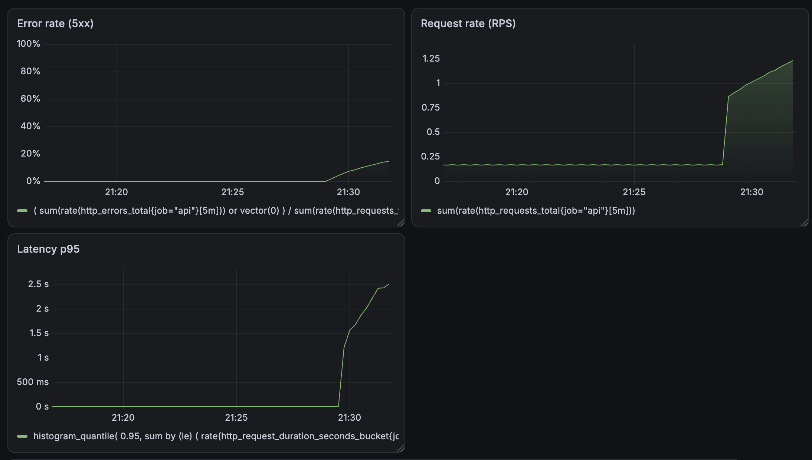

**Дополнить:** связать участки графиков с действиями при проверке; объяснить сглаживание и задержку восстановления из-за окна rate.

### 5.2. Отдельные проверки RPS и ошибок

На раннем снимке RPS виден переход от фоновых запросов к нагрузке.

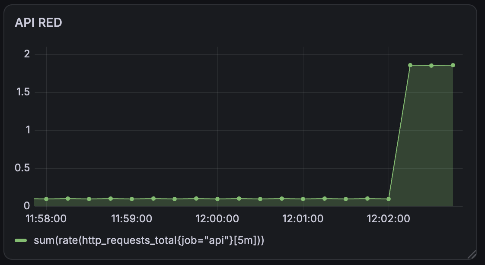

При проверке `/fail` доля ошибок заметно увеличилась.

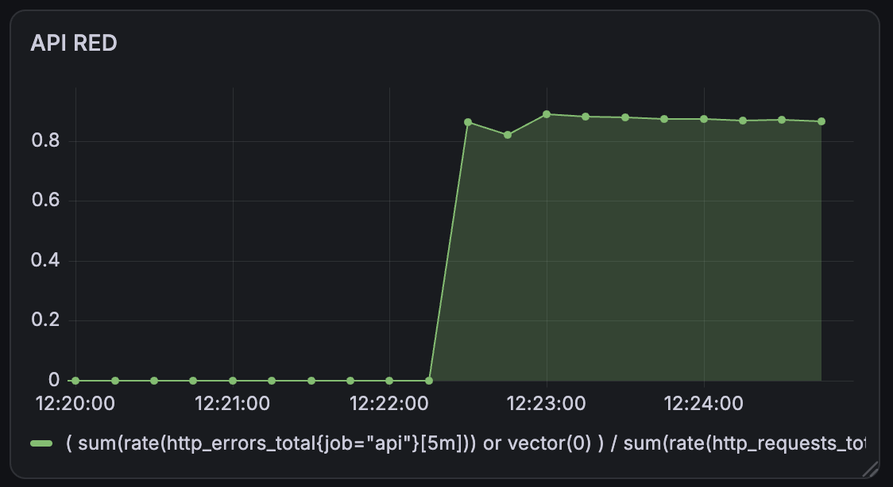

**Дополнить:** почему доля ошибок информативнее абсолютного числа 5xx и какие проверки создают фоновый трафик.

### 5.3. Команды нагрузки

Ранние проверки из Pod API: всплеск RPS, серия 5xx и серия медленных ответов.

```bash
kubectl --context kind-observability -n observability \
  exec deployment/api -- \
  wget -qO- 'http://api:8080/load?count=500&concurrency=25'
```

```bash
kubectl --context kind-observability -n observability \
  exec deployment/api -- \
  wget -qO- 'http://api:8080/load?target=fail&count=100&concurrency=10'
```

```bash
kubectl --context kind-observability -n observability \
  exec deployment/api -- sh -c '
    for i in $(seq 1 20); do
      wget -qO- http://api:8080/slow
      echo
    done
  '
```

Последняя нагрузка через локальный port-forward, использованная для обновлённого общего снимка:

```bash
curl -sS 'http://localhost:18081/load?target=health&count=200&concurrency=10'
```

```bash
for i in $(seq 1 60); do
  curl -sS http://localhost:18081/slow >/dev/null
  curl -sS http://localhost:18081/fail >/dev/null
  sleep 1
done
```

## 6. Логи: Alloy, Loki и Grafana

API пишет JSON в stdout. Alloy работает как DaemonSet, читает файлы контейнерных логов своей ноды, снимает CRI обёртку и отправляет записи в Loki. Grafana обращается к Loki для поиска.

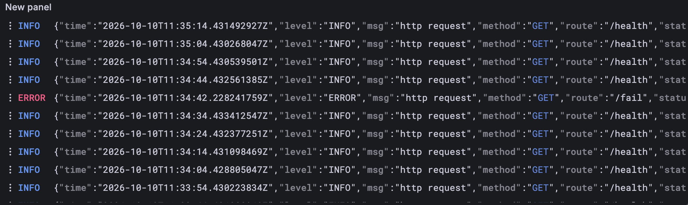

**Дополнить:** почему нужен DaemonSet; что делает `stage.cri`; чем индексируемые labels отличаются от JSON полей, извлекаемых при запросе; почему `trace_id` не стоит превращать в label потока.

### 6.1. Поиск конкретного запроса

```logql
{app="api", namespace="observability"}
| json
| trace_id="246eb66dc80a2ced442fcf41eb48f17c"
```

В найденной записи видны `/fail`, HTTP 500, полный Trace ID и Span ID.

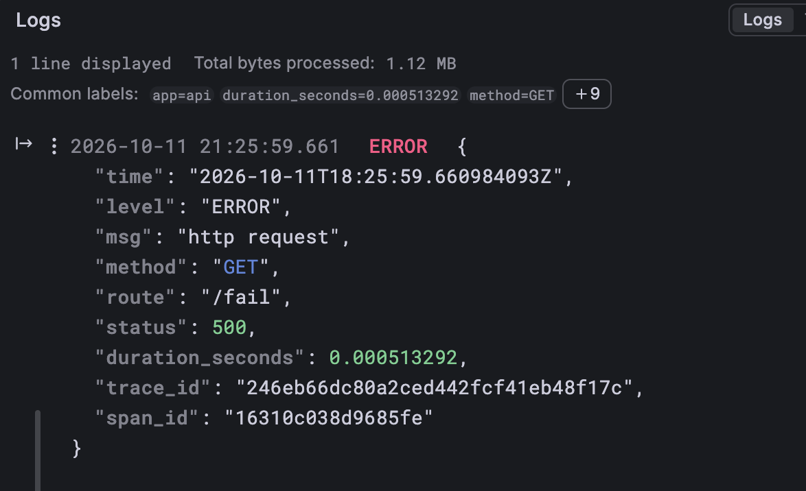

**Дополнить:** почему этот фильтр связывает запись с конкретной трассой точнее, чем поиск только по времени.

### 6.2. Команды проверки хранилища и сборщика

Готовность Loki, его PVC, размещение DaemonSet Alloy и поиск нескольких записей через HTTP API Loki.

```bash
kubectl --context kind-observability -n observability \
  get pods,pvc -l app.kubernetes.io/instance=loki
```

```bash
kubectl --context kind-observability -n observability \
  exec deployment/api -- \
  wget -qO- http://loki:3100/ready
```

```bash
kubectl --context kind-observability -n observability \
  get daemonset,pods -l app.kubernetes.io/instance=alloy
```

```bash
kubectl --context kind-observability -n observability \
  exec deployment/api -- \
  wget -qO- 'http://loki:3100/loki/api/v1/query_range?query=%7Bapp%3D%22api%22%7D&limit=5'
```

Запросы в Grafana Explore → Loki:

```logql
{app="api", namespace="observability"}
```

```logql
{app="api", namespace="observability"}
| json
| route="/fail"
| status=500
```

## 7. Трассировки: OpenTelemetry и Jaeger

API экспортирует spans по OTLP HTTP на `http://jaeger:4318`. Используется пакетная отправка. Jaeger в этой конфигурации хранит трассы в памяти.

### 7.1. Медленный запрос

Трасса `/slow` содержит родительский span и вложенный `slow-op`. Оба занимают примерно 2,7 секунды; вложенная операция объясняет основную задержку запроса.

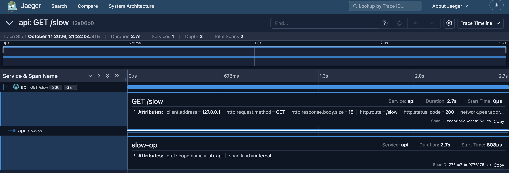

**Дополнить:** почему длительности родительского и дочернего span нельзя складывать; чем отличаются Trace ID и Span ID.

### 7.2. Ошибочный запрос и связь с логом

В `/fail` видны HTTP 500, `error=true` и событие `exception` с сообщением `intentional failure`.

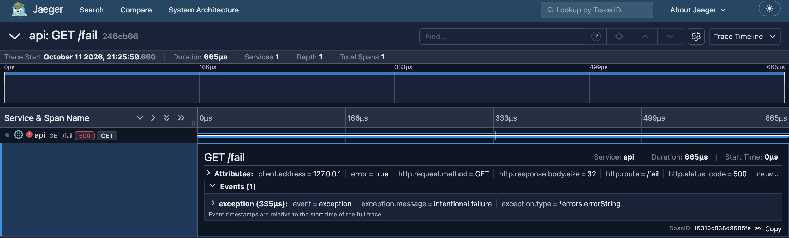

В логе выше записаны `trace_id=246eb66dc80a2ced442fcf41eb48f17c` и `span_id=16310c038d9685fe`. В Jaeger показаны префикс `246eb66` и тот же полный Span ID. Это подтверждает связь показанного лога и span.

**Дополнить:** как нашли трассу по ID из лога; почему запись exception и установка статуса Error — разные операции.

### 7.3. Команды для трассировок и снимков

Вызов endpoints из Pod и чтение последних логов. HTTP 500 для /fail — ожидаемый результат; wget может завершиться с ненулевым кодом.

```bash
kubectl --context kind-observability -n observability \
  exec deployment/api -- \
  wget -S -O- http://api:8080/fail
```

```bash
kubectl --context kind-observability -n observability \
  logs deployment/api --tail=10
```

```bash
kubectl --context kind-observability -n observability \
  exec deployment/api -- \
  wget -S -O- http://api:8080/slow
```

```bash
kubectl --context kind-observability -n observability exec deployment/api -- \
     wget -S -O- http://api:8080/fail
```

Последние вызовы через локальный API. В заголовке ответа читается `X-Trace-ID`:

```bash
curl -sS -i http://localhost:18081/slow
```

```bash
curl -sS -i http://localhost:18081/fail
```

После пакетного экспорта (обычно через несколько секунд) открывался адрес `http://localhost:17686/trace/<X-Trace-ID>`. В Grafana этот же ID подставлялся в фильтр из раздела 6.1.

## 8. Алерты: Prometheus, Alertmanager, webhook и Karma

Правила вычисляет Prometheus. Alertmanager группирует и отправляет уведомления в `alert-webhook`; Karma показывает активные алерты через API Alertmanager.

| Алерт | Условие | `for` | Назначение |
| --- | --- | --- | --- |
| `APIHighErrorRate` | Доля 5xx выше 5%, окно rate 1 минута | 2 минуты | Обнаружить устойчивые ошибки запросов |
| `APIHighLatency` | p95 успешных 2xx запросов выше 1 секунды, окно 1 минута | 2 минуты | Обнаружить медленные успешные ответы |
| `APIUnavailable` | `probe_success{job="api-health"} == 0` | 1 минута | Обнаружить неуспешную проверку `/health` |

Все правила имеют `severity: critical` и `service: api`. Blackbox проверяет HTTP 200 на `/health`; доступность exporter и результат проверки API — разные сигналы.

**Дополнить для каждого алерта:** пользовательский эффект, обоснование порога и длительности, первые действия дежурного. Раскрыть возможные ложные срабатывания и пределы проверки `/health`.

### 8.1. Ошибки и задержка

Нагрузка на `/fail` и `/slow` удержала условия правил достаточно долго для перехода в firing.

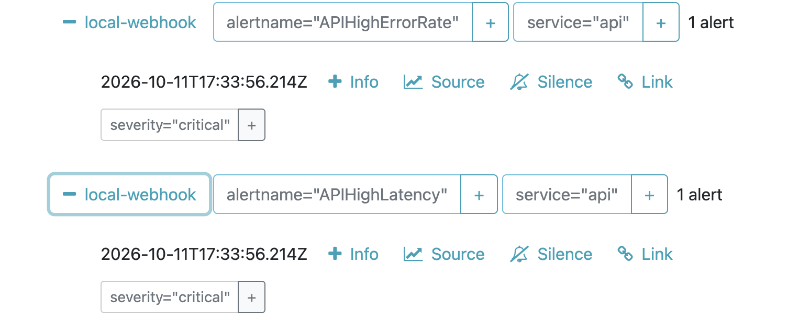

Те же два алерта появились в Karma.

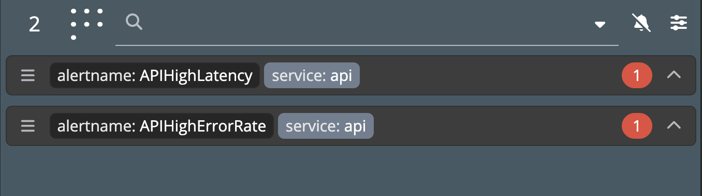

Отдельный более ранний снимок показывает описание `APIHighErrorRate` в Karma.

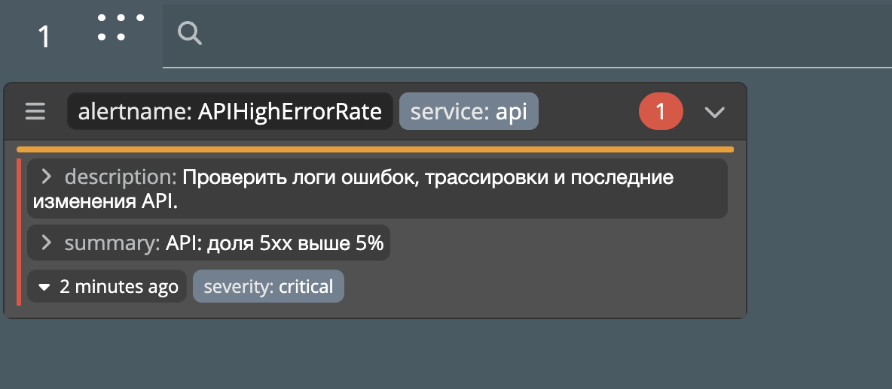

### 8.2. Недоступность

Для проверки API был масштабирован до нуля реплик. После неуспешных probes и выдержки `for` появился `APIUnavailable`. Затем число реплик восстановлено до одного.

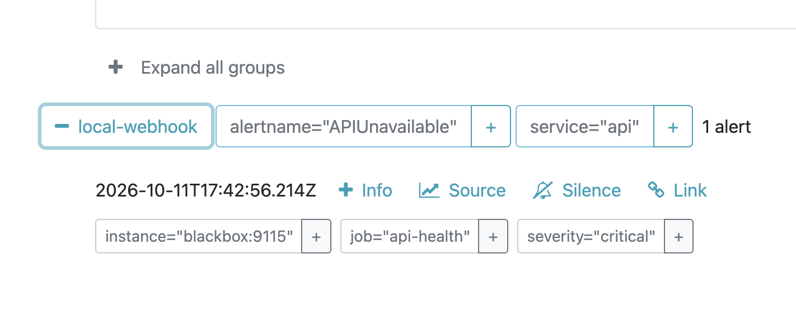

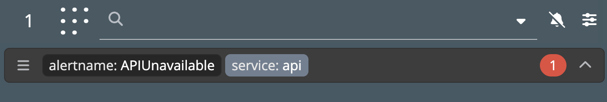

**Дополнить:** команды проверки, наблюдавшиеся `up` и `probe_success`, переходы pending → firing → inactive и поведение `for` при прерывании условия.

### 8.3. Доставка уведомлений

Получатель webhook зафиксировал JSON уведомления со статусом `firing`. Это подтверждает получение уведомлений получателем, отдельно от отображения алертов в интерфейсах.

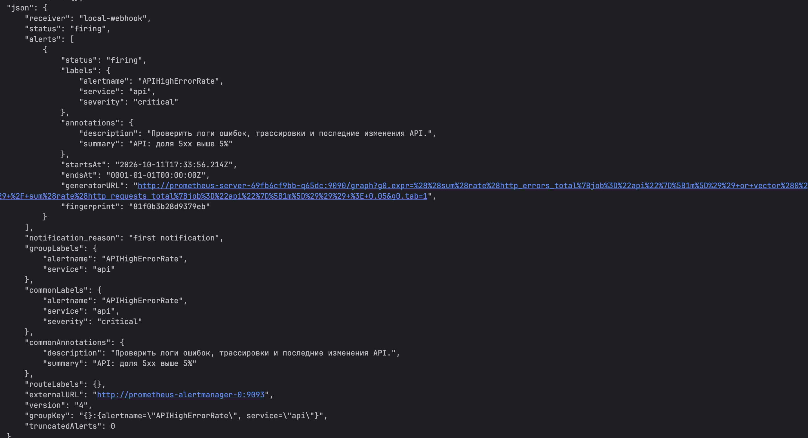

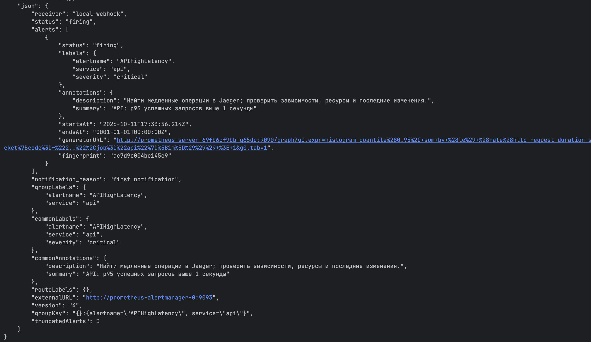

В конфигурации включён `send_resolved: true`. В ходе работы также наблюдались уведомления `resolved`, но отдельные снимки этих уведомлений здесь не сохранены.

**Дополнить:** роль `group_by`, `group_wait`, `group_interval`, `repeat_interval`; почему отказ Karma не останавливает доставку; чем снятие алерта отличается от отправки уведомления о восстановлении.

### 8.4. Команды срабатывания и восстановления

Отдельные длительные проверки: ошибки и затем задержка. Каждый цикл — самостоятельный сценарий проверки.

```bash
kubectl --context kind-observability -n observability \
  exec deployment/api -- sh -c '
    for i in $(seq 1 40); do
      wget -qO- "http://api:8080/load?target=fail&count=10&concurrency=2"
      echo
      sleep 5
    done
  '
```

```bash
kubectl --context kind-observability -n observability \
  exec deployment/api -- sh -c '
    for i in $(seq 1 90); do
      wget -qO- http://api:8080/slow
      echo
      sleep 1
    done
  '
```

Совместная проверка ошибок и задержки:

```bash
kubectl --context kind-observability -n observability \
  exec deployment/api -- sh -c '
    for i in $(seq 1 90); do
      wget -qO- http://api:8080/slow
      wget -qO- "http://api:8080/load?target=fail&count=10&concurrency=2"
      sleep 1
    done
  '
```

Проверка недоступности меняет количество реплик API. После фиксации firing выполнялась команда восстановления:

```bash
kubectl --context kind-observability -n observability \
  scale deployment/api --replicas=0
```

```bash
kubectl --context kind-observability -n observability \
  scale deployment/api --replicas=1

kubectl --context kind-observability -n observability \
  rollout status deployment/api
```

Приём уведомлений наблюдался в логах получателя:

```bash
kubectl --context kind-observability -n observability \
  logs -f deployment/alert-webhook
```

Запросы в интерфейсе Prometheus для различения доступности exporter и результата probe:

```promql
up{job="api-health"}
```

```promql
probe_success{job="api-health"}
```

HTTP проверки правил и активных алертов при финальной верификации:

```bash
curl -sS 'http://localhost:19090/api/v1/rules?type=alert'
curl -sS http://localhost:19093/api/v2/alerts
```

## 9. Хранение и ограничения

- Jaeger использует память с лимитом 10 000 трасс: после перезапуска его хранилища ранее собранные трассы теряются.
- Loki работает в одной реплике, хранит данные в filesystem на PVC. Это не отказоустойчивая конфигурация.
- Grafana, Prometheus, Loki и Alertmanager используют PVC. В текущем локальном kind данные связаны с нодой и не гарантированно сохраняются после удаления кластера.
- Positions Alloy сохраняются в hostPath на ноде. Используется `tail_from_end = true`.
- Проверки `/health` входят в прикладной трафик и влияют на RED метрики.

**Дополнить:** что переживает перезапуск Pod, что теряется при удалении kind; какие изменения нужны для эксплуатации с требованиями к сохранности данных и доступности.

**Дашборд:** в репозиторий добавлена [переносимая версия API RED](dashboards/api-red.json), созданная из трёх использованных PromQL запросов. Это не экспорт пользовательского дашборда со скриншотов: у неё отдельный UID `api-red-portable`. Скрипт запуска загружает её через [дополнительные values Grafana](helm/grafana-dashboard-values.yaml) и `--set-file`. JSON описывает дашборд, а не историю метрик.

## 10. Результаты и выводы

Сохранены доказательства реакции RED графиков, поиска JSON лога, вложенного и ошибочного spans, связи лога с трассой, срабатывания трёх правил в Alertmanager/Karma и доставки двух firing уведомлений в webhook.

**Дополнить:** собственный вывод — что удалось проверить, что оказалось сложным, как использовали разные сигналы для диагностики и какие ограничения остались. Отделить подтверждённое снимками от наблюдений без сохранённого доказательства.

## Приложение. Дополнительные снимки

Предыдущая версия общего RED дашборда до переименования панели задержки:

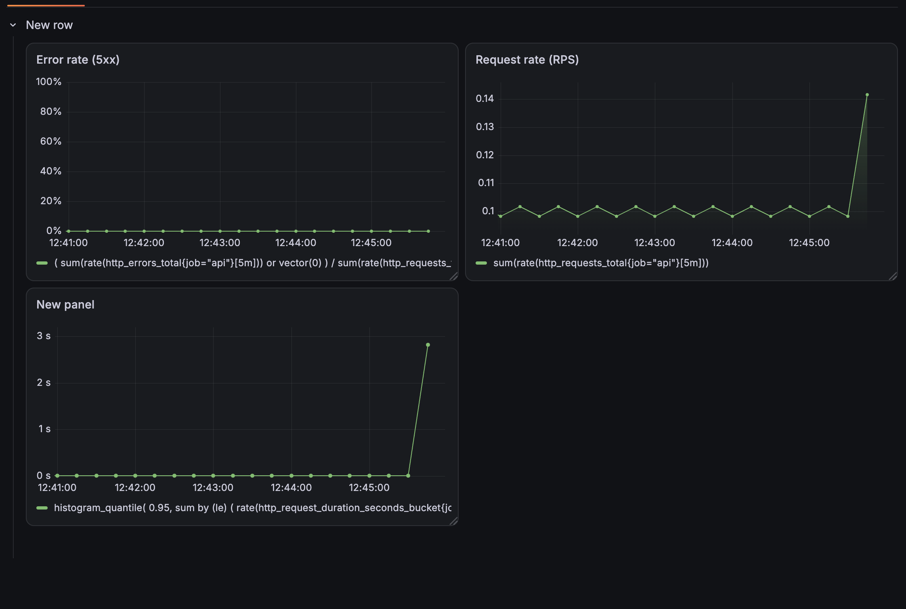

Диагностический снимок предупреждения YAML редактора на Helm выражении; не является доказательством работоспособности Kubernetes ресурсов:

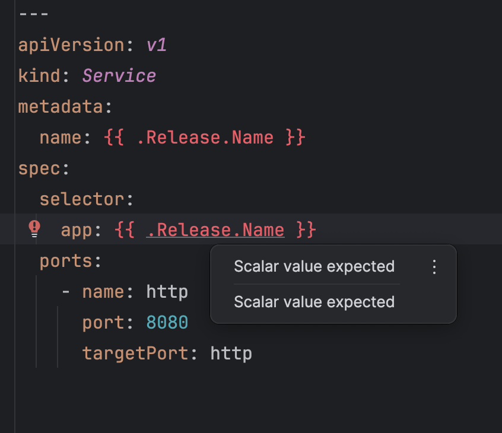

Полный [указатель скриншотов](screenshots/README.md).


### Ранняя локальная проверка через Compose

До перехода к Kubernetes API проверялся через Compose. Этот запуск не является результатом развёртывания по заданию; итоговый стек использует Helm в Kubernetes.

```bash
docker compose up -d --build api
curl http://localhost:8081/health
docker compose logs api
```

### Ранний port-forward прямо к Deployment

До установки Karma порт 18080 использовался для API. Это исторический вариант: одновременно с итоговым port-forward Karma он конфликтует. Итоговый порт API — 18081.

```bash
kubectl --context kind-observability -n observability \
  port-forward deployment/api 18080:8080
```

```bash
curl http://localhost:18080/health

kubectl --context kind-observability -n observability logs deployment/api
```

### Проверки кода вспомогательного API

При подготовке Go сервиса выполнялись:

```bash
cd api
go test -race ./...
go vet ./...
cd ..
git diff --check
```

В среде агента для Go использовались временные каталоги кеша (`GOMODCACHE`, `GOCACHE`); они не являются обязательной частью запуска сервиса.

### Сохранение материалов

```bash
mkdir -p dashboards screenshots
```

Дашборд сохранялся через Grafana UI; экспорт JSON выполняется отдельно через Export → Export as code. Скриншоты сохранены в `screenshots/`.
