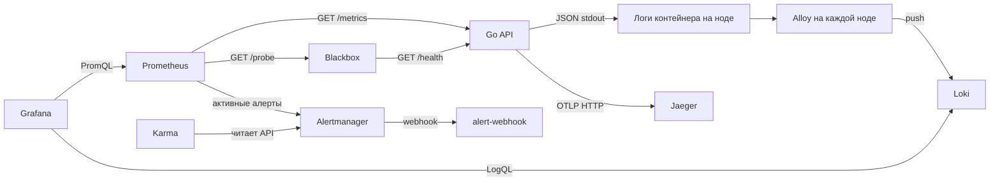

# ЛР2. Метрики, логи и трейсы одного не очень здорового API

Собрали в Kubernetes стек, с которым можно ответить на три разных вопроса: насколько плохо работает сервис, что именно случилось и где запрос потерял время. Для опытов использовали API, который специально умеет ошибаться и тормозить — неожиданно удобное свойство для этой лабы.

Это командный отчёт. Проверки RED, логов, трейсов и алертов со скриншотами выполнил сокомандник 11 октября 2026 года. 26 октября повторно развернули тот же стек через сохранённый скрипт: получили десять готовых Pod, четыре Bound PVC и девять Helm releases в статусе `deployed`. Все прикладные сценарии при повторном запуске заново не прогоняли; ниже сохранены результаты исходного командного прохождения.

## 1. Что и где запустили

Стек установили через Helm в namespace `observability` кластера kind с тем же именем; для команд использовали контекст `kind-observability`. Docker здесь нужен для сборки образов и запуска ноды kind, а Docker Compose в итоговом окружении не используется.

Сервис на Go имеет пять endpoints:

| Endpoint | Что проверяем |
| --- | --- |
| `/health` | Ответ 200 с `ok`, в том числе для внешней проверки доступности |
| `/fail` | HTTP 500, рост error counter, ERROR-лог и ошибочный span |
| `/slow` | Задержка 1–3 секунды во вложенном span `slow-op` |
| `/load?target=health&count=200&concurrency=10` | Всплеск запросов к самому API; `target=fail` создаёт ошибки |
| `/metrics` | Prometheus counters и histogram |

Код и описание запуска сохранены в репозитории: [исходники сервиса](api/server.go), [Dockerfile](api/Dockerfile), [Deployment](helm/api/templates/deployment.yaml) и [Service](helm/api/templates/service.yaml). Обработчик `/metrics` не обёрнут в прикладную instrumentation, иначе Prometheus сам добавлял бы себе RPS и трейсы. Readiness и blackbox, наоборот, вызывают обычный `/health`, поэтому небольшой фоновый трафик остаётся.



На схеме видно, что разные сигналы проходят разный путь. Prometheus сам опрашивает API, логи отправляет Alloy в Loki, а трейсы приложение передаёт в Jaeger. Grafana читает метрики из Prometheus и логи из Loki; сам Loki stdout из Pod не забирает, этим занимается сборщик.

Внутри namespace используются имена Kubernetes Services: `api:8080`, `loki:3100`, `jaeger:4318`. Service даёт стабильный адрес при смене Pod, DNS разрешает его имя. `localhost` внутри Pod означал бы сам Pod, а не компьютер с браузером.

Настройки компонентов лежат в [helm/](helm/), правила — в [prometheus-values.yaml](helm/prometheus-values.yaml). Готовые charts не редактировали: свою конфигурацию передавали через values. Отдельные небольшие charts написаны только для нашего API и webhook-получателя.

| Релиз | Версия chart | Версия приложения из metadata chart |
| --- | --- | --- |
| api | lab-api 0.1.0 | локальный образ Go API |
| prometheus | 29.35.0 | v3.15.0 |
| grafana | 13.3.1 | 13.2.3 |
| loki | 18.15.0 | 3.7.8 |
| alloy | 1.13.1 | v1.20.1 |
| jaeger | 4.14.1 | 2.21.0 |
| blackbox | 11.20.0 | v0.29.0 |
| karma | 2.13.1 | v0.131 |
| alert-webhook | свой chart 0.1.0 | mendhak/http-https-echo:42 |

Версии charts закреплены в [скрипте запуска](scripts/setup-observability.sh), API при повторной сборке получает тег по image ID. Это уменьшает сюрпризы при повторении, хотя не делает все внешние образы навсегда неизменными: для этого ещё нужны digest и сохранённые зависимости.

## 2. Как повторить развёртывание

Из корня репозитория, на Mac с работающим Docker Desktop, kind, kubectl и Helm:

```bash
lab_state="$HOME/.local/state/container-lab"
mkdir -p "$lab_state"
export KUBECONFIG="$lab_state/kubeconfig"
export DOCKER_CONTEXT=desktop-linux
bash lecture-2-observability/scripts/setup-observability.sh
```

Для другого Docker Engine нужно выбрать его context. Отдельный kubeconfig здесь важен: при повторном прохождении команда port-forward из Helm NOTES без него ушла в прежний удалённый кластер и получила `TLS handshake timeout`. Исправлением оказался правильный kubeconfig, а не перезапуск Grafana.

Скрипт создаёт или переиспользует kind, собирает API для архитектуры ноды, загружает образ и устанавливает компоненты. После проверки API и Loki он открывает port-forward на loopback компьютера и остаётся работать в терминале. Завершение через `Ctrl+C` закрывает эти forwards, сохраняя кластер и PVC. Подробные варианты описаны в [руководстве запуска](scripts/README.md).

| Интерфейс | Адрес после запуска |
| --- | --- |
| API | http://localhost:18081/health |
| Grafana | http://localhost:13000/d/api-red-portable |
| Prometheus | http://localhost:19090 |
| Jaeger | http://localhost:17686 |
| Alertmanager | http://localhost:19093 |
| Karma | http://localhost:18080 |

Для входа в Grafana используется логин `admin`, а пароль можно прочитать из Kubernetes Secret командой, которую выводит скрипт; в репозиторий его не записывали. Если выполнять команды вручную в другом терминале, нужно снова указать тот же kubeconfig и `kind-observability`.

Готовность Pod проверяли отдельно от прохождения данных. Зелёные Pod ещё не гарантируют, что Prometheus видит нужный target, Loki получил запись, а Jaeger принял span. [Повторное развёртывание 26 октября](../solutions/lab-1/evidence/part-8-stack.md) подтвердило запуск стека; проверки конкретных сигналов — дальше.

## 3. Метрики: что меняется при нагрузке

Prometheus опрашивает `/metrics` каждые 15 секунд. В Grafana настроен datasource `prometheus`, RED dashboard содержит RPS, долю 5xx и p95 успешных ответов. [Переносимый JSON](dashboards/api-red.json) загружается из файла; это воспроизводимая версия трёх панелей, а не сохранённая история данных со скриншота.

Сначала посмотрели RPS — среднее число запросов в секунду:

```promql
sum(rate(http_requests_total{job="api"}[5m]))
```

Сам счётчик растёт всю жизнь процесса, поэтому для графика берём `rate` — средний прирост в секунду — и складываем выбранные ряды через `sum`. Окно 5 минут сглаживает всплески, из-за чего линия не обязана мгновенно вернуться к исходному уровню после остановки нагрузки.

Затем добавили долю ошибок, чтобы видеть их масштаб относительно общего потока:

```promql
(sum(rate(http_errors_total{job="api"}[5m])) or vector(0))
/ sum(rate(http_requests_total{job="api"}[5m]))
```

В Grafana для этой панели используется единица `percent 0–1`, поэтому 0,05 отображается как 5%. До первой ошибки error series может отсутствовать, и на этот случай в числителе предусмотрен fallback 0. При полном отсутствии трафика знаменатель всё равно остаётся нулевым: отсутствие наблюдений не выдаём за измеренные 0% ошибок.

Третья панель показывает p95 длительности успешных ответов:

```promql
histogram_quantile(
  0.95,
  sum by (le) (
    rate(http_request_duration_seconds_bucket{job="api",code=~"2.."}[5m])
  )
)
```

При суммировании сохраняем `le` — границы histogram buckets, по которым вычисляется квантиль. Получаем оценку p95 в секундах, а не среднюю длительность или точный максимум. Здесь важно и имя label: в метриках HTTP-код называется `code`, а в JSON-логе — `status`, поэтому запросы сверяли с настоящими рядами.

Для нагрузки использовали, например:

```bash
curl -sS 'http://localhost:18081/load?target=health&count=200&concurrency=10'
for i in $(seq 1 60); do
  curl -sS http://localhost:18081/slow >/dev/null
  curl -sS http://localhost:18081/fail >/dev/null
  sleep 1
done
```

После этого на общем снимке RPS поднялся с фонового уровня примерно 0,17 до 1,2, доля ошибок выросла примерно до 15%, p95 — до 2,5 секунды. Эти значения относятся к показанному участку и пятиминутному окну, а не являются характеристиками производительности сервиса.


Дополнительные отдельные проверки: [рост RPS](screenshots/grafana-request-rate.png) и [рост доли ошибок](screenshots/grafana-error-rate.png).

## 4. Логи: находим конкретную ошибку

API пишет JSON в stdout. [Alloy](helm/alloy-values.yaml) работает как DaemonSet: читает `/var/log/pods/observability_api-*/api/*.log` своей ноды, снимает CRI-обёртку через `stage.cri` и отправляет строки в Loki. На каждой ноде свой набор файлов, поэтому одного случайно размещённого сборщика на весь кластер недостаточно.

Для потоков Loki задали стабильные labels `app="api"` и `namespace="observability"`, а поля JSON разбираем уже при запросе. Поэтому `trace_id` не стал label потока: почти каждый запрос давал бы новое значение и сильно увеличивал кардинальность.

После `/fail` нашли запись:

```logql
{app="api", namespace="observability"}
| json
| route="/fail"
| status=500
```

На [общем снимке логов](screenshots/grafana-api-logs.png) видно, что записи дошли до Grafana. Для конкретного запроса отфильтровали его ID:

```logql
{app="api", namespace="observability"}
| json
| trace_id="246eb66dc80a2ced442fcf41eb48f17c"
```


Так от общей доли 5xx на графике перешли к записи о конкретной ошибке. Поиск по ID оказался точнее поиска по времени, поскольку одновременно могло выполняться несколько одинаковых `/fail`.

## 5. Трейсы: куда ушли 2,7 секунды

OpenTelemetry создаёт корневой span входящего запроса. В `/slow` вручную добавлен дочерний `slow-op`; в `/fail` записывается exception и отдельно выставляется статус Error. Одна запись exception сама по себе не равна установке статуса ошибки.

Экспорт идёт пакетами по OTLP HTTP на `http://jaeger:4318`. `X-Trace-ID` возвращается в ответе, тот же ID пишется в лог вместе со `span_id`.

На waterfall `/slow` корневой span и вложенная операция занимают около 2,7 секунды:


Эти длительности нельзя складывать: дочерняя операция уже находится внутри времени родителя. По этой трассе задержка объясняется именно `slow-op`.

Для `/fail` взяли Trace ID из найденного лога и нашли запрос в Jaeger. В заголовке Jaeger отображён его префикс `246eb66`, а полный Span ID `16310c038d9685fe` совпадает с логом. Видны HTTP 500, `error=true` и exception `intentional failure`.


Переход здесь проверяли вручную по ID, автоматическую кнопку из Loki в Jaeger не настраивали. Получилась связка: метрика показывает масштаб ошибки, лог — конкретный запрос, трейс — его выполнение.

## 6. Алерты: график должен не только красиво краснеть

Все три правила описаны в [Helm values Prometheus](helm/prometheus-values.yaml) и вычисляются самим Prometheus. Дальше активные алерты принимает Alertmanager: он группирует их и отправляет уведомления в `alert-webhook`, а Karma читает их из API Alertmanager и показывает в своём UI.

| Алерт | Условие | Почему нужен и что делать |
| --- | --- | --- |
| `APIHighErrorRate` | Доля 5xx > 5%, окно 1 минута, `for: 2m` | Устойчивая часть запросов заканчивается ошибкой. Проверить маршруты и коды, найти ERROR-логи и трейсы, сопоставить с последними изменениями. |
| `APIHighLatency` | p95 ответов 2xx > 1 с, окно 1 минута, `for: 2m` | Даже успешные запросы стали медленными. Найти длинные spans, проверить зависимости и ресурсные ограничения. |
| `APIUnavailable` | `probe_success{job="api-health"} == 0`, `for: 1m` | Сервис не проходит HTTP-проверку. Проверить Pod, readiness, EndpointSlice, DNS и сеть от blackbox до API. |

Пороги выбраны для учебного API: `/health` быстрый, а `/slow` специально отвечает за 1–3 секунды. `for` убирает реакцию на единичный всплеск. Для реального сервиса эти значения нужно согласовать с допустимыми ошибками, задержкой и объёмом трафика. Редкий поток запросов делает доли и p95 менее устойчивыми; один `/health` не проверяет все бизнес-операции.

### Ошибки и задержки

Нагрузку удерживали несколько минут: повторяли `/load?target=fail&count=10&concurrency=2` и запросы `/slow`. Условия успели перейти из pending в firing. Окно `rate` и `for` решают разные задачи: первое оценивает недавнюю частоту, второе требует непрерывного выполнения условия. Их длительности нельзя механически сложить и получить гарантированное время уведомления.


### Недоступность

API масштабировали до нуля, дождались `APIUnavailable`, затем вернули одну реплику:

```bash
kubectl --context kind-observability -n observability scale deployment/api --replicas=0
# После проверки firing восстановили сервис:
kubectl --context kind-observability -n observability scale deployment/api --replicas=1
kubectl --context kind-observability -n observability rollout status deployment/api
```


Алерт появился и в [Karma](screenshots/karma-unavailable-firing.png). Для этой проверки важно различать `up{job="api-health"}` и `probe_success`: первый относится к успешному scrape самого blackbox exporter и может оставаться равным 1, пока HTTP-проверка API уже возвращает 0. Наше правило использует именно `probe_success` и сохраняет target даже при нуле реплик приложения, а для отказа самого exporter нужен отдельный контроль доступности.

### Уведомление действительно дошло

Наличие алерта в UI ещё не означает доставку. В логах webhook-получателя сохранились JSON со статусом `firing` для ошибки и задержки:


Есть отдельный [снимок доставки APIHighLatency](screenshots/webhook-latency-firing.png). Для `APIUnavailable` сохранены firing в Alertmanager и Karma; отдельный снимок его webhook не делали.

В Alertmanager группировка идёт по `alertname` и `service`. `group_wait: 10s` даёт собрать первую группу, `group_interval: 1m` ограничивает частоту обновлений группы, `repeat_interval: 1h` — повторных уведомлений о продолжающейся проблеме. `send_resolved: true` включает отправку восстановления. Сообщения resolved наблюдались в командном прохождении, но отдельного снимка нет.

Karma не участвует в доставке, поэтому её отказ не останавливает webhook. Снятие алерта в Prometheus и получение уведомления resolved — тоже два отдельных события.

## 7. Что здесь переживёт перезапуск

Prometheus, Grafana, Loki и Alertmanager используют PVC, поэтому при обычном пересоздании Pod данные остаются на подключаемом volume. У Alloy positions хранятся на ноде в `/var/lib/alloy`, а `tail_from_end=true` задаёт начало первого чтения с конца файла: старые строки специально не догоняются.

Jaeger хранит до 10000 трасс в памяти — при его перезапуске они теряются. Loki работает в одной реплике с filesystem storage. PVC в локальном kind привязаны к ноде: удаление кластера не является способом надёжно сохранить историю.

Для эксплуатации понадобились бы долговременное хранилище трасс, внешнее хранилище логов/метрик, backup, контроль самого мониторинга и продуманные ресурсы компонентов. У нас получился учебный локальный стенд, без проверки отказоустойчивости.

## Итог

На одном API проверили весь путь: вызов `/fail` отражается в RED, находится в логах, связывается по ID с ошибочной трассой и приводит к алерту. `/slow` объясняется вложенной операцией на waterfall. Уведомления для двух алертов дошли до работающего receiver, все три состояния firing показаны в Alertmanager и Karma.

Самый полезный вывод — проверять прохождение данных, а не только успешную установку. Статус `deployed`, живой exporter, работающий API и доставленное уведомление отвечают на разные вопросы. Один маленький сервис в итоге обеспечил работой довольно много YAML.

Все исходные снимки сохранены в [screenshots/](screenshots/README.md). Повторное развёртывание стека позволило использовать его и для ресурсного dashboard первой лабы, добавив отдельный источник метрик Lima.
