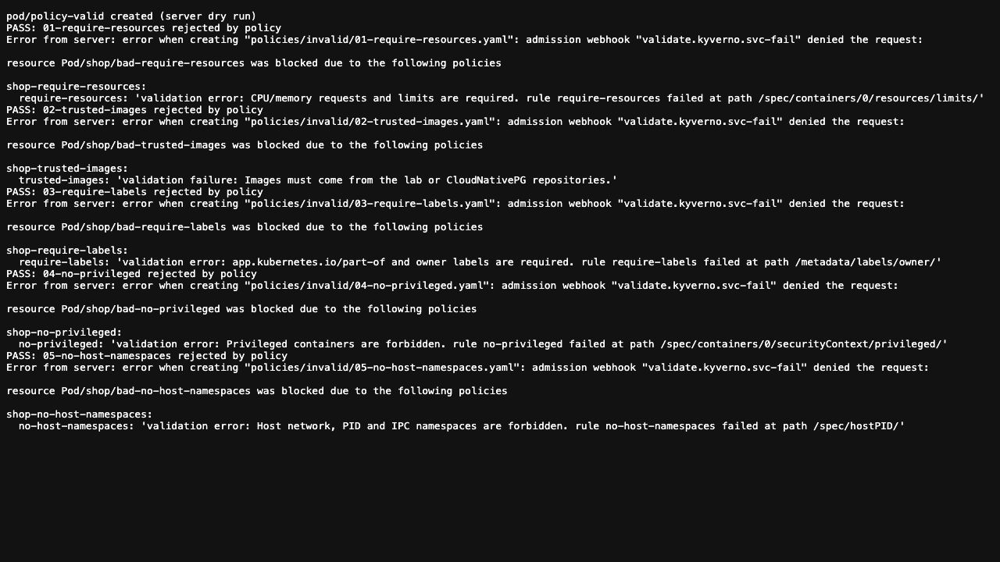
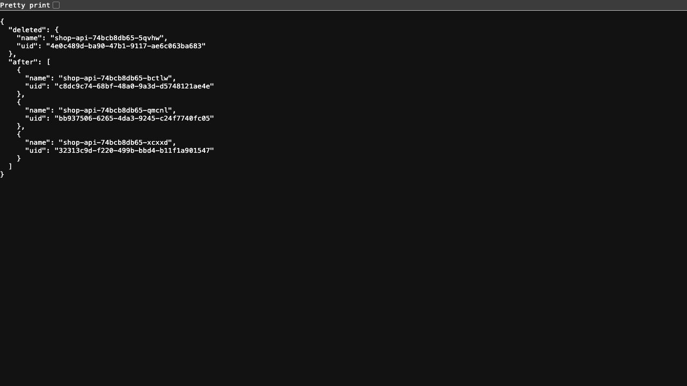
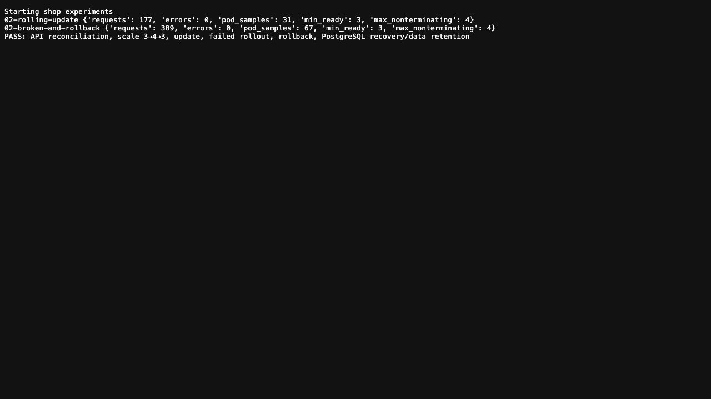
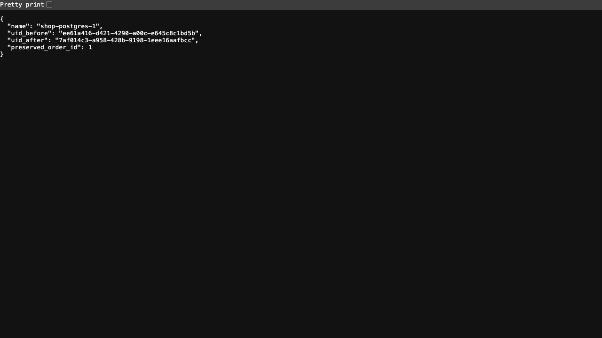
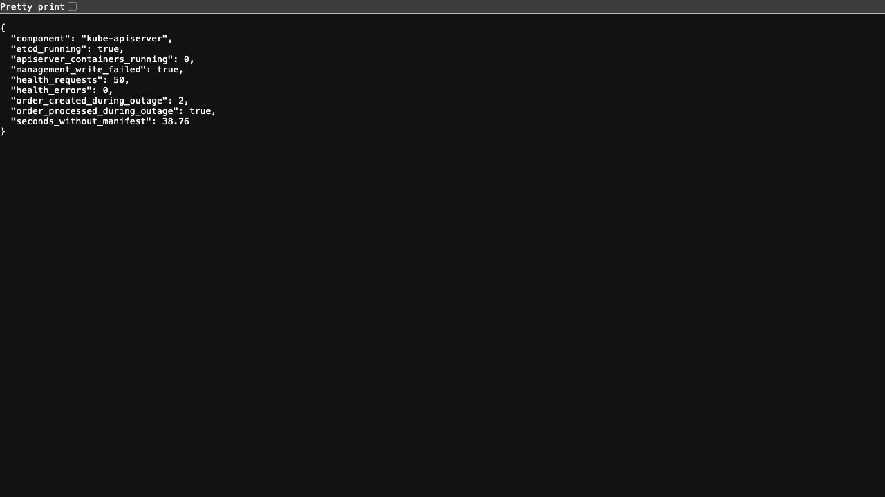
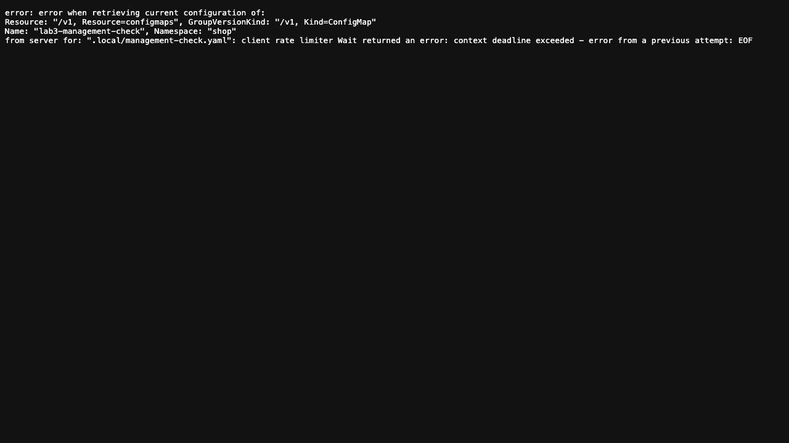
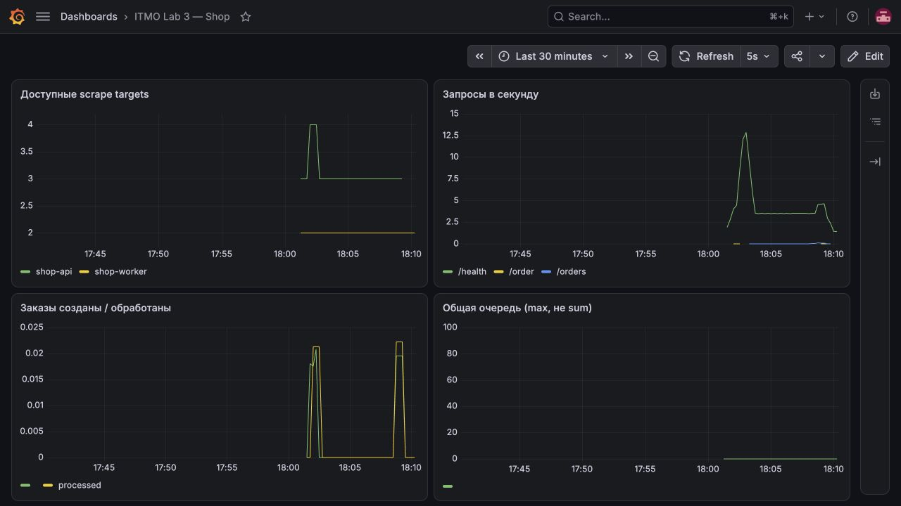
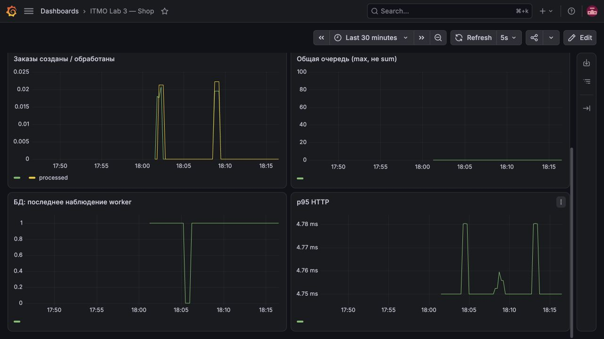
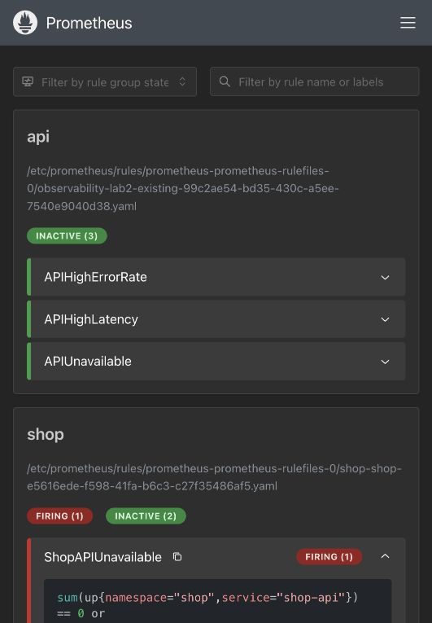
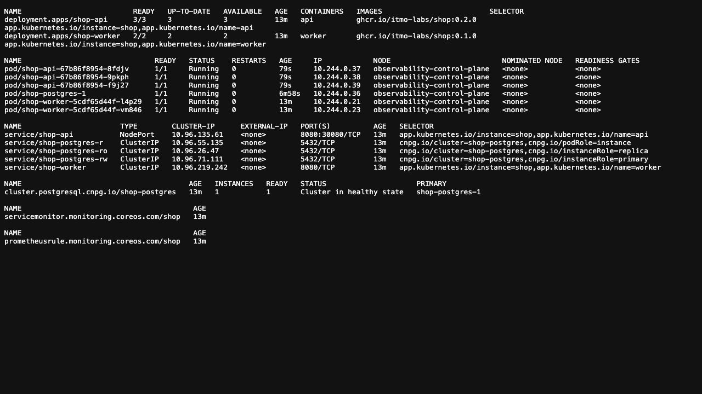

# ЛР3. Политики, обновления и отказы платформы shop

Собрали в Kubernetes платформу из апи, фоновых обработчиков и PostgreSQL. Проверили, что кластер отклоняет неподходящие настройки, восстанавливает удалённые поды и обновляет приложение без ошибок в наших запросах. В конце ненадолго выключили апи-сервер: управление пропало, а заказы продолжили обрабатываться.

Это командный отчёт. Опыты проведены 18 октября 2026 года в локальном kind с мониторингом из второй лабы. Скриншоты и числа ниже относятся к этому прохождению.

## 1. Что и где запустили

Использовали одноузловой кластер `observability`, контекст `kind-observability`. Платформа работает в пространстве имён `shop`, мониторинг — в `observability`. Установлены Kubernetes v1.37.0 и Docker Desktop 28.5.1 на arm64.

В обычном состоянии работают три копии апи, два фоновых обработчика и одна база. Апи создаёт заказы, обработчики отмечают их выполненными. `/health` проверяет работу процесса, а создание и чтение заказа дополнительно проверяют связь с базой. [Исходник приложения](api/main.go) оставили отдельным файлом — он объёмный, целиком в отчёте не нужен.

## 2. Как повторить развёртывание

Нужна готовая вторая лаба в kind, работающий Docker, kind, kubectl, Helm и Python 3.9 или новее. Из папки третьей лабы:

```bash
python3 -m venv .local/venv
source .local/venv/bin/activate
python -m pip install PyYAML
python scripts/setup-shop.py
```

[Установщик](scripts/setup-shop.py) собирает и загружает образы, устанавливает операторов и политики, разворачивает shop и подключает прежний мониторинг. Затем создаёт заказ, ждёт обработки и проверяет сбор метрик. При другом имени кластера нужен параметр `--cluster ИМЯ`.

После запуска апи доступно на `http://localhost:18083/orders`, Grafana — на `http://localhost:13001/d/itmo-shop`, Prometheus — на `http://localhost:19091`. Терминал нужно оставить открытым; `Ctrl+C` закрывает перенаправления портов, сохраняя кластер. Образы локальные, поэтому другу нужно передать всю папку лабы.

Установщик подготавливает платформу, а опыты с отказами выполняются отдельно. Его полный запуск на другом компьютере пока не проверяли; при передаче управления Prometheus оператору возможен короткий перерыв мониторинга.

## 3. Политики: что кластер не даст запустить

Выбрали Kyverno: правила задаются обычными манифестами Kubernetes, без отдельного языка Rego. [Набор политик](configs/kyverno/guardrails.yaml) установили до shop. Проверка перед сохранением объекта в режиме `Enforce` отклоняет нарушения — так ограничения работают автоматически, а не зависят от внимательности автора конфига. Механизм описан в [документации Kyverno](https://kyverno.io/docs/guides/admission-controllers/).

| Политика | Зачем нужна |
| --- | --- |
| Обязательные запросы и ограничения ресурсов | Планировщик учитывает нужные ресурсы, контейнеры получают ограничения по процессору и памяти |
| Только разрешённые образы | Допускаются `ghcr.io/itmo-labs/shop:*` и `ghcr.io/cloudnative-pg/*` |
| Обязательные метки владельца и приложения | Помогают понять, кому принадлежит ресурс |
| Запрет привилегированных контейнеров | Ограничивает доступ к узлу |
| Запрет общих пространств сети и процессов с узлом | Не даёт подам использовать `hostNetwork`, `hostPID`, `hostIPC` |

Правила действуют во всех пространствах имён с исключениями для системных компонентов, операторов и мониторинга второй лабы. Новые обычные пространства проверяются автоматически. Проверка имени образа ограничивает источники, но не подтверждает подпись его содержимого.

Корректный под прошёл проверку, пять отдельных нарушений отклонены своими правилами. Использовали `--dry-run=server`: запрос проходит настоящую проверку на сервере, но опасные контейнеры не запускаются.



## 4. Восстановление, обновление и откат

Пакет Helm устанавливает три копии апи и два обработчика. После удаления одного пода апи появился новый с другим UID, и число копий вернулось к трём. Helm сохраняет описание ресурсов, а нужное число подов дальше поддерживают контроллеры `Deployment` и `ReplicaSet`.



Затем через настройки Helm увеличили число копий с трёх до четырёх и вернули обратно. После этого обновили апи с 0.1.0 до 0.2.0, одновременно отправляя запросы к `/health`.

Для постепенного обновления задали `maxUnavailable: 0` и `maxSurge: 1`: контроллер может добавить один под, но должен дождаться готовой замены перед удалением старого. Проверка готовности не пускает трафик на неподготовленную копию; проверка работоспособности позволяет перезапустить неисправный контейнер. Это соответствует [модели обновления Deployment](https://kubernetes.io/docs/concepts/workloads/controllers/deployment/).

| Опыт | Запросов | Ошибок | Минимум готовых подов | Максимум подов без завершающихся |
| --- | --- | --- | --- | --- |
| Обновление 0.1.0 → 0.2.0 | 177 | 0 | 3 | 4 |
| Сломанное обновление и откат | 389 | 0 | 3 | 4 |

Для второго опыта включили `HEALTH_FAIL=true`: новая копия отвечала 503 и не проходила проверку готовности. Обновление застряло, старая тройка продолжала отвечать, а Helm завершил ожидание по тайм-ауту. Откатили релиз к рабочей ревизии и получили исправное приложение.



В обеих выборках запросы прошли без ошибок. Это результат конкретных опытов, а не гарантия для любой нагрузки.

## 5. PostgreSQL: под новый, заказ прежний

Базу развернули через CloudNativePG. Пакет Helm создаёт объект `Cluster`, а оператор по его описанию — под PostgreSQL, постоянный том, адрес подключения и секрет. В `spec` записано желаемое состояние, например один экземпляр и диск 1 GiB; в `status` — наблюдаемое состояние и готовность базы.

Удалили под `shop-postgres-1`. Оператор восстановил его с тем же именем, но новым UID. Заказ №1 сохранился и оставался обработанным: проверили не только готовность пода, но и данные.



Обычные контроллеры Kubernetes управляют общими ресурсами, а оператор знает особенности PostgreSQL и поддерживает состояние базы. Одной регистрации типа `Cluster` для этого недостаточно — нужен работающий оператор. Подробнее об этом — в [архитектуре CloudNativePG](https://cloudnative-pg.io/docs/1.28/architecture/).

База была в одном экземпляре: её восстановление показали, высокую доступность — нет. Во время перезапуска операции с заказами могли временно отвечать 503.

## 6. Отказ управляющей части: апи работает, kubectl — нет

Выключили только апи-сервер, сохранив узел и etcd. Для этого временно вынесли файл описания апи-сервера из `/etc/kubernetes/manifests/`. Kubelet отслеживает этот каталог и останавливает соответствующий под после исчезновения файла — так устроены [статические поды](https://kubernetes.io/docs/tasks/configure-pod-container/static-pod/). Предусмотрели обязательный возврат файла и дополнительный автоматический возврат через 180 секунд.

Дождались остановки контейнера апи-сервера и проверили:

- изменение через `kubectl apply` не прошло;
- все 50 запросов `/health` получили HTTP 200;
- новый заказ №2 создался и был обработан.





Запросы отправляли изнутри узла через порт 30080. Этот путь использует уже настроенную сеть и не требует апи-сервера для каждого обращения. Перенаправление через `kubectl port-forward` здесь не подошло бы: оно зависит от апи-сервера.

Файл отсутствовал 38,76 секунды, включая ожидание остановки контейнера. Затем вернули его, дождались `/readyz=ok` и успешного изменения через kubectl. Управление восстановилось. Опыт показал, что готовое приложение может продолжать работу при кратком отказе управления; самовосстановление без управляющей части этим не доказано.

## 7. Мониторинг: прежний стенд видит shop

Использовали Prometheus, Grafana и Alertmanager из второй лабы. Добавили Prometheus Operator, чтобы объекты `ServiceMonitor` и `PrometheusRule` действительно настраивали сбор метрик и правила. Сам Prometheus передали оператору, сохранив прежний том, адрес, настройки сбора и три старых правила. UID тома совпал, запрос исторических метрик подтвердил сохранение данных.

Получили пять доступных источников метрик: три апи и два обработчика. В Grafana добавили панель с шестью графиками: доступность, частота запросов, создание и обработка заказов, очередь, состояние базы и задержка ответов. [Объёмное описание панели](dashboards/shop.json) оставили отдельным файлом.





| Правило | Когда срабатывает и зачем |
| --- | --- |
| `ShopAPIUnavailable` | Ни один источник метрик апи не доступен или все исчезли — проверяем поды и сбор метрик |
| `ShopDatabaseUnavailable` | Ни один обработчик не сообщает об успешной последней операции с базой или их метрики исчезли — проверяем обработчики и PostgreSQL |
| `ShopOrderBacklog` | В очереди больше 10 заказов — проверяем, успевают ли обработчики за входящим потоком |

У всех правил ожидание одна минута, чтобы не реагировать на короткие колебания. До срабатывания условие должно сохраняться — это смысл параметра `for` в [Prometheus](https://prometheus.io/docs/prometheus/latest/configuration/alerting_rules/). Очередь считаем через `max`, поскольку оба обработчика видят одни и те же заказы; сумма удвоила бы результат. Успешный сбор метрик апи сам по себе не проверяет создание заказа.

Для проверки уменьшили число копий апи до нуля. Получили `ShopAPIUnavailable` в состоянии `firing`, правило появилось и в Alertmanager. После отката вернулись три копии и оповещение снялось.



Для остальных двух правил проверили загрузку, отдельные срабатывания не вызывали. Доставку внешнего уведомления для shop не проверяли.

## Итог

Проверили пять политик, восстановление апи и базы, обновление и откат, работу заказов без апи-сервера и срабатывание правила мониторинга. К концу опытов апи было готово 3/3, обработчики — 2/2, база работала, все пять источников метрик были доступны.



Снимки Grafana и Prometheus сделаны с работающих интерфейсов. Остальные показывают настоящие сохранённые журналы в браузере, а не терминал в момент опыта. Если для сдачи нужны живые кадры Lens или терминала, соответствующие опыты нужно повторить и снять во время выполнения. Стенд одноузловой; потерю машины и восстановление из резервной копии не проверяли.
