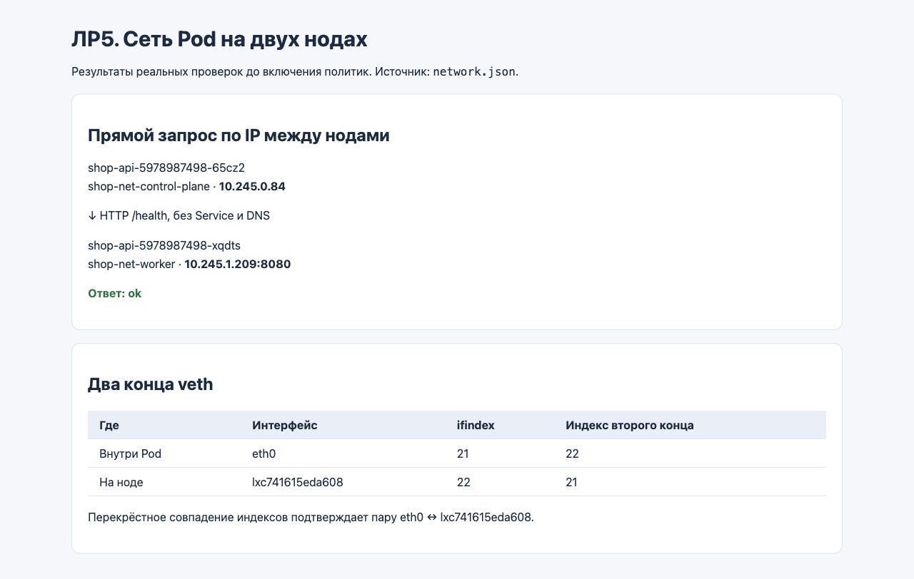
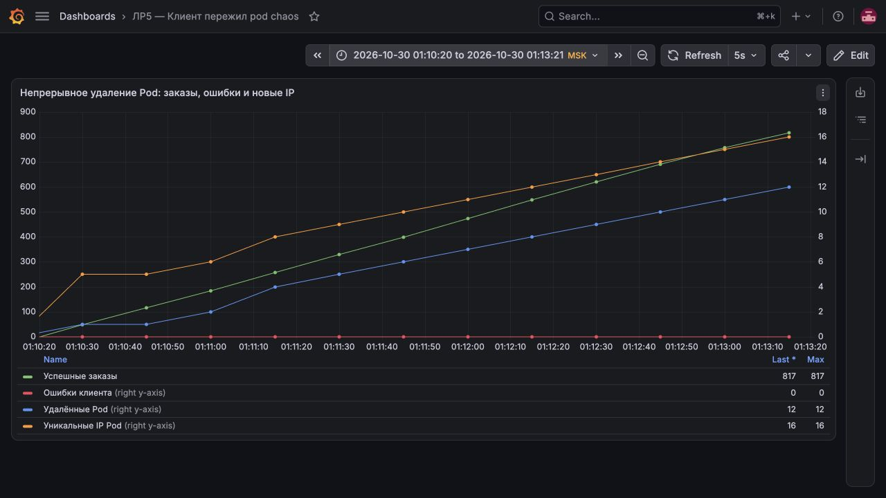
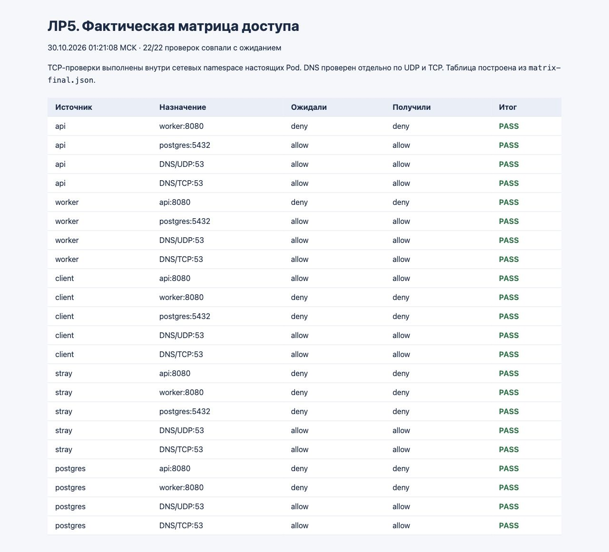
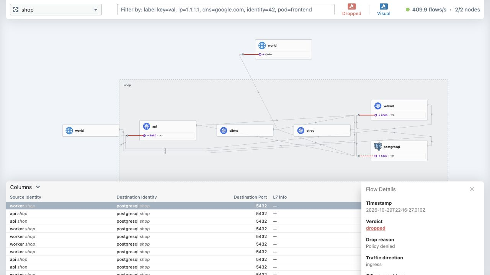
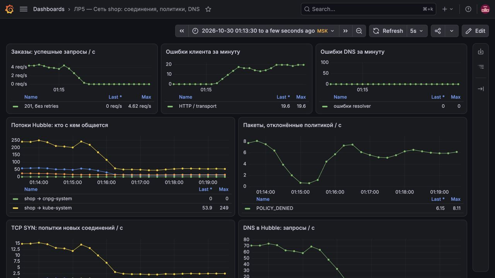
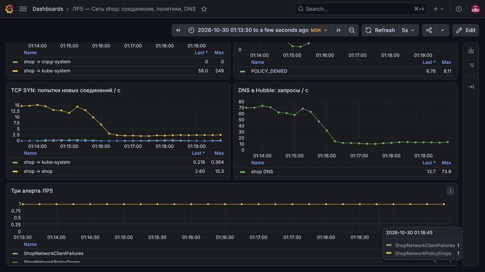
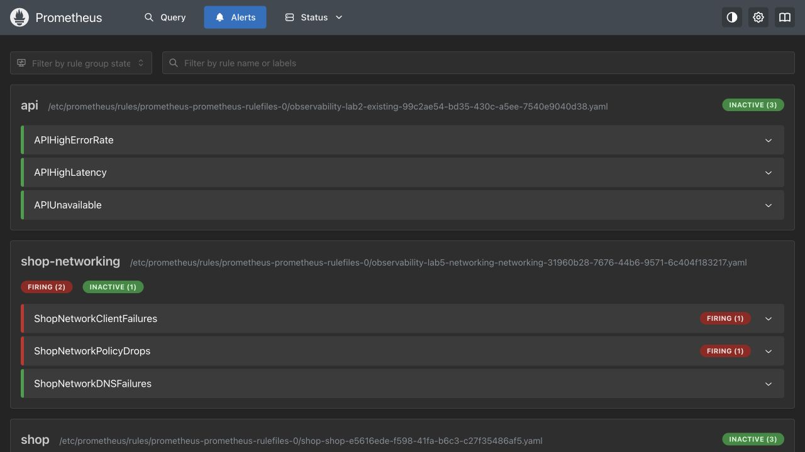

# ЛР5. Сеть shop: поды исчезают, заказы остаются

Проверили, как магазин переживает пересоздание подов, закрыли лишние соединения и нашли специально внесённую сетевую поломку через Hubble. За 180 секунд клиент создал **840 заказов без ошибок**, пока удалялись поды апи и обработчиков заказов. После настройки политик и исправления поломки матрица доступа прошла **22/22** проверки.

Работу выполнили 30 октября 2026 года. Использовали чарт из третьей лабы и мониторинг из второй; четвёртая не понадобилась.

## 1. Что запустили и почему выбрали Cilium

| Где | Что работает |
| --- | --- |
| Двухузловой kind `shop-net` | 3 экземпляра апи, 2 обработчика заказов, PostgreSQL, клиент нагрузки и посторонний под |
| В том же кластере | Cilium 1.20.4, Hubble, CoreDNS, kube-proxy и оператор CloudNativePG |
| Прежний `observability` из ЛР2 | Prometheus, Grafana и Alertmanager |

Выбрали Cilium, потому что он применяет NetworkPolicy и позволяет через Hubble увидеть, какое соединение заблокировано. Стандартный `kindnet` политики не применяет. При создании нового кластера отключили стандартный сетевой плагин, настройки сохранили в [configs/](configs/).

[Чарт `shop`](helm/shop/) расширили сетевыми политиками и шаблонами мониторинга. Релиз `shop` разворачивает приложение в новом кластере, а `lab5-networking` подключает его метрики к прежнему Prometheus через ServiceMonitor и EndpointSlice. Новые Prometheus и Grafana не устанавливали.

## 2. Как запустить

Нужны работающий Docker Desktop, kind, kubectl, Helm, Python с PyYAML и готовый стенд ЛР2/ЛР3 в контексте `kind-observability`. Команды выполняются из каталога этой лабы.

Сначала развернули магазин без ограничений и проверили исходную сеть, затем включили политики:

```bash
export DOCKER_CONTEXT=desktop-linux
python3 scripts/setup.py --open
python3 scripts/network.py
python3 scripts/matrix.py --open --output matrix-open
python3 scripts/setup.py
```

[Установщик](scripts/setup.py) создаёт или переиспользует кластер, загружает образы и устанавливает чарт. Поды апи распределяются между обоими узлами. Для нового кластера используется отдельный `.state/kubeconfig`, прежний кластер не пересоздаётся.

Интерфейсы открывали пробросом портов, каждый — в отдельном терминале:

```bash
kubectl --context kind-observability -n observability port-forward svc/grafana 13005:80 --address 127.0.0.1
kubectl --context kind-observability -n observability port-forward svc/prometheus-server 19095:80 --address 127.0.0.1
kubectl --kubeconfig .state/kubeconfig -n kube-system port-forward svc/hubble-ui 12005:80 --address 127.0.0.1
```

После этого загрузили панели:

```bash
python3 scripts/dashboard.py
```

| Интерфейс | Адрес |
| --- | --- |
| Магазин через NodePort | http://localhost:18085/orders |
| Сетевая панель мониторинга | http://localhost:13005/d/itmo-shop-network |
| График удаления подов | http://localhost:13005/d/itmo-shop-chaos |
| Оповещения Prometheus | http://localhost:19095/alerts |
| Карта Hubble | http://localhost:12005/?namespace=shop |

## 3. Проверили сеть между узлами

До включения политик отправили прямой запрос между подами апи на разных узлах: `10.245.0.84` → `10.245.1.209:8080/health`. Получили `ok`, без участия Service и DNS.

Внутри первого пода нашли `eth0` с индексом 21 и вторым концом 22. На узле ему соответствовал `lxc741615eda608` с обратными индексами — 22 и 21. Так подтвердили конкретную veth-пару.

```bash
python3 scripts/network.py
```



При создании пода Cilium настраивает его сетевой интерфейс, а IPAM выделяет адрес из диапазона узла. В нашем стенде между узлами используется VXLAN. После пересоздания под получает новый IP, поэтому постоянные обращения приложения идут через имя Service.

## 4. Удаляли поды под нагрузкой

Апи опубликовали через `NodePort 30080`, который kind перенаправляет на `localhost:18085`. Внешний вход проверили отдельно. Непрерывный клиент внутри кластера обращался по DNS-имени `shop-api.shop.svc.cluster.local:8080` и создавал заказы через `POST /order`, без повторных попыток.

```bash
curl --fail http://127.0.0.1:18085/health
python3 scripts/chaos.py --duration 180 --interval 10 --seed 530
python3 scripts/collect.py chaos
python3 scripts/dashboard.py
```

Скрипт выбирал случайный готовый под апи или обработчика заказов и удалял его штатной командой Kubernetes. Между итерациями выдерживал паузу 10 секунд; сами команды добавляли время.

| Результат за 180 секунд | Значение |
| --- | --- |
| Созданные заказы / завершённые запросы | 840 / 840 |
| Ошибки HTTP или передачи данных | 0 |
| Удалённые поды апи / обработчиков заказов | 6 / 6 |
| Разные IP в последовательных снимках | 16, включая исходные |



На графике последняя точка показывает 817 успешных запросов: периодический сбор метрик не совпадает с точной границей опыта. Полные **840/840** посчитаны по всем завершённым запросам за этот интервал.

| Компонент | За что отвечал |
| --- | --- |
| Deployment | Восстанавливал удалённые поды |
| Service | Сохранял общий адрес апи |
| EndpointSlice | Обновлял адреса и готовность обслуживающих подов |
| kube-proxy | Обновлял правила направления соединений |
| CoreDNS | Разрешал постоянное имя Service |

В логах kube-proxy подтвердили режим `iptables`; замена kube-proxy средствами Cilium отключена. Разница между `iptables` и IPVS важнее при большом числе сервисов и частом изменении правил, чем на нашем небольшом стенде.

```bash
kubectl --kubeconfig .state/kubeconfig -n kube-system logs daemonset/kube-proxy --tail=40
```

Ноль ошибок получен при штатном удалении: несколько реплик продолжали работать, а удаляемому поду давалось время завершить запросы. Принудительное уничтожение процесса в этот опыт не входило.

| Вариант Service | Чем отличается |
| --- | --- |
| NodePort | Открывает фиксированный порт на узлах |
| LoadBalancer | Использует внешний балансировщик, который предоставляет облако или отдельный контроллер |
| Сервис без виртуального IP | При `clusterIP: None` DNS возвращает адреса самих подов |

## 5. Ограничили доступ и проверили матрицу

Сначала определили нужные направления:

| Источник | Апи:8080 | Обработчик заказов:8080 | PostgreSQL:5432 | DNS, UDP/TCP 53 |
| --- | --- | --- | --- | --- |
| Клиент | Разрешено | Запрещено | Запрещено | Разрешено |
| Апи | — | Запрещено | Разрешено | Разрешено |
| Обработчик заказов | Запрещено | — | Разрешено | Разрешено |
| Посторонний под | Запрещено | Запрещено | Запрещено | Разрешено |
| PostgreSQL | Запрещено | Запрещено | — | Разрешено |

В [шаблонах политик](helm/shop/templates/networkpolicy.yaml) запретили входящий и исходящий трафик по умолчанию, затем открыли нужные соединения по меткам и портам. Параметры задаются через [values.yaml](helm/shop/values.yaml). Отдельно разрешили DNS, сбор метрик и служебные обращения оператора PostgreSQL и самой БД к апи Kubernetes. Общего выхода в Интернет не открывали.

Проверки выполняли из сетевых пространств имён настоящих подов. DNS проверяли по UDP и TCP, прикладные направления — установлением TCP-соединения.

```bash
python3 scripts/matrix.py --output matrix-final
```



Получили **22/22**: апи и обработчики заказов видят PostgreSQL, посторонний под — нет. DNS продолжает работать. Пустая диагональ исключена из проверки: соединение внутри одного пода не показывает изоляцию между подами.

## 6. Нашли скрытую поломку через Hubble

Скрипт случайно выбирает одну из четырёх ошибок: неверный порт БД, неверные метки приложений, закрытый DNS или неверную метку клиента. Ошибка применяется через параметры чарта; выбранный вариант до диагностики не читали.

```bash
python3 scripts/fault.py inject
```

Заказы перестали проходить. В Hubble выбрали пространство имён `shop` и отклонённые соединения. Увидели, что апи и обработчики заказов не могут попасть в PostgreSQL на порт 5432: причина — **запрет политикой**, направление — входящее.



После этого проверили правило входящего трафика БД:

```bash
kubectl --kubeconfig .state/kubeconfig -n shop get networkpolicy shop-database-ingress -o json
```

Порт оказался правильным, но правило ожидало метки `api-typo` и `worker-typo` вместо `api` и `worker`. Оно не выбирало нужные поды. Контрольная матрица дала **20/22**: не работали именно два разрешённых соединения с БД.

Раскрыли вариант, вернули правильные метки и повторили проверку:

```bash
python3 scripts/fault.py reveal
python3 scripts/fault.py fix
python3 scripts/matrix.py --output matrix-final
```

Заказы снова начали создаваться, матрица вернулась к **22/22**. Запрет по умолчанию оставался включённым. Причину нашли по заблокированному соединению в Hubble, а не перебором всех настроек.

## 7. Метрики и оповещения

Метрики клиента и Hubble подключили к прежнему Prometheus из ЛР2. ServiceMonitor и PrometheusRule находятся в [чарте](helm/shop/templates/monitoring.yaml), панели Grafana — в [dashboards/](dashboards/). Метрики собираются каждые 5 секунд, правила проверяются каждые 15 секунд.

На панелях видны успешные заказы, ошибки клиента, TCP-соединения, пакеты, отклонённые политикой, и состояние DNS. Во время поломки успешные заказы исчезли, ошибки и блокировки выросли, а DNS оставался доступен:





| Оповещение | Условие, выдержка 30 секунд | Зачем нужно |
| --- | --- | --- |
| `ShopNetworkClientFailures` | Есть ошибки клиентских запросов за минуту | Показывает, что заказы не проходят с точки зрения клиента |
| `ShopNetworkPolicyDrops` | Более 0,1 отклонённого политикой пакета в секунду | Помогает заметить устойчивую блокировку и перейти к её разбору в Hubble |
| `ShopNetworkDNSFailures` | Есть ошибки DNS за минуту либо исчез его наблюдатель | Выделяет проблему разрешения имён или отказ проверки DNS |

Первые два оповещения **сработали**. Третье осталось неактивным: ошибка была в доступе к БД, а не в DNS.



После исправления новые ошибки прекратились. Когда старые события вышли из минутного окна, оповещения снялись.

## Итог

Магазин пережил 12 удалений подов без ошибок в 840 запросах. Политики закрыли лишние соединения, сохранив нужные маршруты и DNS. Скрытую поломку нашли через Hubble и исправили, после чего снова получили **22/22**.

Чарт и скрипты проверены, повторный запуск установщика прошёл. Прежний мониторинг и его хранилища сохранились. Результат относится к штатному удалению подов в локальном стенде; отказ физического компьютера здесь не проверяли.
