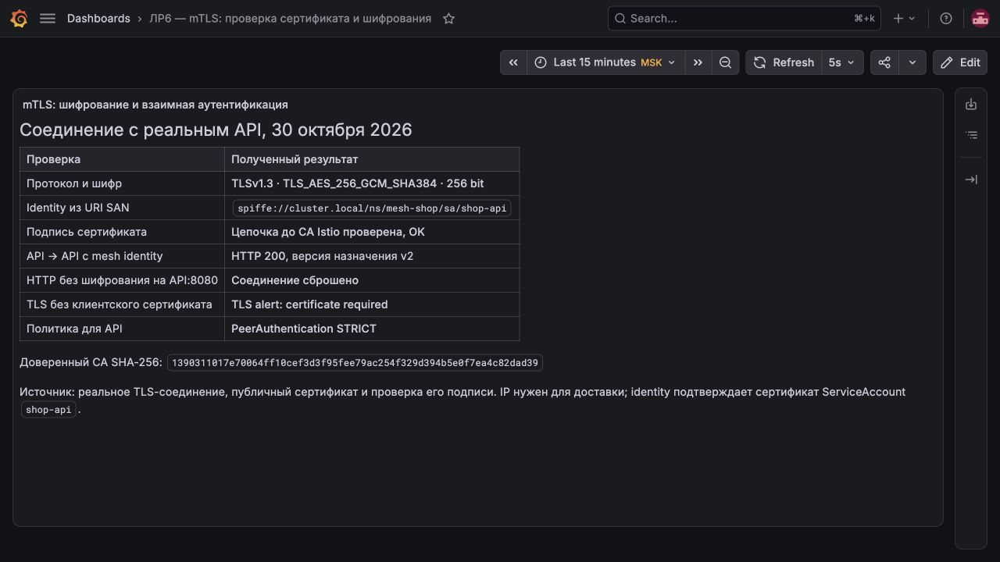
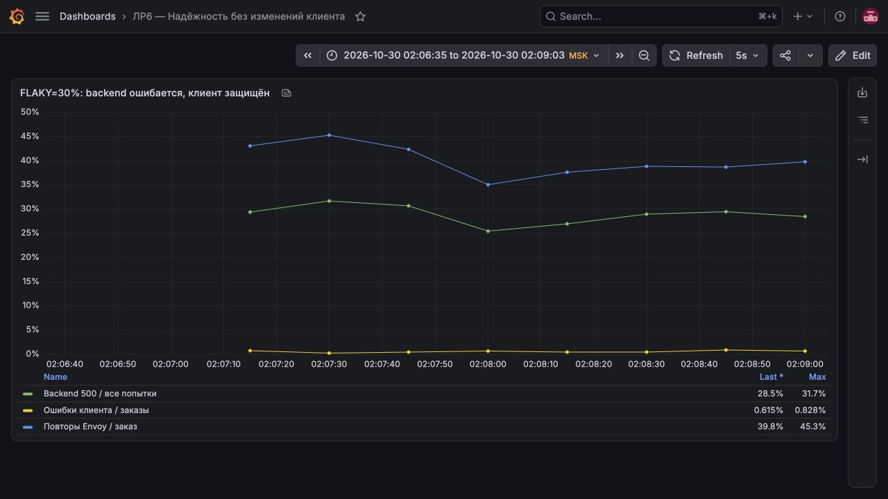
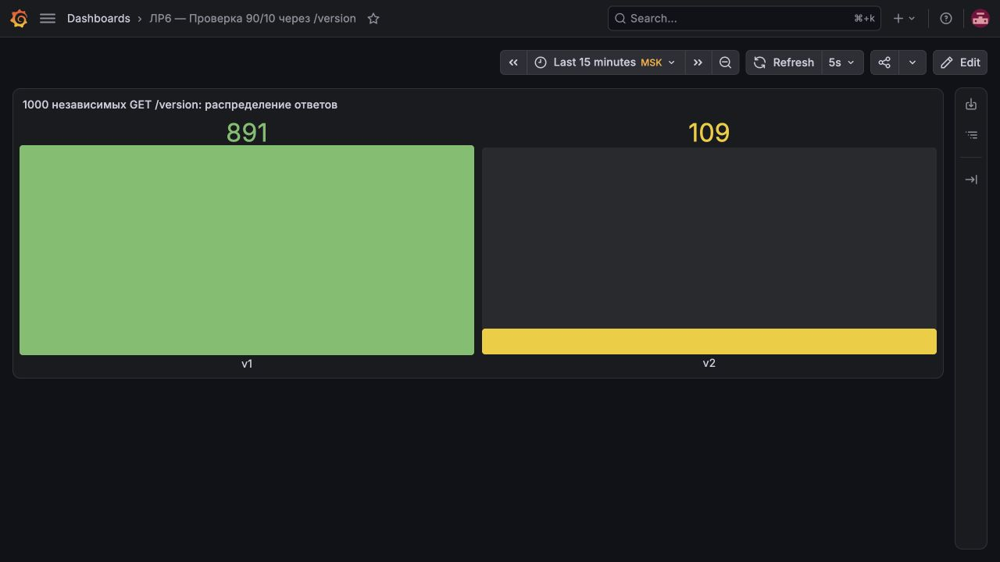
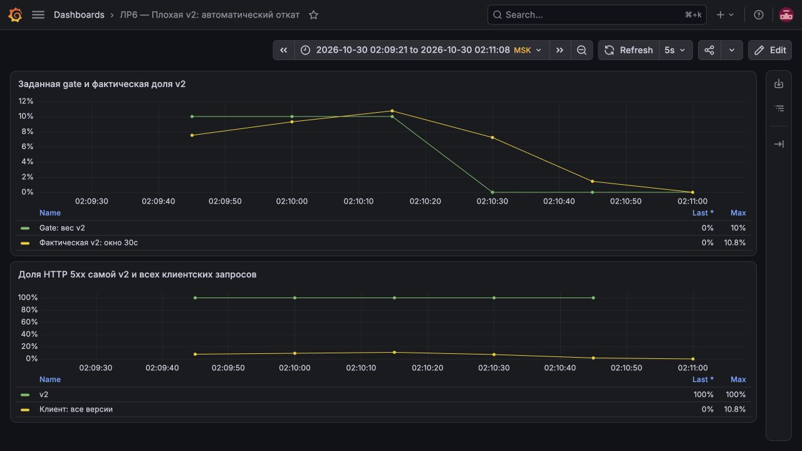
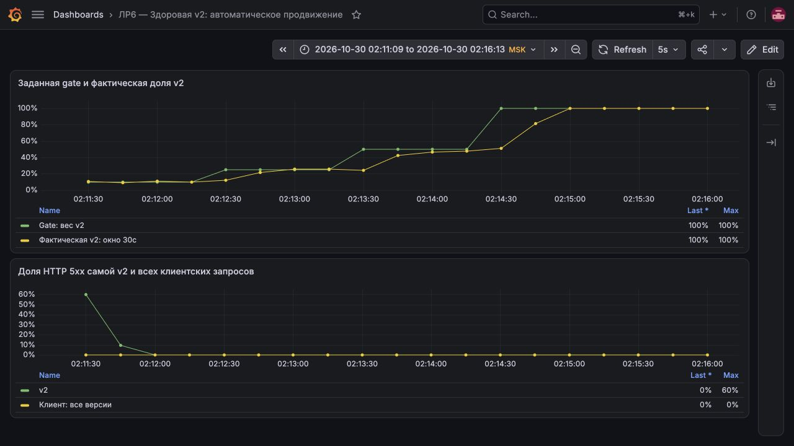
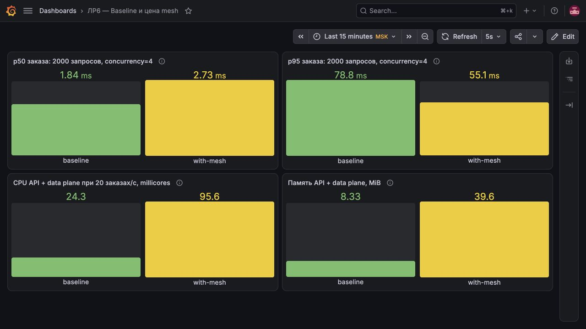
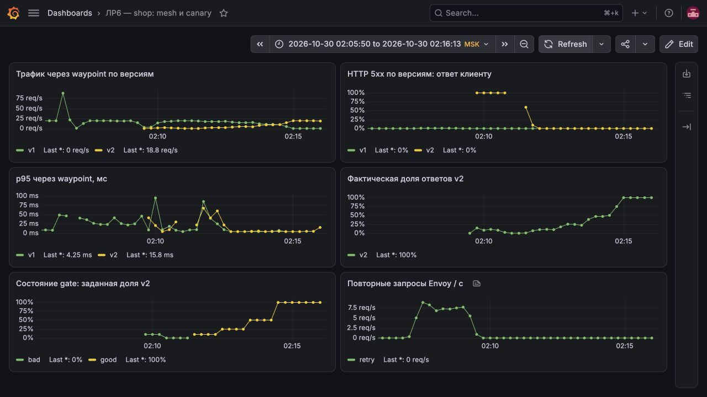

# ЛР6. Релиз, который сам решает, когда ему пора назад

Добавили к `shop` сервисную сеть Istio ambient и настроили постепенный релиз. Плохая v2 автоматически теряет трафик, здоровая забирает его целиком. Проверили шифрование, повторные запросы и посчитали расход ресурсов.

Лабораторную выполнили 30 октября 2026 года в локальном kind. Снимки сделали в работающей Grafana, время на графиках — московское. Команды приведены текстом.

## 1. Что запустили и почему выбрали Istio ambient

Взяли [апи на Go](api/main.go) и [пакет Helm `shop`](helm/shop/) из ЛР3. Развернули отдельный одноузловой кластер `shop-mesh`, пространство имён `mesh-shop`. Prometheus и Grafana переиспользовали из ЛР2. У каждой версии апи по одной реплике; PostgreSQL оставили вне сервисной сети.

Выбрали **Istio ambient 1.30.7**: один `ztunnel` обеспечивает защищённый транспорт на узле, а общий прокси waypoint добавляет HTTP-маршрутизацию, повторные запросы и метрики. Отдельных контейнеров-посредников рядом с каждым апи нет.

| Возможность апи | Для чего нужна |
| --- | --- |
| `GET /health`, `GET /version` | Проверка доступности и версии |
| `POST /order`, `GET /orders` | Создание и чтение заказов из PostgreSQL |
| `GET /metrics` | Метрики приложения |
| `FLAKY=true` на v1 | Примерно 30% обращений завершаются HTTP 500 |
| `FAIL=true` на v2 | Все попытки создать заказ завершаются HTTP 500 |

Искусственные ошибки возникают **до записи в базу**, поэтому их повтор не создаёт дубликаты заказов. Само апи и [клиент нагрузки](tools/client.py) повторных запросов не делают.

## 2. Как развернули стенд

Для повторения нужны Docker Desktop, kind, kubectl, Helm, Python 3 и работающий набор сервисов ЛР2 в контексте `kind-observability`.

```bash
export DOCKER_CONTEXT=desktop-linux
python3 scripts/setup.py
python3 scripts/forward.py
```

Первый запуск разворачивает исходную версию без сервисной сети. Доступ к новому кластеру хранится в `.state/kubeconfig`. Проброс портов открывает Grafana на `http://127.0.0.1:23000`, Prometheus — на `http://127.0.0.1:29090`, управление клиентом — на `http://127.0.0.1:29100`.

## 3. Исходные замеры без сервисной сети

```bash
python3 scripts/benchmark.py baseline
```

Для ресурсов держали 20 заказов/с: после 20 секунд прогрева собирали данные kubelet в течение минуты. Отдельно измерили задержки на 2000 заказах с четырьмя одновременными запросами. Клиент находился внутри кластера; проброс порта не входил в измеряемый путь заказа.

| Показатель | Без сервисной сети |
| --- | ---: |
| Успешные заказы | 2000 из 2000 |
| p50 / p95 | 1,84 / 78,85 мс |
| Загрузка процессора апи | 24,35 миллиядра |
| Память апи | 8,33 МиБ |

Инфраструктура Istio уже была установлена, но апи и клиент ещё не были подключены к сервисной сети: прокси в пути заказа не участвовали.

## 4. mTLS: соединение действительно зашифровано

Подключение к сервисной сети, выбор waypoint и политика `STRICT` заданы в пакете Helm.

```bash
helm --kubeconfig .state/kubeconfig upgrade shop helm/shop -n mesh-shop \
  --reuse-values --set mesh.enabled=true --set api.v2Enabled=false \
  --set traffic.v2Weight=0 --wait
kubectl --kubeconfig .state/kubeconfig -n mesh-shop \
  rollout status deployment/shop-waypoint
```

Запрос из одного Pod апи к другому прошёл с HTTP 200. При отдельной проверке установили TLS 1.3 с шифром `TLS_AES_256_GCM_SHA384` и проверили подпись сертификата по удостоверяющему центру Istio. В сертификате указана учётная запись `spiffe://cluster.local/ns/mesh-shop/sa/shop-api`.

Обычный HTTP к апи был отклонён. TLS-соединение без клиентского сертификата тоже не прошло: сервер потребовал сертификат. Значит, проверили и шифрование, и взаимную аутентификацию, а не только наличие метки подключения.



Учётная запись принадлежит ServiceAccount `shop-api`, а не IP-адресу Pod. v1 и v2 используют одну учётную запись сервиса; версии различаются метками. Соединение апи → PostgreSQL в эту проверку не входит.

## 5. Серверная часть ошибается, клиент почти не замечает

Включили `FLAKY=true` на v1 и направили на неё весь трафик. В HTTPRoute разрешили до трёх повторов HTTP 500 сверх исходной попытки. Начальная задержка между попытками — 10 мс, общее ограничение времени — 3 секунды, одной попытки — 1 секунда.

```bash
python3 scripts/scenario.py reliability
```



На последней точке графика серверная часть возвращает **28,5% ошибок**, а клиент видит только **0,615%**. Синяя линия около 40% означает примерно 40 дополнительных попыток на 100 клиентских заказов.

Причину подтвердили метриками Envoy: `envoy_cluster_upstream_rq_retry` достиг 987, а `envoy_cluster_upstream_rq_retry_success` — 710. Размыкание цепи и исключение сбойных экземпляров не настраивали — помогли именно **повторные запросы**. При независимых 30% ошибок вероятность провала всех четырёх попыток равна примерно `0,3⁴ = 0,81%`, что согласуется с наблюдениями.

## 6. Две версии и распределение 90/10

Развернули v1 и здоровую v2 одновременно. HTTPRoute из пакета Helm направляет 90% трафика в `shop-api-v1`, 10% — в `shop-api-v2`.

```bash
python3 scripts/scenario.py split
curl -sS -X POST http://127.0.0.1:29100/control \
  -H 'Content-Type: application/json' -d '{"active":false}'
curl -sS -X POST http://127.0.0.1:29100/versions \
  -H 'Content-Type: application/json' -d '{"count":1000}'
```

Из 1000 запросов `/version` получили **891 ответ v1 и 109 ответов v2** — 89,1% и 10,9%. Это близко к заданным весам: выбор версии случайный, ровно каждый десятый запрос не гарантируется.



## 7. Автопилот релиза

[Скрипт проверки](gate/gate.py) раз в 15 секунд читает из Prometheus долю ошибок v2, p95 и число запросов за последние 30 секунд. Долю трафика меняет через Helm, без прямого редактирования HTTPRoute. Для скрипта также подготовили [Dockerfile](gate/Dockerfile).

Правила такие:

- После изменения веса ждём 40 секунд и не менее 20 запросов к v2.
- Если ошибок больше 5% или p95 выше 250 мс, откатываем вес v2 в 0.
- После двух успешных проверок повышаем долю: **10 → 25 → 50 → 100%**. На каждой ступени начинаем наблюдение заново.
- Достигнув 100%, ещё раз проверяем результат. При трёх подряд ошибках получения метрик или превышении общего времени 10 минут тоже откатываемся.

Для этих опытов повторные запросы отключили, чтобы они не маскировали ошибки новой версии.

### Плохой релиз

```bash
python3 scripts/scenario.py bad
```

Развернули v2 с `FAIL=true`. Автопилот увидел **100% ошибок** и примерно через **46 секунд** сам снизил её вес с 10% до 0. Вручную трафик не переключали.



Фактическая доля v2 уходит в ноль с задержкой 30-секундного окна. После отката новых запросов к ней нет, поэтому её доля ошибок перестаёт вычисляться.

### Здоровый релиз

```bash
python3 scripts/scenario.py good
```

С `FAIL=false` автопилот прошёл все ступени и подтвердил **100% трафика на v2** примерно за **244 секунды**. В последнем контрольном окне ошибок не было, p95 составил **5,18 мс**. Дополнительные 200 запросов `/version` тоже все пришли от v2.



На старте опыта были три ответа HTTP 504 от шлюза без версии назначения. Первые точки графика также захватывают старые ошибки предыдущего релиза: поэтому автопилот ждёт прогрева и не принимает решение сразу после развёртывания.

## 8. Сколько стоит сервисная сеть

Повторили тот же замер на одной здоровой v1, без повторных запросов и параллельной v2:

```bash
python3 scripts/benchmark.py with-mesh
```

Оба запуска завершились 2000 успешными заказами. Ресурсы измеряли при одинаковой нагрузке 20 заказов/с.

| Показатель | Без сервисной сети | С сервисной сетью | Разница |
| --- | ---: | ---: | ---: |
| p50 | 1,84 мс | 2,73 мс | +0,89 мс, около +48,6% |
| p95 | 78,85 мс | 55,12 мс | −23,73 мс |
| Процессор апи и обслуживающих его прокси | 24,35 миллиядра | 95,62 миллиядра | +71,28 миллиядра |
| Память апи и обслуживающих его прокси | 8,33 МиБ | 39,60 МиБ | +31,27 МиБ |



Сами ztunnel и waypoint потребовали **77,82 миллиядра и 32,16 МиБ**. Istiod и CNI использовали ещё **13,93 миллиядра и 75,91 МиБ**. В исходной колонке учитывается только апи, в колонке с сервисной сетью — апи и целиком обслуживающие его прокси. Это не сравнение полного потребления двух кластеров.

Медиана выросла на 0,89 мс, а p95 оказался ниже. На общей виртуальной машине есть разброс, поэтому это не доказывает ускорение от сервисной сети. Расход ресурсов самих прокси при этом измерен отдельно.

Для такого маленького `shop` постоянная сервисная сеть выглядит дорогой. Её проще оправдать, когда многим сервисам нужны единая аутентификация, обязательное шифрование и общие правила постепенного релиза.

## 9. Мониторинг и три оповещения

[ServiceMonitor и PrometheusRule](helm/shop/templates/monitoring.yaml) добавлены в пакет Helm. Prometheus из ЛР2 загрузил все три правила без ошибок. Панель показывает частоту запросов, долю ошибок и p95 по версиям, фактическое распределение трафика и решения автопилота.



| Оповещение | Условие | Зачем нужно |
| --- | --- | --- |
| `ShopMeshHighErrors` | Ошибки клиента > 5% за минуту, выдержка 30 с | Пользователи теряют заказы: проверить новую версию и откат. |
| `ShopMeshHighLatency` | p95 > 100 мс за минуту, выдержка 1 мин | Найти устойчивое замедление апи, PostgreSQL или прокси. |
| `ShopMeshTelemetryMissing` | Метрики waypoint отсутствуют или `up=0` в течение минуты | Автопилот не должен продвигать релиз вслепую. |

Метрики по версиям берём из `istio_requests_total` и `istio_request_duration_milliseconds_bucket`. Заданный вес и фактическую долю показываем отдельно: решение и его результат не совпадают мгновенно. Описания панелей сохранены в [dashboards/](dashboards/).

## Итог

Проверили шифрование, настоящие повторные запросы, распределение 90/10 и оба сценария автоматического релиза. Плохая v2 откатилась, здоровая дошла до 100%. Сервисная сеть работает, но даже для одного апи её прокси заметно увеличивают расход ресурсов.
