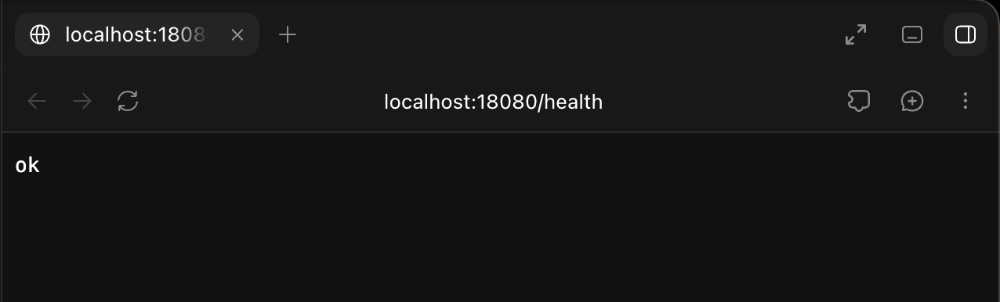
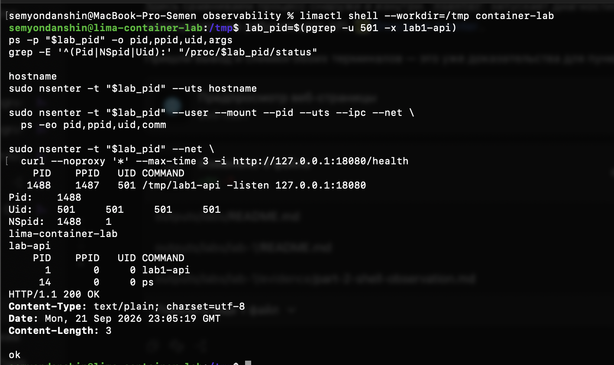
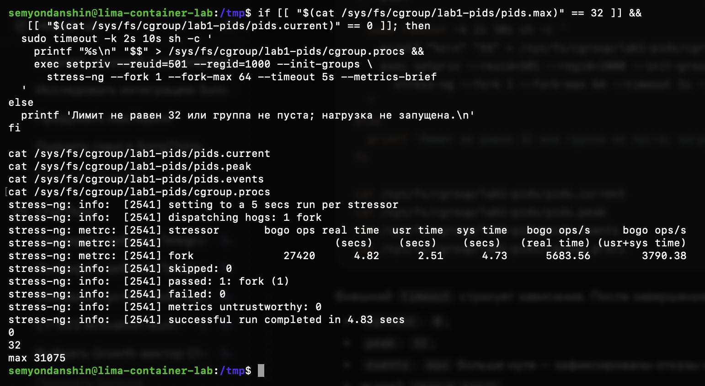
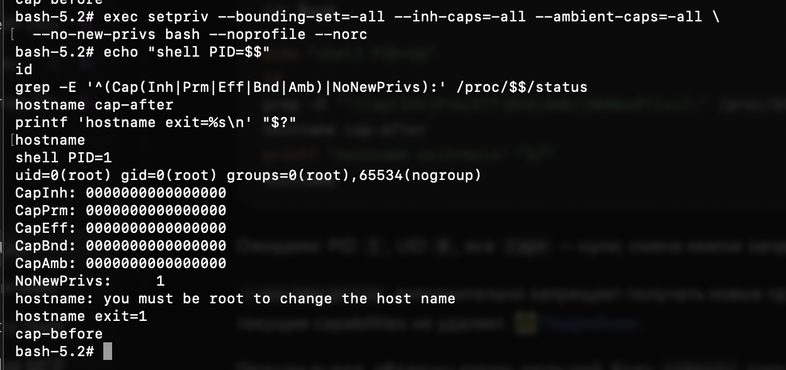
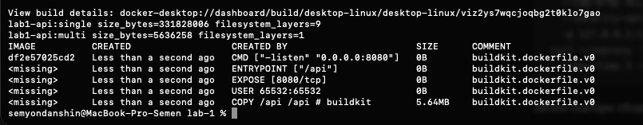
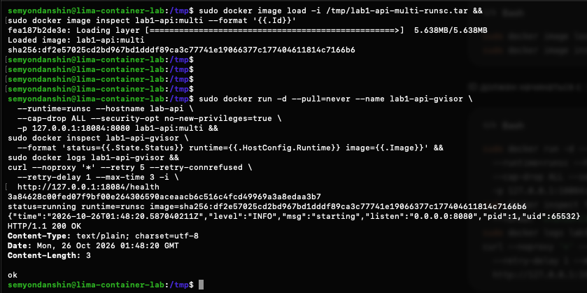
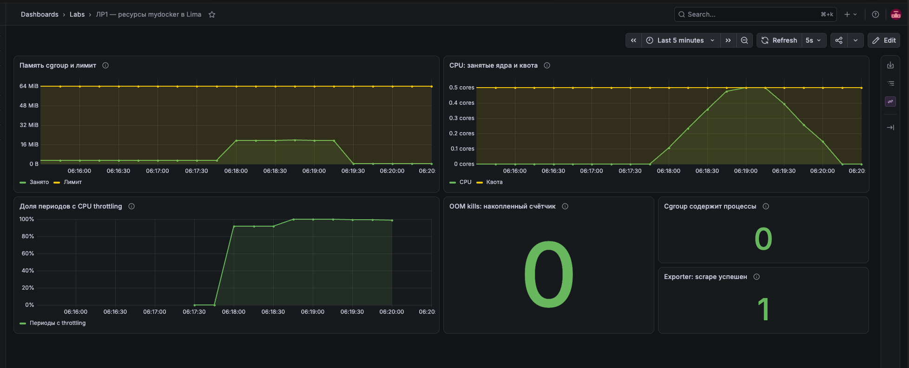

# ЛР1. Собираем свой Docker из обычного процесса

В этой лабе постепенно ограничили обычный HTTP-сервис: сначала изолировали его через namespaces, затем добавили лимиты ресурсов и убрали лишние привилегии. После этого собрали запуск в один скрипт, сравнили результат с Docker и запустили тот же образ через gVisor. В конце посмотрели в Grafana, как ограничения ведут себя под нагрузкой.

Сервис написан на Go. [Исходники](api/main.go) сгенерированы как инструмент для опытов: `/health` отвечает `ok`, `/eat?mb=N` выделяет и удерживает память, `/burn` нагружает одно ядро до остановки процесса. При выделении памяти сервис касается каждой страницы, чтобы измерять не только резервирование виртуальных адресов.

Работали на Mac ARM64: первый запуск сделали прямо на macOS, а Linux-механизмы исследовали в Lima `container-lab` с Debian 13 и cgroup v2. Обычный Docker запускали в Docker Desktop, gVisor — в Lima, поэтому учитывали, что это две разные Linux VM и номера PID и UID относятся к разным окружениям. У Lima было 2 CPU и 2 GiB RAM; в сентябрьских опытах использовалось ядро `6.12.95`, в октябрьском продолжении — `6.12.107`.

## 1. Пока это просто сервис

Запустили API без созданных нами namespaces и лимитов. `/health` вернул HTTP 200 и `ok`, в `ps` нашли процесс с PID `98176`, UID `501`.



Этот запуск взяли за исходное состояние: ответ 200 подтверждает работу HTTP, но ничего не говорит об изоляции. Пока процесс подчиняется обычным правам пользователя и ограничениям ОС, без добавленных нами учебных лимитов. Подробности сохранили в [выводе `ps` и протоколе](evidence/part-1-observation.md).

## 2. Namespaces: один процесс, разные номера и окружение

В Lima запустили оболочку с шестью namespaces:

```bash
unshare --user --map-root-user --pid --fork --mount --mount-proc \
  --net --uts --ipc bash --noprofile --norc
```

Внутри оболочка получила PID 1 и UID 0. Задали ей hostname `lab-api` и включили единственный сетевой интерфейс — loopback `lo` — командой `ip link set lo up`, после чего заменили оболочку на API через `exec`.

| Namespace | Что изменилось |
| --- | --- |
| PID | Своя нумерация процессов; API видит себя как PID 1 |
| Mount | Отдельное представление монтирований; новый `/proc` показывает процессы этого PID namespace |
| Network | Свои интерфейсы, маршруты и сокеты; host loopback сюда не переезжает |
| UTS | Свой hostname `lab-api` |
| IPC | Отдельное пространство System V IPC и POSIX message queues |
| User | UID 0 внутри сопоставлен обычному UID 501 снаружи |

С Linux-хоста тот же API виден как PID `1488`, UID `501`: строка `NSpid: 1488 1` связывает внешнюю и внутреннюю нумерацию. Аналогично `uid_map` содержит `0 501 1`, то есть внутренний UID 0 соответствует внешнему 501.



На этом примере стало понятнее различие двух операций: `unshare` создаёт namespaces, а `exec` заменяет программу в уже существующем процессе, сохраняя PID и в нашем случае UID. Если бы просто запустили API дочерним процессом без `exec`, PID 1 остался бы у оболочки.

Mount namespace тоже сам по себе не выдаёт новый rootfs: корнем пока остаётся файловая система VM. А HTTP проверили через `nsenter --net`, из сети самого процесса. Публикации порта наружу этим не сделали. [Полный опыт](evidence/part-2-api-observation.md).

## 3. Cgroups: память убивает, CPU притормаживает

### Память

Создали `lab1-memory`, задали `memory.max=67108864` — 64 MiB — и `memory.swap.max=0`. Затем перенесли туда API и вызвали `/eat?mb=128`.

В ответ получили `Empty reply from server` и проверили причину по `memory.events`: `max` вырос до 36, `oom` и `oom_kill` — до 1. Вместе с опустевшей группой это подтвердило, что API действительно убил OOM killer.


Сразу после переноса процесса `memory.current` был 0. Это не означает, что Go внезапно перестал занимать память: уже учтённые страницы при миграции процесса не обязаны переучитываться в новой группе. Запрос выделял новую память уже под новым лимитом. [Исходные счётчики](evidence/part-3-memory-baseline.md), [результат OOM](evidence/part-3-memory-oom.md).

### CPU

Следующий API поместили в `lab1-cpu` с `cpu.max=50000 100000`: 50 мс CPU-времени на период 100 мс. Это квота в половину одного ядра для всей группы.

После `/burn` CPU-время выросло на `2544469` мкс, `nr_throttled` — на 49, `throttled_usec` — на `2419377`. При этом `/health` продолжил отвечать 200: в отличие от опыта с памятью, CPU-лимит замедлил выполнение, а процесс остался работать. После замера API остановили через SIGTERM.


Добавление второго работника не удвоило бы доступную квоту: процессы и потоки делят бюджет группы. [Протокол CPU-опыта](evidence/part-3-cpu-throttling.md).

### Число задач

В отдельной группе задали `pids.max=32` и запустили `stress-ng --fork 1 --fork-max 64 --timeout 5s`. Родитель нагрузки вошёл в cgroup до создания потомков, поэтому ограничения наследовались сразу.

За опыт stress-ng выполнил 27420 операций, но `pids.peak` достиг только 32, а `pids.events:max` вырос до 31075. После завершения `pids.current=0`.



27420 операций не противоречат лимиту 32: ограничено число одновременно учитываемых задач, включая потоки, а не количество вызовов `fork` за всю историю. Уже запущенные задачи от достижения этого лимита не убиваются. [Протокол](evidence/part-3-pids-limit.md).

## 4. UID 0 остался, вседозволенность закончилась

Сначала root внутри user namespace успешно менял hostname, но после удаления capabilities через `setpriv` и включения `no-new-privs` команда `hostname cap-after` завершилась отказом. PID 1 и UID 0 при этом сохранились, а имя осталось прежним — `cap-before`.



Здесь важны именно capabilities, а не надпись `root` в `id`. `no-new-privs` отдельно запрещает получать дополнительные привилегии при `exec`; сам по себе он текущие capabilities не удаляет. API после такого ограничения отвечал на `/health`: для обычного HTTP на высоком порту привилегии смены hostname не нужны. [Проверка API](evidence/part-4-capabilities-api.md).

Для seccomp выбрали системный вызов `getppid`, который не требует специальных capabilities. [Профиль](seccomp/deny-getppid.json) разрешает остальные вызовы, а для него возвращает `EPERM`.

| Проверка | Без фильтра | С фильтром |
| --- | --- | --- |
| UID, CapEff | 501, 0 | 501, 0 |
| `getppid` | 966, errno 0 | −1, errno 1 (`EPERM`) |
| `Seccomp` | 0 | 2 — режим фильтрации |
| `Seccomp_filters` | 0 | 1 |


Так отказ нельзя списать на потерю capabilities: они отсутствуют в обеих probe. Под тем же фильтром API работал и возвращал 200. Capabilities ограничивают полномочия, seccomp контролирует системные вызовы; ограничения сохраняются у потомков и после обычного `exec`. Один запрещённый вызов здесь показывает механизм, но не делает профиль полноценной защитной политикой. [Вывод probe](evidence/part-4-seccomp-getppid.md), [API под фильтром](evidence/part-4-seccomp-api.md).

## 5. Склеиваем это в mydocker.sh

[Запускатель](mydocker.sh) создаёт или проверяет пустую cgroup, задаёт 64 MiB RAM без swap, 0,5 CPU и 32 задачи. Его новый дочерний процесс входит в группу, возвращается к обычному host UID, создаёт namespaces, настраивает hostname и loopback. Только после настройки он удаляет capabilities, включает `no-new-privs`, загружает seccomp и делает `exec` API.

Порядок оказался важен: после удаления capabilities настраивать hostname и сеть уже поздно. А если помещать процесс в cgroup после запуска нагрузки, часть потомков может успеть родиться без нужных ограничений.

Получили внешний PID `1260` и UID `501`, внутренний PID 1, hostname `lab-api`, все заданные лимиты, пустые Cap-наборы, один seccomp-фильтр и HTTP 200.


Затем запустили тот же статический бинарник в Alpine через Docker Desktop: `--network none`, те же лимиты, `--cap-drop ALL`, `no-new-privileges` и тот же seccomp-профиль. `/health` тоже работал.

| Что сравнивали | mydocker.sh | Обычный Docker в нашем опыте |
| --- | --- | --- |
| PID приложения внутри | 1 | 1 |
| CPU, память, pids | 0,5 / 64 MiB / 32 | Те же значения |
| Capabilities и seccomp | Удалены, фильтр активен | Удалены, фильтр активен |
| UID снаружи | 501 за счёт user namespace | 0 в Linux VM Docker Desktop, userns remap не включён |
| Корневая ФС | Корень Lima, без chroot/pivot_root | Rootfs из образа Alpine |
| Cgroup namespace | Путь `0::/lab1-mydocker` | Свой namespace, внутри `0::/` |
| Образы, слои, volumes, сеть, жизненный цикл | Вручную, многое отсутствует | Управляет Docker |

`0::/` у Docker не отменяет resource limits: это корень видимого cgroup namespace. UID 0 в его VM тоже не означает, что capabilities вернулись. Наш скрипт воспроизводит часть механизмов контейнеризации, но до Docker как системы управления ему ещё далеко. [Проверка Docker](evidence/part-5-docker-comparison.md).

## 6. Образ худеет, данные переживают пересоздание

Собрали [одноэтапный Dockerfile](api/Dockerfile.single) на Go SDK и [multi-stage вариант](api/Dockerfile), где в `scratch` копируется только статический `/api`. В обоих задан UID/GID `65532:65532`.

| Образ | Размер | Слои файловой системы |
| --- | ---: | ---: |
| `lab1-api:single` | 331828006 байт, около 316,5 MiB | 9 |
| `lab1-api:multi` | 5636258 байт, около 5,38 MiB | 1 |

Оба ответили 200, а SHA-256 их `/api` совпал: `8c794d09a9c9dff4abb2d0eb92acd8b80e78c35487982cd38bbc5917a26f568a`. Уменьшение примерно в 58,9 раза объясняется составом rootfs: SDK, исходники и build cache остались в builder.



Повторная сборка без правок показала `CACHED` для `COPY`, `RUN go build` и финального `COPY`; image ID сохранился. Если поменять Go-файл, `COPY *.go` и следующий `RUN` перестанут подходить под этот cache. Сам опыт с изменением исходника не делали. [Сборки и cache](evidence/part-6-multi-cache.md).

Следующим опытом проверили хранение данных: записали файл в writable layer, удалили контейнер и создали новый из прежнего образа. В новом контейнере файла уже не оказалось, зато при повторении с named volume `lab1-data-20261026` он прочитал прежнее `volume-data`.


Остановка и удаление — разные события: `stop/start` того же контейнера сохраняет его writable layer. Здесь проверяли именно удаление и пересоздание. Named volume живёт отдельно от контейнера, поэтому `--rm` его не удалил. Учебный volume оставили. [Протокол](evidence/part-6-volumes.md).

## 7. gVisor: между API и Linux появляется Sentry

Для опыта с gVisor установили в Lima Docker 26.1.5 и `runsc release-20261019.0`, выбрав платформу `systrap`, поскольку KVM в этой VM недоступен. Чтобы сравнивать запуск прежнего образа, экспортировали готовый `lab1-api:multi` из Docker Desktop и загрузили в Lima без пересборки. Его image ID сохранился:

```text
sha256:df2e57025cd2bd967bd1dddf89ca3c77741e19066377c177404611814c7166b6
```

Запустили с `--runtime=runsc`, без capabilities и с `no-new-privileges`. Inspect показал `running` и `runtime=runsc`, лог API — PID 1 / UID 65532, `/health` — HTTP 200. Прямой `ps` по `State.Pid=9383` на Linux-хосте показал `gvisor_sentry` с `--platform=systrap`.



Разница здесь в пути системных вызовов: у mydocker и обычного Docker разрешённые вызовы API обслуживает ядро Linux-хоста, а у gVisor интерфейс Linux реализует Sentry в userspace. Он обрабатывает вызовы приложения и сам обращается к хосту ограниченным набором операций. Простое ужесточение seccomp такого эффекта не даёт, поскольку фильтр не выполняет семантику syscall.

Общее ядро остаётся пределом обычной контейнерной изоляции. Свои PID и rootfs отдельного ядра не создают. gVisor добавляет ещё одну границу, но не обещает неуязвимость и полную совместимость Linux ABI. В этом запуске индивидуальные resource limits не задавали, производительность с runc не сравнивали. [Установка и фактический запуск](part-7-gvisor.md).

## 8. Что видно на графиках

Для Prometheus/Grafana переиспользовали Helm-стек из [второй лабы](../../lecture-2-observability/README.md) в kind. Но его cAdvisor видит ноду kind, а наш API живёт в другой VM. Поэтому сделали маленький [exporter](monitoring/cgroup-exporter.py): он читает только `lab1-mydocker`, сам в её лимиты не входит и отдаёт `/metrics`. При ошибке чтения возвращает 503, не рисует нули.

Путь данных: **cgroup Lima → exporter → `host.docker.internal:19100` → Prometheus → Grafana**. Scrape настроен каждые 5 секунд через [values](monitoring/prometheus-lima-values.yaml). Проверили доступ из Pod Prometheus, `up=1` и все десять рядов. [Dashboard JSON](monitoring/lab1-resources.json) также лежит в репозитории.

Один раз вызвали `/eat?mb=16`, затем `/burn` на 90 секунд. В конце [скрипт](monitoring/load-90s.sh) проверил `/health` и остановил API, чтобы нагрузка не осталась работать.

| Замер | До | Перед остановкой |
| --- | ---: | ---: |
| Память cgroup | 3,148 MiB | 19,512 MiB |
| CPU-время | 0,38532 с | 45,44778 с |
| Всего CPU-периодов | 62 | 964 |
| Периодов с throttling | 3 | 904 |
| OOM kills | 0 | 0 |



За опыт добавилось примерно 45 CPU-секунд: это около половины ядра за 90 секунд ожидания. Из 902 новых периодов в 901 квота исчерпывалась — около 99,9%. Это **доля периодов с throttling**, а не 99,9% времени без CPU. Поэтому одновременно возможны почти 100% на этой панели, занятые 0,5 ядра и работающий `/health`.

После остановки API `populated` стал 0, а exporter остался `up=1`. На графиках память упала сразу, тогда как CPU снизился постепенно из-за окна `rate(...[1m])`; сам лимит группы сохранился. Исходные значения и расчёты приведены в [протоколе нагрузки](evidence/part-8-load.md).

Выбрали три метрики для алертов:

| Сигнал | Что поймает и зачем |
| --- | --- |
| Память / лимит | Исчезающий запас до OOM; можно заметить проблему до убийства процесса |
| Доля периодов throttling | Давление на CPU-квоту группы и возможный рост задержек; это не доказательство нехватки CPU всего хоста |
| Новые `oom_kill` | Уже произошедшее убийство процесса, после которого API мог стать недоступен |

Для OOM смотрели бы прирост counter за окно, а не вечное `total > 0` после первого инцидента. Численные пороги и новые правила не устанавливали: в этой части задания требовалось выбрать сигналы и объяснить их. [Обоснование и PromQL](monitoring/alerts.md).

## Где пришлось разобраться, а не просто повторить команду

**Root, PID и `exec`.** Первые внутренний PID 1 и UID 0 легко принять за «получили настоящий root». Разбор `NSpid`, `uid_map` и опыта без capabilities показал, что это три разных вопроса: кто процесс, как он виден и что ему разрешено.

**runsc установлен, а Docker его не знает.** Пакет не создал `daemon.json`: его postinst регистрировал runtime только при уже существующем файле. Исправили явным `runsc install --runtime=runsc -- --platform=systrap` и перезапуском Docker. Проверяли результат через `docker info`, а не только наличие бинарника. [Сбой и исправление](evidence/part-7-install.md).

**Port-forward ушёл в другой кластер.** Команда из Helm NOTES без нашего kubeconfig получила `TLS handshake timeout`: kubectl выбрал прежний удалённый контекст. Стали явно передавать отдельный kubeconfig и `kind-observability`. После этого Grafana открылась.

**Метрика доступна по curl — ещё не значит, что есть график.** Проверили всю цепочку: файлы cgroup, HTTP exporter, доступ из kind, target Prometheus, ряды TSDB и только потом панель Grafana. Это заняло больше действий, зато было понятно, на каком участке искать проблему.

## Итог

Получился запускатель, который собирает namespaces, cgroups и ограничения привилегий вокруг обычного Linux-процесса. Docker использует те же базовые механизмы и добавляет rootfs, образы, сеть, хранение и управление жизненным циклом. gVisor меняет ещё и путь системных вызовов через Sentry.

Главный результат — ограничения проверены по эффекту: OOM действительно убил API, CPU-квота вызвала throttling, pids-лимит остановил создание новых задач, удалённые права и seccomp дали отказы. Одного зелёного HTTP 200 для всех этих выводов было бы маловато.

Все 37 исходных снимков и подробные протоколы находятся в [evidence/](evidence/). Их [контрольные суммы](evidence/SHA256SUMS) сохранены; дополнительные [команды прохождения](part-8-monitoring.md) и [проверка комплекта](completion-check.md) оставлены отдельно от отчёта.
