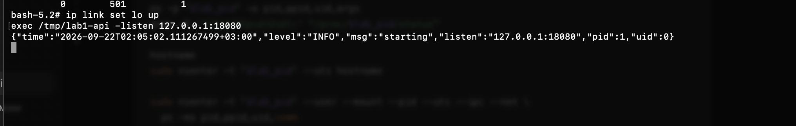

# Часть 2: API внутри namespaces и с Linux-хоста

Источник: два снимка терминала, присланные студентом 22 сентября 2026 года. Текст ниже переписан с видимых результатов; оригинальные изображения сохранены без изменения содержимого.

## Запуск в изолированном окружении

В открытой ранее оболочке PID 1 выполнены:

```sh
ip link set lo up
exec /tmp/lab1-api -listen 127.0.0.1:18080
```

Стартовый лог API:

```json
{"time":"2026-09-22T02:05:02.111267499+03:00","level":"INFO","msg":"starting","listen":"127.0.0.1:18080","pid":1,"uid":0}
```



## Наблюдение с Linux-хоста

Во втором терминале выполнены команды из `part-2-namespaces.md`. Результаты:

```text
    PID    PPID   UID COMMAND
   1488    1487   501 /tmp/lab1-api -listen 127.0.0.1:18080
Pid:    1488
Uid:    501    501    501    501
NSpid:  1488   1
```

Hostname Linux-хоста и hostname через `nsenter --uts`, соответственно:

```text
lima-container-lab
lab-api
```

`ps` через `nsenter --user --mount --pid --uts --ipc --net`:

```text
    PID    PPID   UID COMMAND
      1       0     0 lab1-api
     14       0     0 ps
```

Запрос через `nsenter --net`:

```text
HTTP/1.1 200 OK
Content-Type: text/plain; charset=utf-8
Date: Mon, 21 Sep 2026 23:05:19 GMT
Content-Length: 3

ok
```

Время HTTP-ответа соответствует 22 сентября 2026 года, 02:05:19 по Москве.


## Подтверждённый результат

Один процесс имеет PID 1488 снаружи и PID 1 внутри; это непосредственно связано строкой `NSpid`. Его внешний UID остаётся 501, внутренний — 0. Внешний PID совпал с PID прежней оболочки, подтверждая замену программы посредством `exec`.

Имена хоста различаются. Во внутреннем `ps` видны API и сама диагностическая команда. Loopback был включён перед запуском API; HTTP-запрос успешен из его network namespace. Проверка HTTP-доступа снаружи без `nsenter` не выполнялась, и публикация порта на хост этим результатом не подтверждается.

Практические наблюдения части 2 собраны. Проверка понимания пройдена 22 сентября 2026 года после разбора `exec`, наследования UID дочерним процессом и области действия root в user namespace; итог отражён в основном отчёте.
