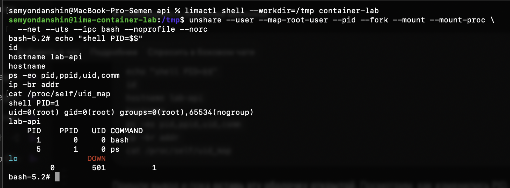

# Часть 2: оболочка внутри namespaces

Результат прислан студентом 22 сентября 2026 года вместе со снимком терминала. Команда выполнена в Linux-VM `container-lab` без `sudo`:

```sh
unshare --user --map-root-user --pid --fork --mount --mount-proc \
  --net --uts --ipc bash --noprofile --norc
```

Вывод из сообщения пользователя, с нормализованными пробелами:

```text
shell PID=1
uid=0(root) gid=0(root) groups=0(root),65534(nogroup)
lab-api
    PID    PPID   UID COMMAND
      1       0     0 bash
      5       1     0 ps
lo               DOWN
         0        501          1
```

Последняя строка — вывод `/proc/self/uid_map`: один UID, начиная с внутреннего 0, отображается в UID 501 родительского user namespace. Диагностический `ps` виден как отдельный временный процесс. `PPID=0` у PID 1 не обозначает отсутствие родителя на Linux-хосте: родитель не виден из этого PID namespace.



Дополнительная read-only проверка ассистента с Linux-хоста (`pgrep -a -u 501 -x bash`) в момент подготовки продолжения показала:

```text
1481 /bin/bash -l
1488 bash --noprofile --norc
```

Внешний PID изолированной оболочки на момент этой проверки — 1488, пользователь — 501. Это наблюдение оболочки, а не ещё не запущенного API.

Для следующего шага исходники API повторно собраны с `CGO_ENABLED=0 GOOS=linux GOARCH=arm64`. Статический ELF ARM64 скопирован в VM в `/tmp/lab1-api`, права `0755`, владелец UID 501. SHA-256 совпал на macOS и внутри VM:

```text
fae2d74dea2434ed3428ab1b4459539250d4cf87132b584397d64ff220484b0d
```

Запуск API как PID 1, его HTTP-ответ в отдельной сети, снимок API изнутри/снаружи и проверка понимания части 2 ещё ожидаются.
