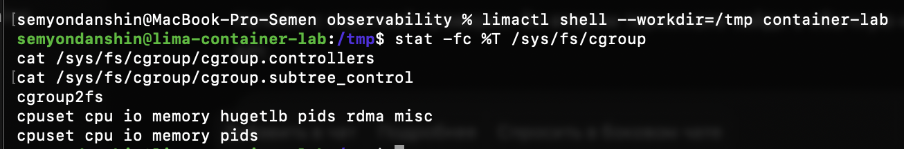

# Часть 3: проверка cgroup v2

Источник: снимок терминала, присланный студентом 22 сентября 2026 года. Команды выполнены в обычной оболочке Linux-VM `container-lab`, вне namespaces API.

```text
$ stat -fc %T /sys/fs/cgroup
cgroup2fs
$ cat /sys/fs/cgroup/cgroup.controllers
cpuset cpu io memory hugetlb pids rdma misc
$ cat /sys/fs/cgroup/cgroup.subtree_control
cpuset cpu io memory pids
```



Подтверждено: используется cgroup v2; контроллеры `memory`, `cpu` и `pids` доступны и уже включены в корневой группе для дочерних групп. Дополнительно включать их в корневом `cgroup.subtree_control` для следующего опыта не требуется.

Этот вывод не подтверждает наличие отдельной группы API, настроенные лимиты или результаты нагрузки. На данном шаге выполнено только чтение состояния; память, CPU и число процессов не изменялись.
