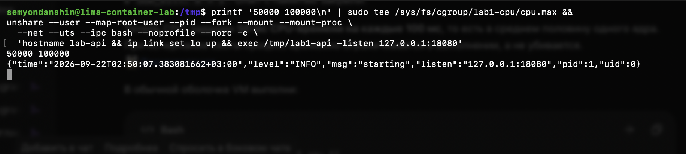

# Часть 3: CPU-квота и новый запуск API

Источник: снимок терминала студента от 22 сентября 2026 года. В обычной оболочке Linux-VM `container-lab` выполнены:

```sh
printf '50000 100000\n' | sudo tee /sys/fs/cgroup/lab1-cpu/cpu.max &&
unshare --user --map-root-user --pid --fork --mount --mount-proc \
  --net --uts --ipc bash --noprofile --norc -c \
  'hostname lab-api && ip link set lo up && exec /tmp/lab1-api -listen 127.0.0.1:18080'
```

Вывод:

```text
50000 100000
```

```json
{"time":"2026-09-22T02:50:07.383081662+03:00","level":"INFO","msg":"starting","listen":"127.0.0.1:18080","pid":1,"uid":0}
```



На снимке нет ошибок записи `cpu.max`, и следующая команда запустила API. Показан внутренний PID 1 и UID 0 нового экземпляра. Команда создания каталога `lab1-cpu` на этом снимке не показана; внешний PID нового API пока не определён.

Запись квоты и запуск API сами по себе не помещают процесс в эту cgroup. Принадлежность API группе, значения `cpu.stat` и throttling на этом шаге ещё не проверены; `/burn` не вызывался.
