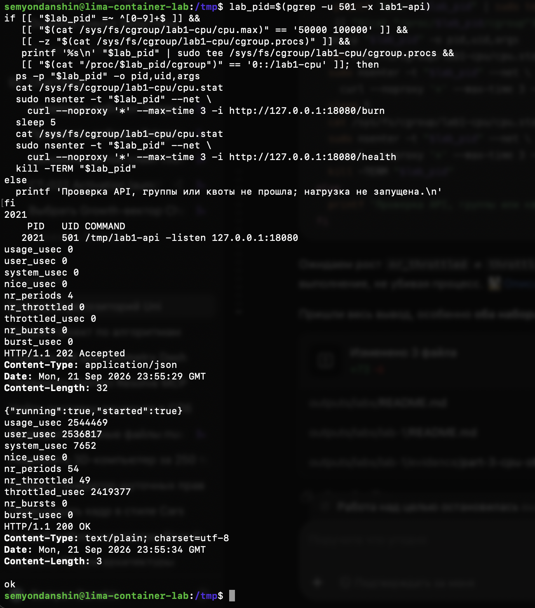

# Часть 3: CPU throttling под нагрузкой

Источник: снимок терминала студента от 22 сентября 2026 года. Выполнен блок проверки CPU из основного отчёта: найдены API, квота `50000 100000` и пустая целевая группа; PID записан в `cgroup.procs`, проверена принадлежность `lab1-cpu`.

Внешнее наблюдение:

```text
2021
    PID   UID COMMAND
   2021   501 /tmp/lab1-api -listen 127.0.0.1:18080
```

Первую строку с PID вывел `tee`. Исходный `cpu.stat` после переноса:

```text
usage_usec 0
user_usec 0
system_usec 0
nice_usec 0
nr_periods 4
nr_throttled 0
throttled_usec 0
nr_bursts 0
burst_usec 0
```

Ответ на `/burn` через `nsenter --net`:

```text
HTTP/1.1 202 Accepted
Content-Type: application/json
Date: Mon, 21 Sep 2026 23:55:29 GMT
Content-Length: 32

{"running":true,"started":true}
```

После `sleep 5` получен второй `cpu.stat`:

```text
usage_usec 2544469
user_usec 2536817
system_usec 7652
nice_usec 0
nr_periods 54
nr_throttled 49
throttled_usec 2419377
nr_bursts 0
burst_usec 0
```

Проверка `/health` под продолжающейся CPU-нагрузкой:

```text
HTTP/1.1 200 OK
Content-Type: text/plain; charset=utf-8
Date: Mon, 21 Sep 2026 23:55:34 GMT
Content-Length: 3

ok
```



## Интерпретация

| Счётчик | До | После | Изменение |
| --- | ---: | ---: | ---: |
| `usage_usec` | 0 | 2544469 | 2544469 мкс ≈ 2,54 с CPU |
| `nr_periods` | 4 | 54 | 50 периодов |
| `nr_throttled` | 0 | 49 | 49 периодов с throttling |
| `throttled_usec` | 0 | 2419377 | 2419377 мкс ≈ 2,42 с накопленного throttling |

За интервал порядка пяти секунд группа получила около 2,54 секунды CPU-времени. Это согласуется с квотой около половины ядра. Деление на ровно пять секунд даёт приблизительно 50,9%, но точная длительность между чтениями не измерялась: интервал включает команды и HTTP-запрос, поэтому эта оценка не является точным измерением процента CPU или доказательством нарушения квоты.

Рост `nr_throttled` и `throttled_usec` подтверждает применение ограничения. Доля 49/50 = 98% относится к периодам, в которых происходил throttling, а не к доле использованного CPU. Определения счётчиков: [документация CPU controller](https://docs.kernel.org/admin-guide/cgroup-v2.html#cpu).

API оставался жив и отвечал на `/health` под нагрузкой. После этой проверки блок выполнил `kill -TERM "$lab_pid"`, чтобы прекратить бесконечную нагрузку; видимых ошибок этой команды на снимке нет. Это предусмотренная остановка по команде пользователя, не действие CPU-квоты. Отдельного наблюдения PID после SIGTERM в снимке нет.

Практический опыт с CPU подтверждён. Проверка понимания пройдена 22 сентября 2026 года: студент объяснил throttling вместо завершения процесса и общую для всей cgroup квоту, не увеличивающуюся при добавлении второго процесса.

Позднее ассистент отдельно прочитал состояние VM: API пользователя 501 с именем `lab1-api` не найден, а `lab1-cpu/cgroup.procs` пуст. Это подтверждает остановку нагрузки после опыта; результат включён в [следующий протокол подготовки](part-3-pids-preflight.md). Ограничение числа процессов пока не проверялось.
