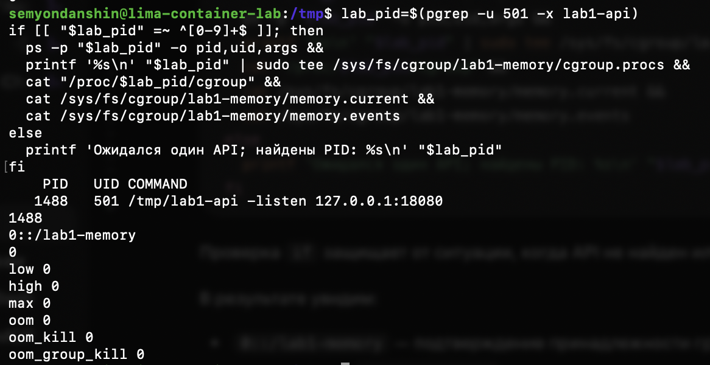

# Часть 3: API в memory cgroup, исходные счётчики

Источник: снимок терминала студента от 22 сентября 2026 года. Выполнен блок переноса API из основного отчёта.

```text
    PID   UID COMMAND
   1488   501 /tmp/lab1-api -listen 127.0.0.1:18080
1488
0::/lab1-memory
0
low 0
high 0
max 0
oom 0
oom_kill 0
oom_group_kill 0
```



Вторую строку с PID `1488` вывел `tee`, записавший PID в `cgroup.procs`. Строка `0::/lab1-memory` получена из `/proc/1488/cgroup` и подтверждает принадлежность процесса новой группе. Следующее отдельное число `0` — значение `memory.current` в байтах. Далее приведены исходные значения `memory.events`: все показанные счётчики равны нулю.

Нулевое `memory.current` не означает отсутствие расхода памяти у API: уже учтённые до переноса страницы не переучитываются автоматически в новой cgroup. Этот снимок подтверждает перенос и исходное состояние, но не OOM. Нагрузка через `/eat` на данном шаге ещё не запускалась.
