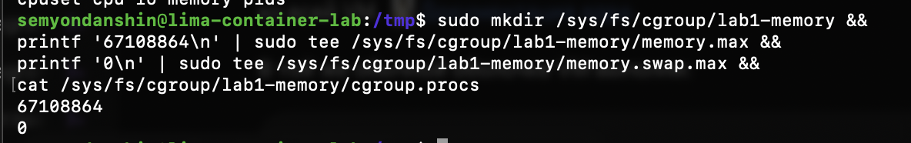

# Часть 3: создание группы с лимитом памяти

Источник: снимок терминала студента от 22 сентября 2026 года. Команды выполнены в обычной оболочке Linux-VM `container-lab`.

```sh
sudo mkdir /sys/fs/cgroup/lab1-memory &&
printf '67108864\n' | sudo tee /sys/fs/cgroup/lab1-memory/memory.max &&
printf '0\n' | sudo tee /sys/fs/cgroup/lab1-memory/memory.swap.max &&
cat /sys/fs/cgroup/lab1-memory/cgroup.procs
```

Видимый вывод:

```text
67108864
0
```



Ошибок на снимке нет. `tee` вывел записанные значения; последующий `cat cgroup.procs` не вывел PID. Результат соответствует созданию пустой группы `lab1-memory`, записи `memory.max = 67108864` и `memory.swap.max = 0`. Отдельное чтение параметров после записи на этом снимке не показано.

API в группу ещё не добавлен. Снимок не подтверждает ограничение его памяти или OOM; нагрузка на этом шаге не запускалась.
