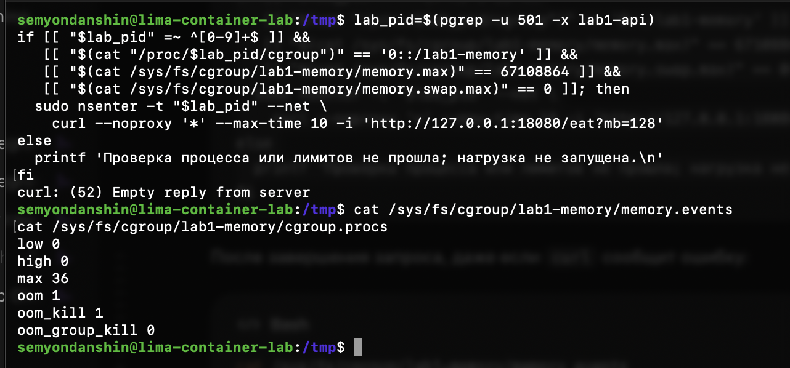

# Часть 3: OOM при превышении лимита памяти

Источник: снимок терминала студента от 22 сентября 2026 года. Перед опытом API с внешним PID 1488 находился в `lab1-memory`; все показанные счётчики `memory.events` были нулевыми — см. [исходное состояние](part-3-memory-baseline.md).

Выполнен блок из основного отчёта: повторно найден единственный API пользователя 501, проверены его принадлежность `lab1-memory`, `memory.max = 67108864` и `memory.swap.max = 0`. Затем через `nsenter --net` отправлен один запрос `/eat?mb=128`. Ветка отказа проверки не сработала; HTTP-клиент сообщил:

```text
curl: (52) Empty reply from server
```

Последующее чтение `/sys/fs/cgroup/lab1-memory/memory.events`:

```text
low 0
high 0
max 36
oom 1
oom_kill 1
oom_group_kill 0
```

Чтение `/sys/fs/cgroup/lab1-memory/cgroup.procs` не вывело PID; оболочка Linux-хоста осталась работоспособной.



## Вывод

При попытке выделить и затронуть 128 MiB новой памяти в группе с лимитом 64 MiB и без swap произошёл OOM. `oom_kill` увеличился с 0 до 1, а список процессов группы опустел. Вместе с исходным состоянием, где в группу был добавлен API, это подтверждает завершение учебного API OOM-killer’ом.

`max = 36` — число событий, когда потребление группы собиралось превысить `memory.max`, а не число завершённых процессов. Для числа процессов, завершённых OOM-killer’ом, используется `oom_kill`. Значение `oom_group_kill = 0` не отменяет OOM: группового уничтожения как отдельного механизма здесь не зафиксировано. Определения: [документация memory controller](https://docs.kernel.org/admin-guide/cgroup-v2.html#memory).

Ошибка `curl` сама по себе не доказывала бы OOM; доказательством служат изменения счётчиков и отсутствие живых процессов в группе. Успешное выделение всех 128 MiB не утверждается: процесс завершился в ходе обработки запроса. Код выхода API и журнал ядра в присланный снимок не входили.

Практический опыт с памятью выполнен. Проверка понимания пройдена 22 сентября 2026 года: студент связал завершение API с лимитом cgroup и объяснил недоступность сервиса гибелью процесса. В обсуждении уточнено, что недоступность сама по себе недостаточна для диагноза OOM, в отличие от зафиксированного роста `oom_kill`. CPU throttling и ограничение числа процессов этим опытом не проверяются.
