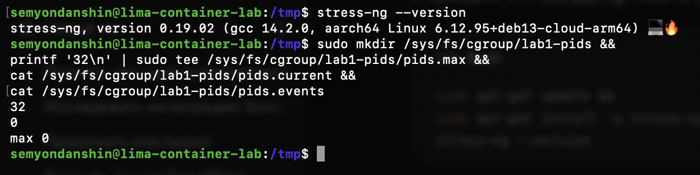

# Часть 3: stress-ng и исходное состояние pids-группы

Источник: снимок терминала студента от 22 сентября 2026 года.

Показана установленная версия:

```text
stress-ng, version 0.19.02 (gcc 14.2.0, aarch64 Linux 6.12.95+deb13-cloud-arm64)
```

Выполнены команды создания группы и чтения счётчиков:

```sh
sudo mkdir /sys/fs/cgroup/lab1-pids &&
printf '32\n' | sudo tee /sys/fs/cgroup/lab1-pids/pids.max &&
cat /sys/fs/cgroup/lab1-pids/pids.current &&
cat /sys/fs/cgroup/lab1-pids/pids.events
```

Вывод:

```text
32
0
max 0
```



## Дополнительная проверка ассистента

Read-only команды через `limactl shell` подтвердили поддержку установленной версией `--fork`, `--fork-max`, `--timeout`, `--metrics-brief`. У `setpriv` доступны `--reuid`, `--regid`, `--init-groups`; найден `/usr/bin/timeout`.

Повторное чтение файлов группы дало:

| Файл | Результат |
| --- | --- |
| `pids.max` | `32` |
| `pids.current` | `0` |
| `pids.peak` | `0` |
| `pids.events` | `max 0` |
| `cgroup.procs` | Пусто |

На этом шаге нагрузка не запускалась. Подтверждены инструмент, лимит и исходные значения, но не срабатывание ограничения.
