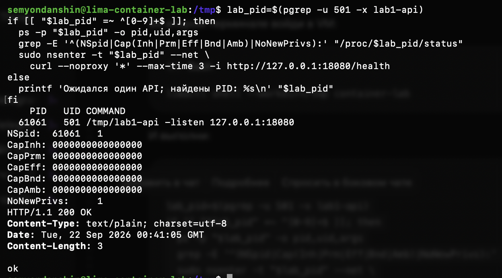

# Часть 4: API отвечает без capabilities

Источник: снимок терминала студента от 22 сентября 2026 года. Проверка после запуска `/tmp/lab1-api -listen 127.0.0.1:18080` вместо изолированной оболочки с удалёнными capabilities. Предыдущий результат — [отказ смены hostname](part-4-capabilities-denied.md).

## Полученный вывод

В обычной оболочке Linux VM найден единственный API с UID 501:

```text
PID   UID COMMAND
61061 501 /tmp/lab1-api -listen 127.0.0.1:18080
NSpid: 61061 1
CapInh: 0000000000000000
CapPrm: 0000000000000000
CapEff: 0000000000000000
CapBnd: 0000000000000000
CapAmb: 0000000000000000
NoNewPrivs: 1
HTTP/1.1 200 OK
Content-Type: text/plain; charset=utf-8
Date: Tue, 22 Sep 2026 00:41:05 GMT
Content-Length: 3

ok
```

HTTP-запрос выполнен через `sudo nsenter -t "$lab_pid" --net curl ...`, с отключением proxy и таймаутом 3 секунды. Проверяющий curl вошёл в сетевой namespace API; capabilities прочитаны непосредственно из `/proc/61061/status` самого сервиса, а не проверяющего процесса.



## Вывод и границы проверки

API имеет PID 61061 и UID 501 с точки зрения VM, а внутри своего PID namespace — PID 1. Все пять наборов capabilities нулевые, `NoNewPrivs = 1`. Несмотря на снятие полномочий, `/health` отвечает HTTP 200 с телом `ok`.

Вместе с предыдущим опытом это подтверждает две стороны ограничения: смена hostname стала недоступна, но проверенная HTTP-функция сервиса работает. Ответ `/health` не доказывает доступность всех операций приложения, полную защищённость процесса или применение seccomp. API на снимке работает; его остановка этим протоколом не подтверждена.

Практическая проверка capabilities завершена. В последующем сообщении от 22 сентября студент верно объяснил различие между требующей полномочий сменой hostname и проверенной работой HTTP-сервиса. Ответ о наследовании удалённых прав уточнён как сохранение ограничений через exec в том же user namespace, без восстановления capabilities. Проверка понимания завершена. На время ночного перерыва остановились перед seccomp; новые эксперименты не начаты.

Оригинальный снимок сохранён без изменений. SHA-256: `4d30396ec66beb0ea2b487707ba07370ba7bf88e9f94aae514bd4dc25005d32c`.
