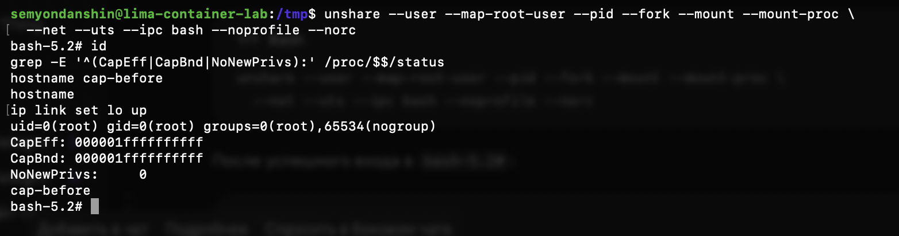

# Часть 4: capabilities до удаления полномочий

Источник: снимок терминала студента от 22 сентября 2026 года. В обычной оболочке VM `container-lab` выполнен rootless `unshare` с user, pid, mount, net, uts и ipc namespaces. В новой оболочке проверены UID и capabilities, изменён hostname, отправлена команда поднятия loopback.

## Наблюдения

```text
uid=0(root) gid=0(root) groups=0(root),65534(nogroup)
CapEff: 000001ffffffffff
CapBnd: 000001ffffffffff
NoNewPrivs: 0
cap-before
```

После `hostname cap-before` чтение hostname вернуло `cap-before`. Команда `ip link set lo up` завершилась без видимого сообщения об ошибке; состояние интерфейса отдельным чтением на снимке не показано. Оболочка осталась открытой.



## Вывод и границы доказательства

UID внутри user namespace равен 0. Действующий и ограничивающий наборы capabilities ненулевые; маска соответствует битам 0–40, что согласуется с ранее прочитанным `cap_last_cap = 40`. Это полномочия в созданном user namespace, а не root-права на VM или macOS.

Успешная смена hostname — положительная контрольная проверка перед удалением capabilities. После удаления повторим то же действие в том же UTS namespace и сравним результат. Само удаление полномочий, отказ смены hostname и работа API без capabilities пока не проверены; seccomp не начат.

Оригинальный снимок сохранён без изменений. SHA-256: `18861b39f027dab5c01973209619174c69c6a6b369caf654509c6aa2fa50821f`.
