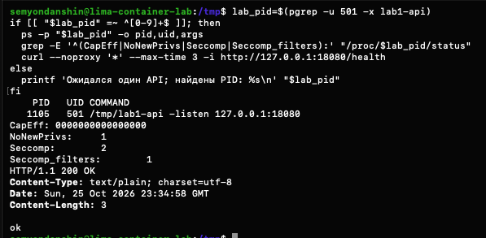

# Часть 4: HTTP API под seccomp-фильтром

Источник: снимок терминала студента от 26 октября 2026 года. Продолжение [опыта с getppid](part-4-seccomp-getppid.md). API запущен через тот же загрузчик с профилем, возвращающим `EPERM` для getppid и разрешающим остальные системные вызовы.

Во втором терминале обычной оболочки VM найден единственный процесс `lab1-api` от UID 501. Состояние прочитано непосредственно из `/proc/1105/status` API, затем выполнен запрос к его listener в общей сети VM.

## Полученный вывод

```text
PID  UID COMMAND
1105 501 /tmp/lab1-api -listen 127.0.0.1:18080
CapEff: 0000000000000000
NoNewPrivs: 1
Seccomp: 2
Seccomp_filters: 1
HTTP/1.1 200 OK
Content-Type: text/plain; charset=utf-8
Date: Sun, 25 Oct 2026 23:34:58 GMT
Content-Length: 3

ok
```

HTTP Date соответствует 26 октября 2026 года, 02:34:58 по Москве.



## Вывод и границы проверки

У процесса API нулевой действующий набор capabilities, `NoNewPrivs = 1`, режим фильтрации seccomp и один фильтр. После замены загрузчика сервисом через exec фильтр остался активным. Несмотря на запрет getppid, проверенный `/health` отвечает HTTP 200 с телом `ok`.

В этом опыте не создавались новые namespaces: PID 1105 относится к обычному представлению VM. Совместный запуск namespaces, cgroups и ограничений привилегий относится к следующей части 5. Ответ `/health` подтверждает работоспособность этого эндпоинта под профилем, а не всех функций API или полноту защиты. API на момент снимка работает; его остановка не подтверждена.

Практика seccomp завершена. В последующем сообщении 26 октября студент верно различил capabilities и фильтрацию syscall, объяснил наследование фильтра дочерними процессами и сохранение после exec. Проверка понимания пройдена, часть 4 закрыта. Начат отдельный этап сборки единого запускателя; результаты этого этапа в данный протокол не входят.

Оригинал сохранён без изменений. SHA-256: `869ab6e45adc9eaf81f8ace935ebb22e032be772e8b5c7950b5c2a3e739d71b0`.
