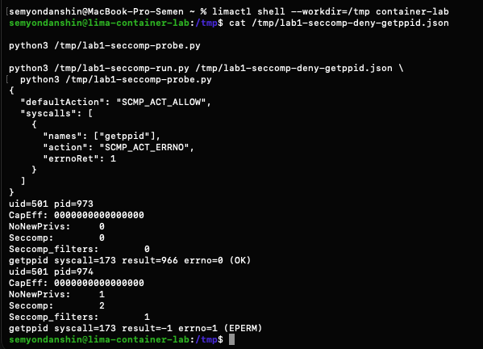

# Часть 4: getppid до и после seccomp-фильтра

Источник: снимок терминала студента от 26 октября 2026 года. В обычной оболочке Linux VM `container-lab` прочитан профиль и выполнена одна probe сначала напрямую, затем через загрузчик seccomp.

Профиль: `defaultAction = SCMP_ACT_ALLOW`; правило для `getppid`: `SCMP_ACT_ERRNO`, `errnoRet = 1` (`EPERM`). Исходники и команды — [опыт seccomp](../seccomp/README.md).

## Без фильтра

```text
uid=501 pid=973
CapEff: 0000000000000000
NoNewPrivs: 0
Seccomp: 0
Seccomp_filters: 0
getppid syscall=173 result=966 errno=0 (OK)
```

## С фильтром

```text
uid=501 pid=974
CapEff: 0000000000000000
NoNewPrivs: 1
Seccomp: 2
Seccomp_filters: 1
getppid syscall=173 result=-1 errno=1 (EPERM)
```



## Вывод

Оба запуска идут с UID 501 и нулевыми действующими capabilities. Без фильтра syscall 173 возвращает PID родителя 966; с фильтром возвращает -1 и errno 1. Отказ выбранного системного вызова подтверждён в режиме seccomp filter (`Seccomp = 2`), число фильтров равно 1. Изменение результата нельзя объяснить удалением capabilities: `CapEff` нулевой в обоих запусках. Загрузчик заменил себя probe через exec; фильтр действует у этой probe.

PID 973 и 974 относятся к двум отдельным запускам программы, а не к внутреннему и внешнему PID одного процесса. `Seccomp: 2` обозначает режим фильтрации, не число фильтров.

Проверка API под фильтром и проверка понимания ещё предстоят. Этот профиль с одним запретом — учебное доказательство действия seccomp, не исчерпывающая политика ограничения API.

Оригинал сохранён без изменений. SHA-256: `182f3f69bb0d2002cdf7528ba54a036556650f5be5c0efded7a77ece53f9bb75`.
