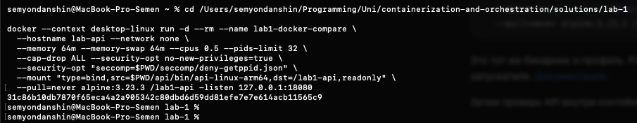
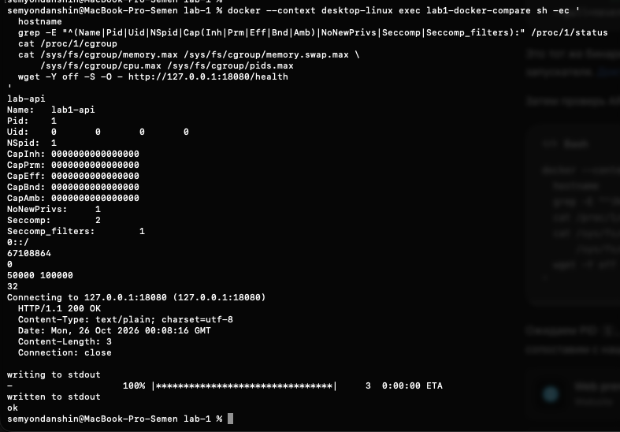

# Часть 5.3: тот же API через Docker

Источник: два снимка терминала студента от 26 октября 2026 года и дополнительные read-only проверки ассистента. Выполнены команды из [инструкции сравнения](../part-5-docker-compare.md): локальный Alpine 3.23.3, тот же статический ARM64-бинарник через read-only bind mount, тот же seccomp-профиль и сопоставимые resource limits.

## Запуск

`docker run` вернул ID:

```text
31c86b10db7870f65eca4a2a905342c80dbd6d59dd81efe7e7e614acb11565c9
```



## Проверка внутри контейнера

```text
lab-api
Name: lab1-api
Pid: 1
Uid: 0 0 0 0
NSpid: 1
CapInh: 0000000000000000
CapPrm: 0000000000000000
CapEff: 0000000000000000
CapBnd: 0000000000000000
CapAmb: 0000000000000000
NoNewPrivs: 1
Seccomp: 2
Seccomp_filters: 1
0::/
67108864
0
50000 100000
32
HTTP/1.1 200 OK
Content-Type: text/plain; charset=utf-8
Date: Mon, 26 Oct 2026 00:08:16 GMT
Content-Length: 3
Connection: close

ok
```

Лимиты прочитаны в порядке memory.max, memory.swap.max, cpu.max, pids.max. Capabilities/seccomp прочитаны у API из `/proc/1/status`, а HTTP-запрос выполнен wget через docker exec в сетевом namespace контейнера.



## Дополнительные проверки ассистента

`docker inspect` и `docker top` только указанного учебного контейнера показали:

```text
running=true
LinuxHostPID=729
Config.User=""
UsernsMode=""
CgroupnsMode="private"
NetworkMode="none"
Image="alpine:3.23.3"
ReadonlyRootfs=false
CapDrop=["ALL"]
Memory=67108864
MemorySwap=67108864
NanoCpus=500000000
PidsLimit=32

PID PPID UID COMMAND
729 705  0  lab1-api
```

Единственный bind mount — подготовленный файл `api/bin/api-linux-arm64` в `/lab1-api`, `RW=false`. PID 729 и UID 0 относятся к Linux VM Docker Desktop, не к представлению процессов macOS. В этом запуске UID remapping к 501 не применяется. При этом capabilities процесса нулевые, seccomp активен: UID 0 не отменяет этих ограничений.

На момент дополнительных проверок Docker-контейнер работает. В Lima `lab1-api` больше не найден ни по UID 501, ни среди процессов с этим именем; `lab1-mydocker/cgroup.events` показывает `populated 0`, `frozen 0`, `cgroup.procs` пуст. Причина завершения прежнего API не устанавливалась; успешный сентябрьский и октябрьский вывод остаётся историческим результатом, не утверждением о текущем запуске. Ассистент процессы не останавливал.

## Вывод

Одинаковые настройки дали PID 1, тот же hostname, нулевые capabilities, no_new_privs, режим seccomp filter, 64 MiB RAM без swap, квоту 0,5 CPU и 32 задачи. `/health` отвечает HTTP 200 с `ok`. Docker дополнительно предоставил rootfs образа и управление контейнером; различия UID mapping и cgroup namespace отмечены в [сравнении](../part-5-docker-compare.md). Нагрузочный бенчмарк двух Linux VM не проводился. В последующем сообщении студент верно объяснил корень cgroup namespace и необходимость отдельного rootfs со сменой корня процесса. Финальная проверка понимания пройдена, часть 5 завершена.

Оригиналы сохранены без изменений:

- `part-5-docker-start.png`: SHA-256 `07ca7fd76e66378fc1dbf46fc055eb156a1f1177a6878e8ae06a35c942955dba`.
- `part-5-docker-health.png`: SHA-256 `fb8c405c084f3add1991275329645c1417580d416a4316293cfcf6d5876c83de`.
