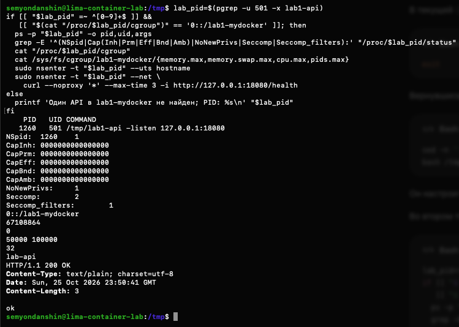

# Часть 5.2: API через единый mydocker.sh

Источник: снимок терминала студента от 26 октября 2026 года. После выхода из оболочки первого каркаса запущена обновлённая версия `mydocker.sh`, объединяющая cgroup, namespaces, capabilities и seccomp.

Проверка во втором терминале выполнялась только при нахождении одного API от UID 501 в cgroup `0::/lab1-mydocker`.

## Полученный вывод

```text
PID  UID COMMAND
1260 501 /tmp/lab1-api -listen 127.0.0.1:18080
NSpid: 1260 1
CapInh: 0000000000000000
CapPrm: 0000000000000000
CapEff: 0000000000000000
CapBnd: 0000000000000000
CapAmb: 0000000000000000
NoNewPrivs: 1
Seccomp: 2
Seccomp_filters: 1
0::/lab1-mydocker
67108864
0
50000 100000
32
lab-api
HTTP/1.1 200 OK
Content-Type: text/plain; charset=utf-8
Date: Sun, 25 Oct 2026 23:50:41 GMT
Content-Length: 3

ok
```

Лимиты прочитаны в порядке memory.max, memory.swap.max, cpu.max, pids.max. Hostname прочитан через `nsenter --uts`; HTTP-проверка выполнена через `nsenter --net` в сетевом namespace API. Capabilities и seccomp прочитаны у самого API из `/proc/1260/status`, не у проверяющего процесса.



## Вывод

Единый запускатель работает: API с внешним PID 1260 и UID 501 имеет PID 1 внутри, нужную cgroup, лимит 64 MiB без swap, квоту 0,5 CPU и лимит 32 задачи. Все пять наборов capabilities нулевые, no_new_privs включён, активен один seccomp-фильтр. UTS hostname — `lab-api`; `/health` отвечает HTTP 200 с `ok` через отдельную сеть процесса.

Это подтверждение совместного применения настроек и работоспособности проверенного эндпоинта. Нагрузочные OOM/CPU/fork-опыты в этом запуске не повторялись. API на момент снимка работает. В последующем сообщении студент верно объяснил порядок настройки hostname/сети перед удалением capabilities и назначение cgroup до создания потомков. Проверка понимания сборки пройдена; затем [выполнено сравнение с Docker](part-5-docker-comparison.md). При дополнительной проверке на этапе Docker API в Lima уже отсутствовал и группа была пуста; причина завершения не устанавливалась.

Оригинал сохранён без изменений. SHA-256: `850ed65ccf1ee53c34dee341259e9721f65ecb99781e56c49fb57d71ae352802`.
