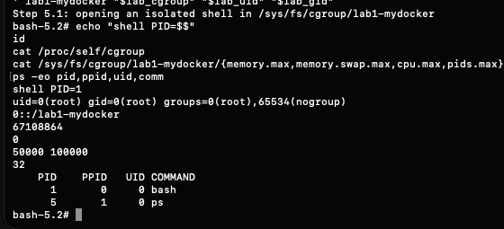

# Часть 5.1: cgroup и namespaces в одном запуске

Источник: снимок терминала студента от 26 октября 2026 года. Запущена первая версия каркаса `mydocker.sh`, открывающая оболочку в шести namespaces и группе `lab1-mydocker`.

```text
Step 5.1: opening an isolated shell in /sys/fs/cgroup/lab1-mydocker
shell PID=1
uid=0(root) gid=0(root) groups=0(root),65534(nogroup)
0::/lab1-mydocker
67108864
0
50000 100000
32
PID PPID UID COMMAND
  1    0   0 bash
  5    1   0 ps
```

Значения лимитов прочитаны в порядке `memory.max`, `memory.swap.max`, `cpu.max`, `pids.max`.



## Вывод

Один запуск каркаса поместил оболочку в отдельные namespaces и ограниченную cgroup. Внутри PID 1, UID 0, видны bash и проверяющий ps; путь cgroup — `0::/lab1-mydocker`. Подтверждены 64 MiB, запрет swap, квота 0,5 CPU и 32 задачи. Это не повторный нагрузочный тест, а проверка совместного применения настроек.

Дополнительное чтение ассистентом из обычной VM: `cgroup.procs` содержит 1192 и 1193, `cgroup.events` — `populated 1`, `frozen 0`; API от UID 501 не найден. PID группы снаружи и внутренний PID оболочки — разные представления; в группу входит также внешний родитель unshare. Оболочка пока открыта. API, capabilities и seccomp в этой версии каркаса ещё не запускались.

Далее скрипт дополнен запуском API под всеми ограничениями. Результаты новой версии ожидаются и данным снимком не подтверждаются.

Оригинал сохранён без изменений. SHA-256: `8b11b77a8c8c8522953a0abe4fa965e657aeda566bb71c126f2bd33f374ef656`.
