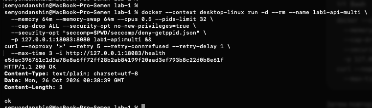
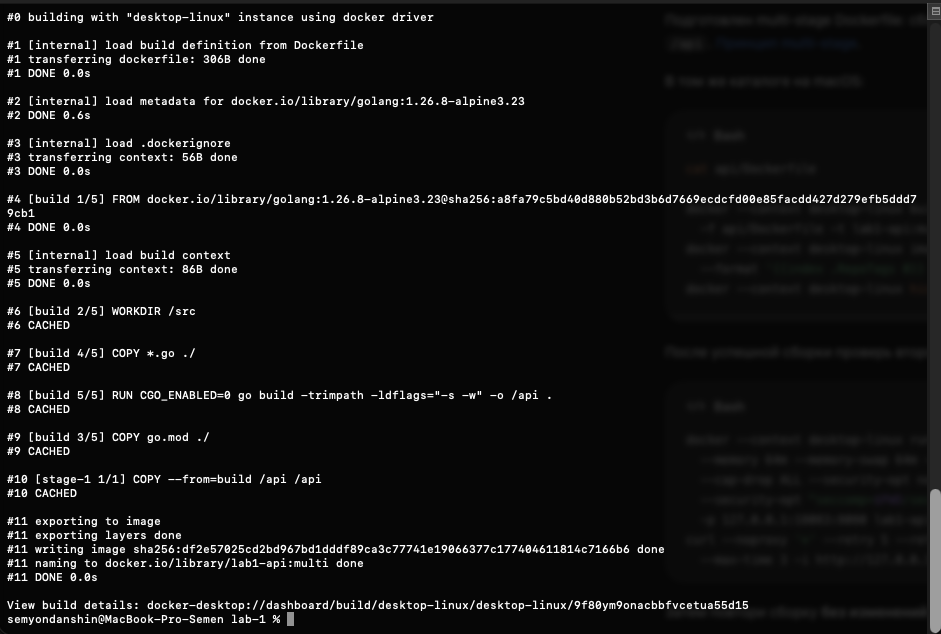

# Часть 6.2–6.3: multi-stage и повторная сборка

Источник: три снимка студента от 26 октября 2026 года; дополнительные read-only проверки образов, контейнера и хешей бинарника. Выполнены команды из [части 6](../part-6-images.md).

## Сравнение образов

| Показатель | Single | Multi-stage |
| --- | ---: | ---: |
| Size, байт | 331828006 | 5636258 |
| MB, десятичные | 331,83 | 5,64 |
| RootFS.Layers | 9 | 1 |
| HTTP health | 200 ok | 200 ok |

Уменьшение Size — 326191748 байт, около 98,30%; multi-stage примерно в 58,87 раза меньше. Сравнивается локальный Size двух образов одного приложения, не расход RAM, размер registry-transfer или скорость запросов.

```text
single ID=sha256:589256268ada1062cdf95b0a420187dad1af541bc87e89fab71edddce4229d2b
multi  ID=sha256:df2e57025cd2bd967bd1dddf89ca3c77741e19066377c177404611814c7166b6
```

В history финального multi-stage образа один COPY `/api /api`, около 5,64 MB. USER, EXPOSE, ENTRYPOINT и CMD имеют нулевой размер; слои Go SDK/build-stage в финальный rootfs не вошли.


Ассистент скопировал только `/api` из обоих работающих учебных контейнеров во временный каталог для read-only сравнения. SHA-256 обоих файлов одинаковый: `8c794d09a9c9dff4abb2d0eb92acd8b80e78c35487982cd38bbc5917a26f568a`. Разница образов получена при одинаковом бинарнике, не из-за иной версии кода или флагов компиляции.

## HTTP-проверка multi-stage

```text
container ID=e5dac396761c1d3a78e8a6ff72ff28b2ab84199f20aad3ef793b8c22d0b8e61f
HTTP/1.1 200 OK
Content-Type: text/plain; charset=utf-8
Date: Mon, 26 Oct 2026 00:38:39 GMT
Content-Length: 3

ok
```



Inspect подтвердил running=true, UID/GID `65532:65532`, правильный Image ID и публикацию 8080/tcp на 127.0.0.1:18083. Бинарник находится в образе, bind mount приложения не используется. Контейнер ассистентом не запускался и не останавливался.

## Повторная сборка без изменений

На снимке BuildKit переиспользовал:

```text
[build 2/5] WORKDIR /src                         CACHED
[build 4/5] COPY *.go ./                        CACHED
[build 5/5] RUN CGO_ENABLED=0 go build ...        CACHED
[build 3/5] COPY go.mod ./                      CACHED
[stage-1 1/1] COPY --from=build /api /api        CACHED
```

Порядок отображения строк лога сохранён по снимку; он не меняет зависимости Dockerfile. Также показаны отдельная загрузка metadata, передача контекста и экспорт. Финальный Image ID остался `df2e57025cd2...`. Снимок доказывает reuse cache при неизменных входах; эксперимент с изменением исходников не проводился.



## Вывод

Обычная и multi-stage сборки, размеры/слои, HTTP и cache-reuse подтверждены. Builder даёт готовый статический бинарник, финальная стадия scratch содержит его без SDK/исходников/build cache. В последующем сообщении студент верно объяснил выборочный перенос бинарника из builder и инвалидацию COPY/RUN при изменении исходников. Проверка понимания образов/cache пройдена. Volume-опыт ещё не выполнен, часть 6 целиком не завершена.

Оригиналы сохранены без изменений:

- `part-6-multi-image.png`: SHA-256 `6c8eb3f6ee52f62a5d39d819c37563a91070f70a761b9b0a67a161d8a3593113`.
- `part-6-multi-health.png`: SHA-256 `f599ef0d3db3884b9b3b4521222c6492aa6a35d66a3b3c757b7d3b2520f7041f`.
- `part-6-build-cache.png`: SHA-256 `ad4ae0fe0da8a3d639dc4146591d12e0edf5732d958d501c7726b62d570e47a1`.
