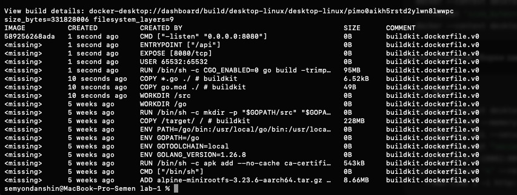
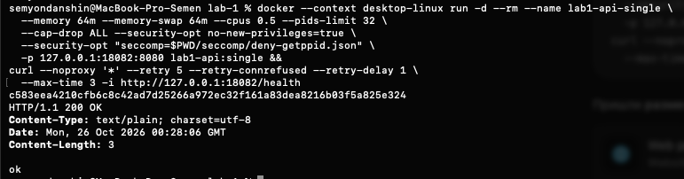

# Часть 6.1: одноэтапный образ

Источник: два снимка студента от 26 октября 2026 года и дополнительные read-only проверки Docker metadata и бинарника. Выполнены build/inspect/history и запуск из [инструкции части 6](../part-6-images.md).

## Образ и слои

```text
ID=sha256:589256268ada1062cdf95b0a420187dad1af541bc87e89fab71edddce4229d2b
size_bytes=331828006
filesystem_layers=9
user=65532:65532
entrypoint=["/api"]
cmd=["-listen","0.0.0.0:8080"]
```

Это примерно 331,83 MB или 316,46 MiB. History показывает, в частности, около 228 MB для COPY Go SDK, 95 MB для RUN go build, 8,66 MB для Alpine и небольшие COPY исходников/go.mod. USER, EXPOSE, ENTRYPOINT и CMD имеют нулевой размер в history и не добавляют содержимое файлов в rootfs.



При дополнительной проверке работающего контейнера сам `/api` имеет размер 5636258 байт и SHA-256 `8c794d09a9c9dff4abb2d0eb92acd8b80e78c35487982cd38bbc5917a26f568a`. Следовательно, 95 MB у RUN не следует принимать за размер только бинарника: в слое остаются также результаты работы toolchain/cache.

## Запуск и health

Создан контейнер:

```text
c583eea4210cfb6c8c42ad7d25266a972ec32f161a83dea8216b03f5a825e324
HTTP/1.1 200 OK
Content-Type: text/plain; charset=utf-8
Date: Mon, 26 Oct 2026 00:28:06 GMT
Content-Length: 3

ok
```



Дополнительный inspect подтверждает `running=true`, совпадение Image ID с собранным образом и публикацию 8080/tcp на 127.0.0.1:18082. API запущен из самого образа без подключения бинарника с хоста. Ассистент контейнер не создавал и не останавливал; диагностический exec только прочитал размер и хеш бинарника.

Одноэтапная сборка и HTTP-проверка подтверждены. Multi-stage, повторная сборка и опыты с volume ещё предстоят; проверка понимания части 6 не пройдена.

Оригиналы сохранены без изменений:

- `part-6-single-image.png`: SHA-256 `df1a9dc8a3d710c51bc856b432ae78c0f638c9432523fb5a12d4702fbe99e68e`.
- `part-6-single-health.png`: SHA-256 `11212357dbb718896db0e37a3d1d2aaff7159e8ff73914fe320dd242bf63e4a8`.
