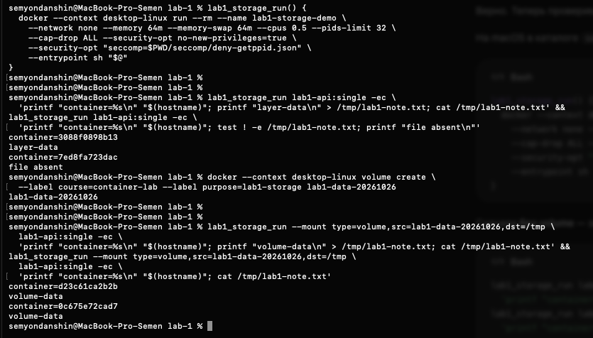

# Часть 6.4: файл без volume и с named volume

Источник: снимок терминала студента от 26 октября 2026 года. Выполнен [файловый опыт](../part-6-volumes.md) на lab1-api:single с entrypoint sh. Все четыре запуска использовали --rm и одно учебное имя lab1-storage-demo; каждый завершившийся контейнер удалялся до следующего запуска.

## Без volume

Первый контейнер записал `/tmp/lab1-note.txt`, второй проверил отсутствие файла:

```text
container=3088f0898b13
layer-data
container=7ed8fa723dac
file absent
```

Два разных идентификатора подтверждают пересоздание. Файл существовал в writable layer первого контейнера; второй создан из неизменного образа и файла не получил.

## С named volume

Создан lab1-data-20261026 с метками course=container-lab и purpose=lab1-storage. Оба новых контейнера подключили его к /tmp:

```text
lab1-data-20261026
container=d23c61ca2b2b
volume-data
container=0c675e72cad7
volume-data
```

В первом контейнере файл записан, во втором прочитан без повторной записи. Разные идентификаторы и одинаковое содержимое подтверждают сохранение данных через общий named volume после удаления первого контейнера.



## Дополнительная read-only проверка

```text
name=lab1-data-20261026
driver=local
labels={"course":"container-lab","purpose":"lab1-storage"}
```

Поиск контейнера с точным именем lab1-storage-demo не вернул результатов. Named volume остался, одноразовые контейнеры удалились. Ассистент volume/marker не создавал и не удалял, данные напрямую из Docker storage не читались. Учебный volume с файлом оставлен для дальнейшего использования.

## Вывод

Runtime-запись не изменила исходный образ. Writable layer связан с конкретным контейнером и удалился вместе с ним; named volume имеет отдельный жизненный цикл и сохранил файл. Этот опыт проверяет удаление/пересоздание, а не обычный stop/start одного сохранённого контейнера. Отдельный опыт stop/start не выполнялся.

Практика и финальная проверка понимания части 6 завершены 26 октября: студент верно объяснил сохранение writable layer через stop/start и отдельный жизненный цикл named volume. Источник семантики: [Docker storage](https://docs.docker.com/engine/storage/), [volume lifecycle](https://docs.docker.com/engine/storage/volumes/).

Оригинал сохранён без изменений. SHA-256: `dd9b70fc97666f5029a41f8e6d025f9b2a1aa50f807d772b95514a8a2f089976`.
