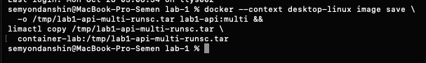

# Часть 7: тот же образ API работает под gVisor

Источник: два снимка терминала студента от 26 октября 2026 года, дополненные read-only проверкой.

## Перенос образа

Образ lab1-api:multi экспортирован из Docker Desktop командой image save и перенесён через limactl copy. В Lima выполнен docker image load. Получен тот же image ID:

```text
sha256:df2e57025cd2bd967bd1dddf89ca3c77741e19066377c177404611814c7166b6
```



## Запуск API

Контейнер lab1-api-gvisor создан через --runtime=runsc, hostname lab-api, cap-drop ALL, no-new-privileges=true, порт 127.0.0.1:18084:8080 внутри Lima.

```text
container=3a84628c00fed07f9bf00e264306590aceaacb6c516c4fcd49969a3a8edaa3b7
status=running runtime=runsc
image=sha256:df2e57025cd2bd967bd1dddf89ca3c77741e19066377c177404611814c7166b6
API log: listen=0.0.0.0:8080 pid=1 uid=65532
HTTP/1.1 200 OK
Content-Length: 3
ok
```


## Дополнительная проверка на хосте VM

docker inspect подтвердил status=running, runtime=runsc, прежний image ID, Config.User=65532:65532, CapDrop=[ALL], SecurityOpt=[no-new-privileges=true]. Повторный GET /health из VM вернул 200 и ok.

State.Pid=9383. Прямой ps на хосте VM и readlink /proc/9383/exe показали:

```text
PID=9383 PPID=9357 UID=0 COMMAND=gvisor_sentry
exe=/usr/bin/gvisor-bin/gvisor_sentry
args: runsc-sandbox ... --platform=systrap --systemd-cgroup=true ... boot ...
cgroup=0::/system.slice/docker-3a84628c00fed07f9bf00e264306590aceaacb6c516c4fcd49969a3a8edaa3b7.scope
```

State.Pid относится к Sentry, а не к отдельному host-процессу Go API. Внутренний PID 1 приложения относится к виртуальной таблице процессов gVisor. UID из ps Sentry не следует переносить на UID приложения или трактовать как неограниченные полномочия: проверка полного набора host-привилегий Sentry здесь не проводилась.

Дополнительный docker top вернул строку systemd с PID 1; этот вывод не использован как представление процессов sandbox или доказательство утечки изоляции. Для установления host-процесса использованы State.Pid и прямой ps/readlink по нему.

Индивидуальные memory/CPU/pids лимиты в этом запуске не задавались; /eat и /burn не вызывались. Подтверждены перенос образа, выбор runtime, фактический Sentry и работа HTTP, без сравнительного бенчмарка или проверки атак на sandbox. Контейнер оставлен работающим, ассистент его не запускал и не останавливал.

Оригиналы сохранены без изменений. SHA-256:

- part-7-image-transfer.png: `17228aa1589301bb197306a294c98c5e23b35c2599886583db61ebcdf63dae4b`
- part-7-api-health.png: `2a5413cc2f8f5c508aa8dcbb2fd4b74d1793afe38ba429a6917285defa87d8b9`
