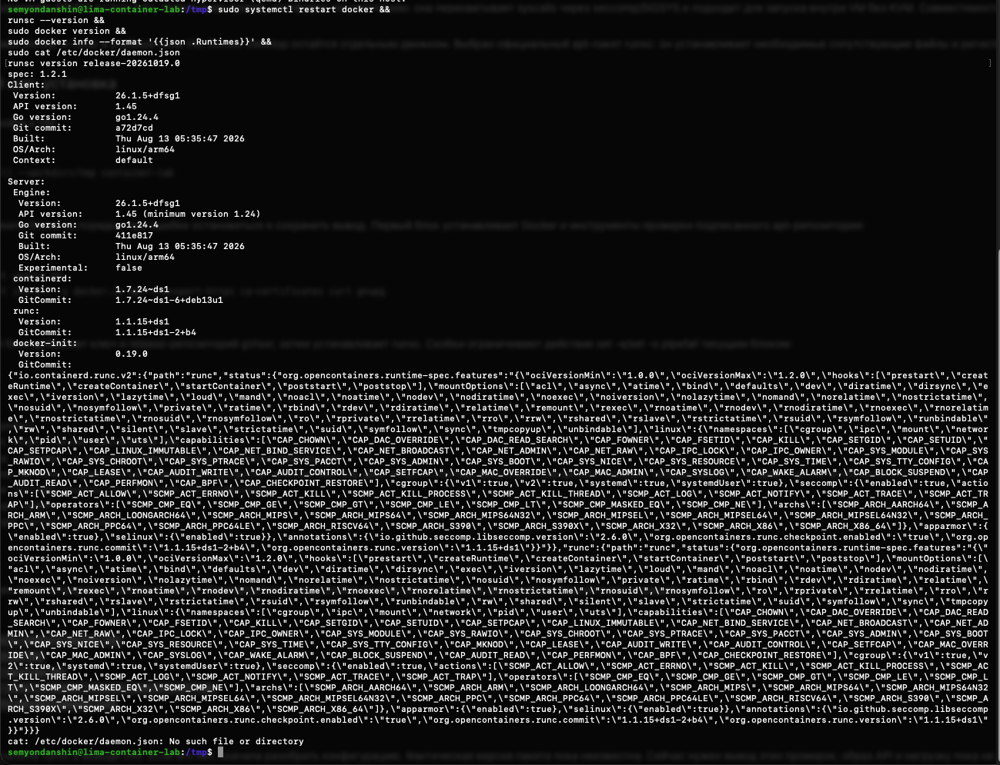

# Часть 7: установка Docker и runsc в Lima

Источник: снимок терминала студента 26 октября 2026 года и дополнительная read-only проверка VM.

```text
runsc version release-20261019.0
spec: 1.2.1
Docker Client/Server: 26.1.5+dfsg1, linux/arm64
containerd: 1.7.24~ds1
runc: 1.1.15+ds1
docker-init: 0.19.0
cat: /etc/docker/daemon.json: No such file or directory
```

В списке runtimes присутствуют только io.containerd.runc.v2 и runc. Установка пакета подтверждена, регистрация runsc в Docker пока отсутствует.



Дополнительная проверка: dpkg-query возвращает runsc 20261019.0, бинарник находится в /usr/bin/runsc. Пакет содержит /usr/bin/gvisor-bin/ с gvisor_sentry и другими сопутствующими файлами. Скрипт /var/lib/dpkg/info/runsc.postinst выполняет runsc install --clobber=false только внутри условия [ -f /etc/docker/daemon.json ]. Отсутствие файла объясняет пропуск авторегистрации. Ассистент конфигурацию VM не менял.

Подготовлена [явная регистрация](../part-7-gvisor.md#выполненный-шаг-регистрация-runtime) с --platform=systrap; затем [регистрация выполнена](part-7-runtime-registered.md), после неё [API запущен](part-7-api.md).

Оригинал сохранён без изменений. SHA-256: `b8b999c6fbc23107048411ea661edd10237c6878ea5856a95b2035149acf3fe4`.
