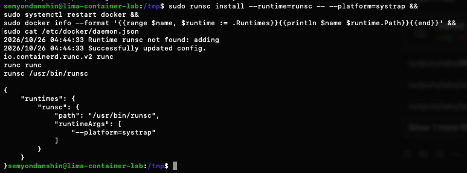

# Часть 7: runtime runsc зарегистрирован

Источник: снимок терминала студента 26 октября 2026 года. Выполнены runsc install с --platform=systrap, перезапуск Docker и проверка конфигурации.

```text
Runtime runsc not found: adding
Successfully updated config.
io.containerd.runc.v2 runc
runc runc
runsc /usr/bin/runsc
```

```json
{
  "runtimes": {
    "runsc": {
      "path": "/usr/bin/runsc",
      "runtimeArgs": ["--platform=systrap"]
    }
  }
}
```



Дополнительное чтение daemon.json и docker info подтвердило регистрацию. На момент проверки образы и контейнеры в Docker Lima отсутствовали, порт 18084 был свободен. Ассистент runtime не регистрировал и контейнер не запускал. Регистрация даёт возможность выбрать runtime; на момент этого снимка запуск ещё не был выполнен. Позже [API запущен и проверен](part-7-api.md).

Следующий опыт — [перенос и запуск API](../part-7-gvisor.md#выполненный-шаг-тот-же-образ-под-gvisor).

Оригинал сохранён без изменений. SHA-256: `3ac9df70ccd26b829c63df5e34eb4343e1623d5c988fa709289cab00ac0e9bbf`.
