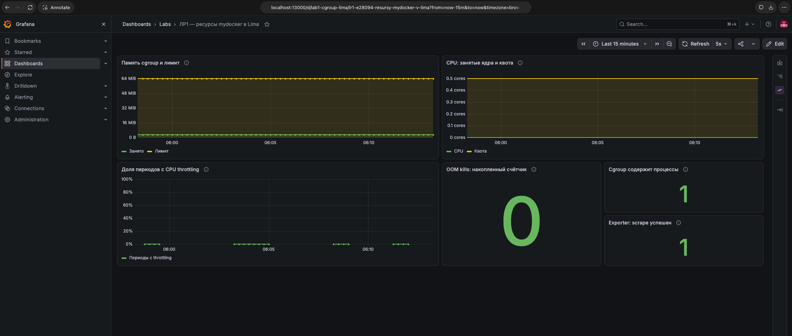

# Часть 8: baseline dashboard ресурсов

Источник: оригинальный снимок Grafana от студента 26 октября 2026 года. Открыт dashboard lab1-cgroup-lima, папка Labs, диапазон Last 15 minutes, refresh 5s.

Панели показывают: память около 3 MiB и лимит 64 MiB; CPU близко к нулю и квоту 0,5 cores; отдельные нулевые участки доли throttled periods с промежутками без значения; OOM kills=0, populated=1, exporter up=1. Визуально панели и подписи размещены корректно, ошибок запросов на снимке нет. Пустые участки throttling соответствуют описанному 0/0 при отсутствии CPU-периодов и не подменены нулём.

Дополнительная read-only проверка: Grafana Helm revision 2, status deployed. API PID 9568, host UID 501, cgroup 0::/lab1-mydocker; /health через его network namespace вернул ok. memory.current=3293184, memory.max=67108864, cpu.max=50000 100000. Эти значения сняты позже исходного /metrics, поэтому текущая память немного отличается.

Dashboard установлен и визуально подтверждён. Это исходное состояние без новой нагрузки: рост памяти, CPU и throttling в данном опыте ещё не показан. Подготовлен ограниченный 90-секундный опыт, выполнение ожидается. Выбор трёх метрик для алертов и объяснение результатов ещё впереди.

Оригинал сохранён без изменений. SHA-256: `0ea462d2b0d4edd0fa802f7aa547b4026f5ffd3ccce554f567d5daddffe8c9b4`.
