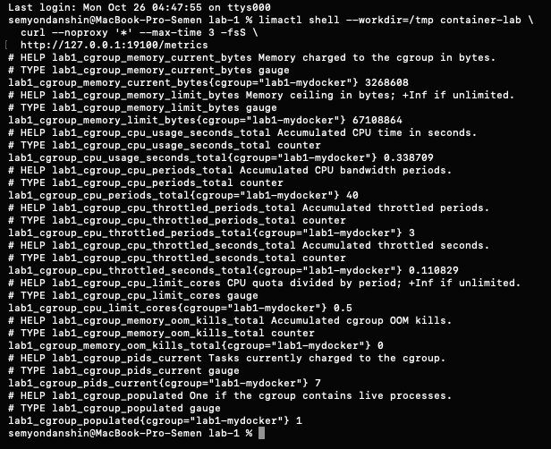

# Часть 8: exporter настоящей cgroup lab1-mydocker

Источник: снимок терминала студента от 26 октября 2026 года. Через limactl shell выполнен GET http://127.0.0.1:19100/metrics внутри Lima.

| Метрика lab1_cgroup_ | Значение на снимке |
| --- | --- |
| memory_current_bytes | 3268608 |
| memory_limit_bytes | 67108864 |
| cpu_usage_seconds_total | 0.338709 |
| cpu_periods_total | 40 |
| cpu_throttled_periods_total | 3 |
| cpu_throttled_seconds_total | 0.110829 |
| cpu_limit_cores | 0.5 |
| memory_oom_kills_total | 0 |
| pids_current | 7 |
| populated | 1 |

Все ряды имеют cgroup="lab1-mydocker". Это данные группы нашего запускателя, а не API ЛР2 в kind или отдельного gVisor-контейнера. Ненулевой throttling — накопленная статистика группы; эксперимент с новой CPU-нагрузкой на этом шаге ещё не выполнялся.

## Дополнительная read-only проверка

В Lima pgrep нашёл lab1-api с PID 9568, cgroup.procs содержит 9567 и 9568. Повторный запрос exporter подтвердил лимиты, populated=1 и все десять метрик. Количество задач включает потоки, поэтому pids_current=7 не обязано совпадать с числом строк cgroup.procs.

Проверены GET без proxy из macOS на 127.0.0.1:19100 и из контейнера prometheus-server в kind на host.docker.internal:19100. Оба вернули полный набор метрик. Значит, существующий port forwarding Lima и доступ через Docker Desktop работают; дополнительных туннелей не создавалось. Проверка из Pod выполнена wget с таймаутом 3 секунды, не с помощью настроенного scrape job.

Подготовлен [overlay Prometheus](../monitoring/prometheus-lima-values.yaml) с новым job lab1-cgroup и сохранёнными api/api-health. На момент этого протокола overlay ещё не применён; наличие метрик внутри TSDB Prometheus этим не подтверждается. Нагрузка и dashboard ресурсов ещё впереди.

Оригинал сохранён без изменений. SHA-256: `baa158b7921fcd421cac16f8c204b3dc601d1da7a533bb296daa6b68292610d1`.
