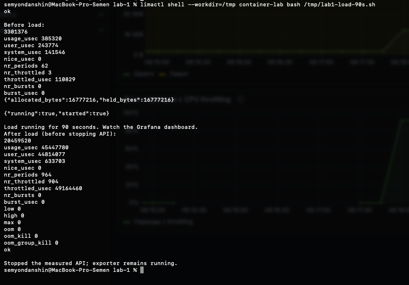

# Часть 8: память, CPU и throttling под ограниченной нагрузкой

Источник: два оригинальных снимка студента от 26 октября 2026 года после load-90s.sh. Выполнен один запрос /eat?mb=16, затем /burn и ожидание 90 секунд. Оба /health до нагрузки и перед остановкой API вернули ok. После измерений скрипт штатно отправил API SIGTERM, завершив CPU-работника.

## Изменение счётчиков на снимке

| Показатель | До нагрузки | После нагрузки, до остановки | Разница |
| --- | --- | --- | --- |
| memory.current, байты | 3301376 | 20459520 | +17158144 |
| cpu.stat usage_usec | 385320 | 45447780 | +45062460 |
| cpu.stat nr_periods | 62 | 964 | +902 |
| cpu.stat nr_throttled | 3 | 904 | +901 |
| cpu.stat throttled_usec | 110829 | 49164460 | +49053631 |

/eat ответил allocated_bytes=16777216 и held_bytes=16777216. /burn вернул running=true, started=true. Все memory.events, включая max, oom и oom_kill, равны 0.

Память выросла с 3,148 до 19,512 MiB: прирост около 16,363 MiB включает удержанные 16 MiB и изменение прочей учитываемой памяти группы. CPU-время увеличилось на 45,06246 секунды за опыт с 90-секундным ожиданием — примерно 0,5 ядра в среднем. Вызовы и считывание счётчиков добавляют небольшой интервал к sleep; расчёт не является точным секундомером.

Среди 902 новых CPU-периодов 901 содержал throttling — примерно 99,89%. Это доля периодов, в которых квота хотя бы раз исчерпалась, а не доля времени полной остановки приложения. Накопленное throttled-время выросло на 49,053631 секунды. Оно не следует автоматически трактовать как число CPU-секунд, которые приложение получило бы без лимита.

## Dashboard

На диапазоне Last 5 minutes видны ступень памяти примерно до 19,5 MiB, CPU с выходом к 0,5 cores, доля периодов с throttling около 100%, затем спад памяти и CPU после остановки. CPU-график сглажен rate за 1 минуту. OOM kills=0, populated=0 после завершения процесса, exporter up=1.

## Дополнительная проверка после опыта

Read-only проверка Lima: pgrep не нашёл lab1-api текущего пользователя, cgroup.procs пуст, populated=0, pids_current=0. Все memory.events остались 0. Exporter отвечает /metrics; memory.current снизилась до 352256 байт. Нагрузка не осталась работающей. Остаточная учитываемая память пустой cgroup не означает живой API.

По дополнительному чтению counters немного выросли на завершении API: usage_seconds_total=45.626719, periods_total=969, throttled_periods_total=907, throttled_seconds_total=49.311559. Эти значения сняты позже и не заменяют таблицу до остановки.

Практика мониторинга и обязательный dashboard подтверждены. Финальная интерпретация throttling пройдена 26 октября; [выбор трёх метрик для алертов](../monitoring/alerts.md) обоснован. Часть 8 завершена. API остановлен сценарием; exporter, Prometheus и Grafana продолжают работать. События OOM в части 3 остаются отдельным опытом; здесь OOM не провоцировался.

Оригиналы сохранены без изменений. SHA-256:

- part-8-load-terminal.png: `fee582ad2a3d4fae5e312e2cc6498f994a930f2bcba5d2c7434bf2611b14aec6`
- part-8-dashboard-load.png: `bc4adbcc173171b97bd59407c01c5a91b5025c3abe2626766a19b1bcc54adbbb`
