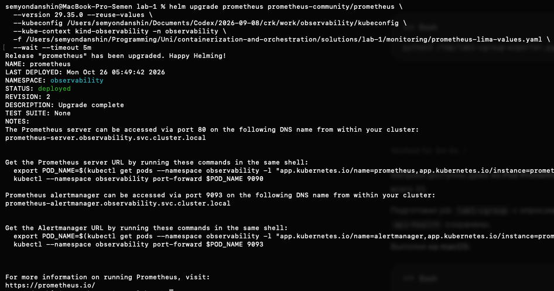

# Часть 8: Prometheus собирает метрики cgroup Lima

Источник: снимок Helm upgrade от студента 26 октября 2026 года и read-only запросы в Prometheus через Kubernetes service proxy с отдельным kubeconfig и контекстом kind-observability.

На снимке release prometheus обновлён до revision 2, status deployed, description Upgrade complete. Chart сохранён 29.35.0, применён monitoring/prometheus-lima-values.yaml с --reuse-values.

## Проверка реального сбора

Targets API вернул scrapeUrl=http://host.docker.internal:19100/metrics, health=up, пустой lastError, labels job=lab1-cgroup, lab=lab1, source=lima.

Instant query up{job=~"lab1-cgroup|api|api-health"} вернул три ряда со значением 1. Новый job работает, существующие jobs сохранены и также успешно опрашиваются. up у api-health подтверждает scrape blackbox exporter, а не значение probe_success.

Запрос {__name__=~"lab1_cgroup_.*"} вернул все десять метрик. У них присутствуют cgroup=lab1-mydocker, job=lab1-cgroup, source=lima. Значения в дополнительной проверке:

| Метрика lab1_cgroup_ | Значение |
| --- | --- |
| memory_current_bytes | 3268608 |
| memory_limit_bytes | 67108864 |
| cpu_usage_seconds_total | 0.345449 |
| cpu_periods_total | 44 |
| cpu_throttled_periods_total | 3 |
| cpu_throttled_seconds_total | 0.110829 |
| cpu_limit_cores | 0.5 |
| memory_oom_kills_total | 0 |
| pids_current | 7 |
| populated | 1 |

Подтверждён путь cgroup Lima → exporter → сеть → scrape → временные ряды Prometheus. Это не проверка HTTP-доступности API внутри его network namespace: up относится к exporter. Новая CPU/memory нагрузка ещё не запускалась. Накопительные counters не являются текущей загрузкой.

Запросы к Prometheus выполнял ассистент без изменения ресурсов. Helm upgrade выполнил студент. Dashboard ресурсов и выбор трёх алертов ещё не завершены.

Оригинал сохранён без изменений. SHA-256: `926d759ef2d491c81413abaa1e5da333e0d1ff251bf69ad681e4087c39de75d0`.
