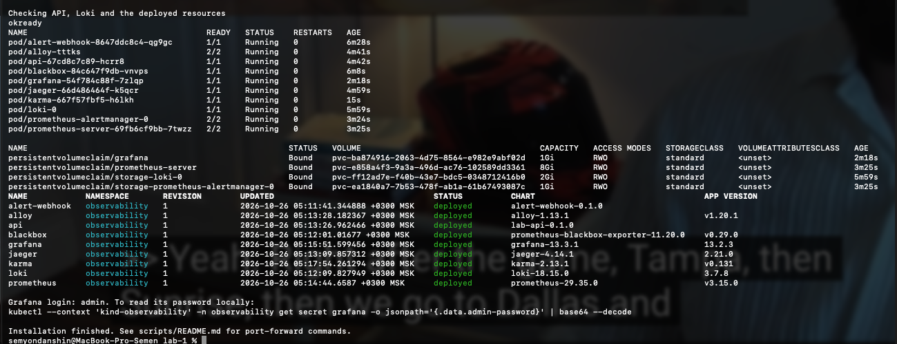

# Часть 8: стек мониторинга развёрнут

Источник: снимок терминала студента от 26 октября 2026 года после setup-observability.sh --no-port-forward и дополнительные read-only проверки.

На снимке проверки API и Loki вывели ok и ready подряд (okready). Все десять Pod Running, все контейнеры Ready, рестартов 0. Четыре PVC имеют статус Bound. Все девять Helm releases deployed, revision 1. Скрипт завершился сообщением Installation finished.



## Дополнительная проверка

С отдельным kubeconfig work/observability/kubeconfig и явным контекстом kind-observability повторно прочитаны Pod/PVC и Helm releases. Подтверждены десять готовых Pod, четыре Bound PVC и девять deployed releases: alert-webhook, alloy, api, blackbox, grafana, jaeger, karma, loki, prometheus. Обычный пользовательский kubeconfig не менялся командами ассистента; к другому Kubernetes-кластеру запросы не отправлялись.

В конфигурации Prometheus найдены штатные jobs kubernetes-nodes и kubernetes-nodes-cadvisor, последний использует /metrics/cadvisor. Дополнительные jobs api и api-health сохранены. Следовательно, прикладные scrape jobs не являются единственными источниками: chart также добавил Kubernetes-сборщики.

Через API proxy Kubernetes выполнен read-only instant query в Prometheus:

```promql
count by (__name__) (
  {__name__=~"container_cpu_usage_seconds_total|container_memory_working_set_bytes|container_cpu_cfs_throttled_periods_total",
   namespace="observability", container="api"}
)
```

Ответ success: один ряд container_cpu_usage_seconds_total и один ряд container_memory_working_set_bytes. Для container_cpu_cfs_throttled_periods_total ряд с этим фильтром не получен. Это отсутствие ряда, а не измеренный нулевой throttling; причина здесь не устанавливалась.

Метрики относятся к контейнеру API ЛР2 в kind. Наличие этого job не означает сбор ресурсов mydocker/runsc в отдельной Lima VM. Для ЛР1 ещё нужны выбор наблюдаемого workload, подтверждённые memory/CPU/throttling под нагрузкой, dashboard и обоснование трёх алертов. ЛР2 не объявляется полностью проверенной по одному успешному развёртыванию: реакции RED, логи, трассировки и доставка алертов в нашей среде ещё не воспроизводились.

Оригинал сохранён без изменений. SHA-256: `cf275d340eccda0f6c7a12db7e7962112300869769f372180066cfb7f737be2b`.
