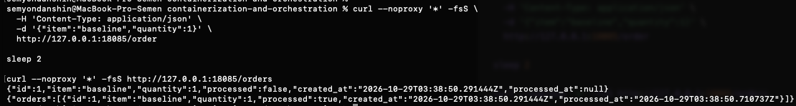
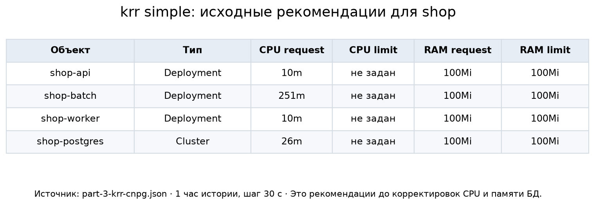
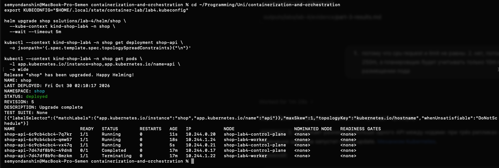
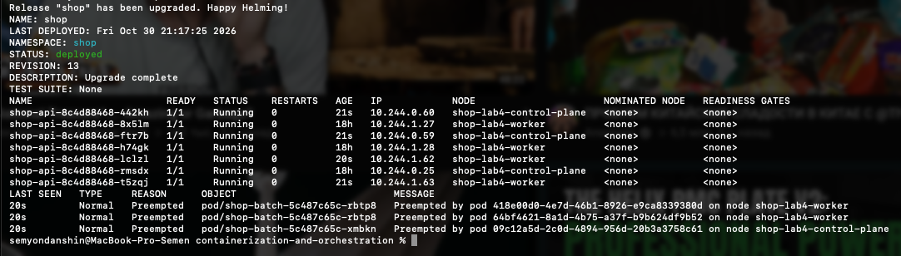
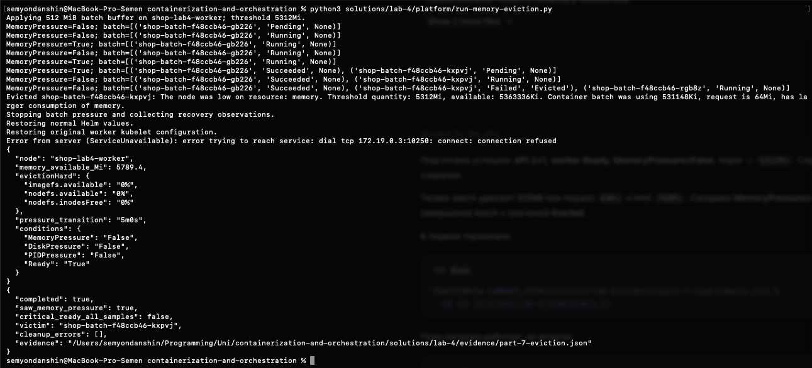
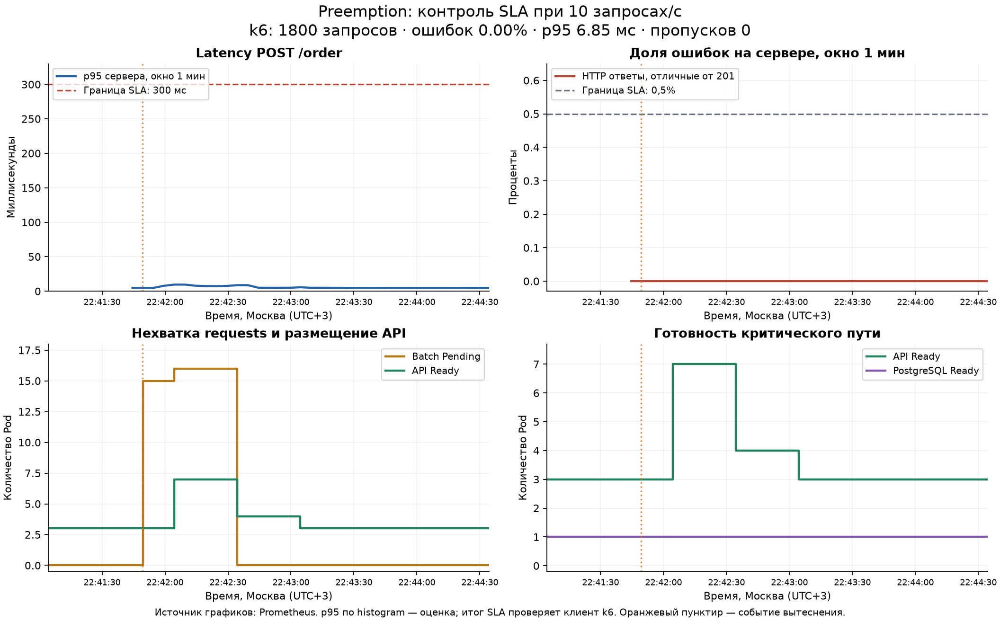
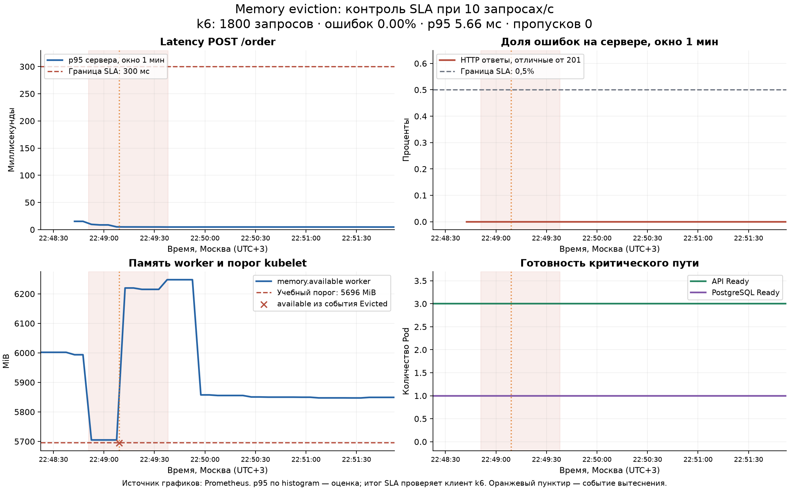
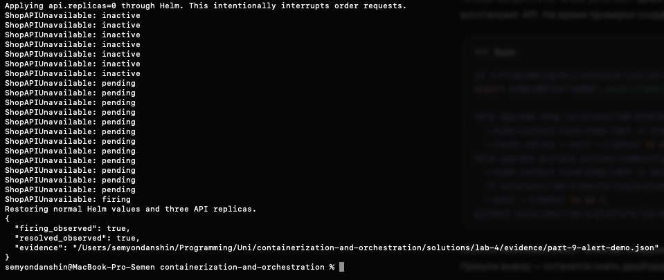
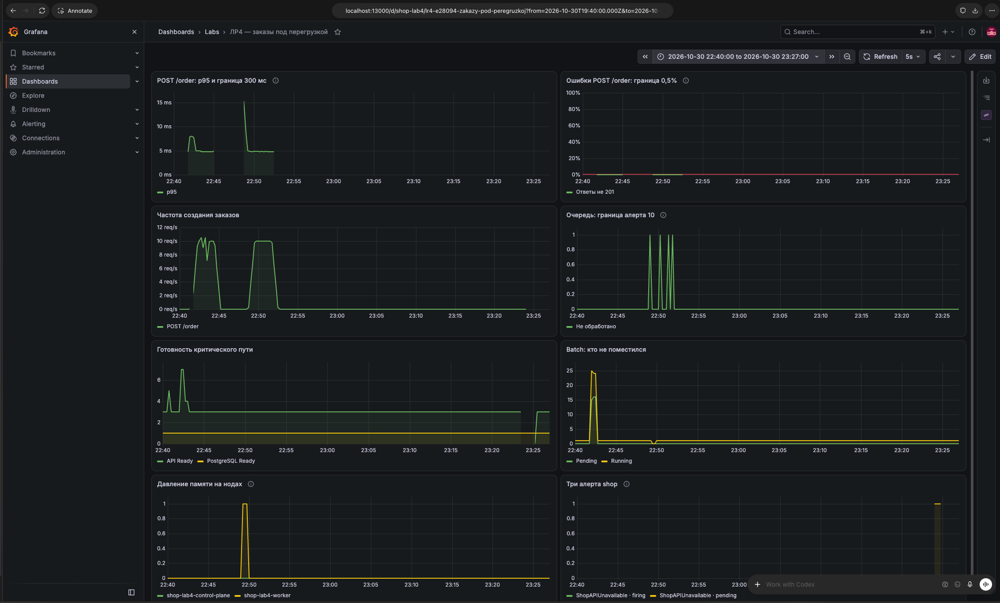

# ЛР4. Заказы важнее ночной аналитики

Проверили, сможет ли магазин принимать заказы, когда ресурсов на всех уже не хватает. Критический путь здесь — **API → PostgreSQL**, а пожертвовать можно фоновой нагрузкой `batch`. Для этого распределили API между нодами, подобрали ресурсы по метрикам, настроили приоритеты и довели стенд до двух разных видов вытеснения: scheduler preemption и memory eviction.

В двух итоговых контрольных прогонах получили по 1800 успешно созданных заказов без ошибок и пропущенных итераций. p95 составил 6,85 мс при preemption и 5,66 мс при memory eviction — при заранее выбранной границе 300 мс. К этим результатам пришли не с первой попытки: рекомендации по ресурсам пришлось проверить на запуске и под давлением памяти.

## 1. Стенд и бесполезная работа

Работали 29–30 октября 2026 года на Mac ARM64 с Docker Desktop. В отдельном kind-кластере `shop-lab4` на Kubernetes v1.37.0 создали две ноды: control-plane и worker. С control-plane сняли `NoSchedule`, чтобы приложения могли использовать обе ноды. Это разрешает размещение, но само по себе ничего не распределяет.

Обе ноды — контейнеры одной Docker VM с 8 CPU и примерно 7,75 GiB RAM. Их объявленные ресурсы нельзя складывать и получать два независимых физических сервера: отказ Mac или общей VM остановит весь стенд.

За основу взяли приложение и chart из командной ЛР3: три API принимают заказы, два worker обрабатывают их в фоне, PostgreSQL хранит данные на PVC. Через NodePort API доступен на `127.0.0.1:18085`. POST `/order` возвращает созданный заказ с ID, а последующий GET `/orders` позволяет увидеть `processed=true` после работы worker.



Добавили [batch на Go](batch/main.go) с [Dockerfile](batch/Dockerfile): он удерживает буфер и нагружает CPU, ничего полезного не производя. Размер буфера и число CPU-работников задаются через values отдельно от Kubernetes requests/limits. Обычный режим — 32 MiB и один работник; для каждого опыта предусмотрен отдельный override. У ночной аналитики в этой лабе очень прозрачный бизнес-результат.

Все компоненты запускаются через [chart shop](helm/shop/). На batch распространяются те же пять guardrails из ЛР3: обязательные CPU/memory requests и limits, разрешённые образы, labels, запрет privileged и host namespaces. Исключений для нагрузки не добавляли. Использовали [стек мониторинга ЛР2](../../lecture-2-observability/README.md), переведя Prometheus под управление оператора с сохранением прежнего PVC и scrape jobs.

## 2. Сначала измерили, потом меняли ресурсы

Начальные ресурсы были предположением. Чтобы их проверить, запустили k6: 10 POST `/order` в секунду на 15 минут. Получили 9001 созданный заказ, ноль ошибок и пропущенных итераций, p95 6,33 мс. Worker успел обработать очередь. [Summary k6](evidence/part-3-load-summary.json) и [исходные метрики](evidence/part-3-prometheus-baseline.json) сохранены отдельно.

CPU и working set собирал cAdvisor, владельцев Pod и allocations — kube-state-metrics. Наличие Pod мониторинга проверили отдельно от данных: Prometheus действительно видел все три API, два worker и контейнерные метрики shop.

Запустили krr `simple` по часовому окну, включающему эти 15 минут нагрузки и соседний простой. Стратегия использовала p95 CPU, пик памяти с запасом 15% и нижние границы 10m CPU / 100 MiB памяти. Поэтому рекомендация памяти 100Mi не означает, что сервис действительно занимал все 100 MiB.

| Компонент | Исходный CPU request / limit | CPU request krr | Исходная память request / limit | Память krr request / limit |
| --- | --- | --- | --- | --- |
| API | 25m / 250m | 10m | 32Mi / 128Mi | 100Mi / 100Mi |
| Worker | 25m / 250m | 10m | 32Mi / 128Mi | 100Mi / 100Mi |
| PostgreSQL | 100m / 500m | 26m | 128Mi / 512Mi | 100Mi / 100Mi |
| Batch | 50m / 250m | 251m | 64Mi / 128Mi | 100Mi / 100Mi |

CPU limit krr предложил не задавать, а guardrails требуют его наличия. Сначала применили рекомендованные requests и память, сохранив прежние CPU limits. Batch оставили управляемым источником нагрузки: его рекомендация около 250m отражала уже действующую квоту, а не доказательство достаточной производительности.

CloudNativePG управляет PostgreSQL через `Cluster`, а штатный запуск krr находил только Deployment. Для обнаружения БД добавили [адаптер](platform/krr-cnpg.py): он передаёт реальные Pod и их allocations в штатный алгоритм, не меняя расчёт и не подменяя Cluster фиктивным StatefulSet. Сохранены [обычный отчёт](evidence/part-3-krr-native.json), [отчёт с PostgreSQL](evidence/part-3-krr-cnpg.json), [сравнение с замерами](evidence/part-3-results.md) и [порядок запуска](platform/krr.md).



После первого применения PostgreSQL был Ready, а новый заказ прошёл весь путь до `processed=true`. Но одной такой проверки оказалось мало для выбора окончательных лимитов.

## 3. Три API на двух нодах

Выбрали `topologySpreadConstraints`: при трёх репликах на двух подходящих нодах можно получить 2+1 с разницей не больше одной. Жёсткая `podAntiAffinity` по hostname разрешила бы максимум по одной реплике на ноду, оставив третью без места.

В [values](helm/shop/values.yaml) есть переключатель механизма. Для нашего варианта заданы:

```yaml
spreading:
  enabled: true
  mechanism: topologySpreadConstraints
```

[Шаблон](helm/shop/templates/_helpers.tpl) добавляет `maxSkew: 1`, `whenUnsatisfiable: DoNotSchedule` и `topologyKey: kubernetes.io/hostname`. Selector учитывает только API текущего release. После rolling update подтвердили три готовые реплики: две на control-plane, одна на worker. [Снимок состояния](evidence/part-4-api-spread.json).



Если одна нода станет недоступна, API на второй не исчезнет вместе с ней. Но PostgreSQL у нас один, а физический хост общий — полноценной отказоустойчивости всего магазина это не создаёт.

Ещё выяснили, что spread работает при назначении новых Pod. После уменьшения API с семи до трёх контроллер однажды оставил все три на одной ноде: правило не выбирает, кого удалить, и не переселяет уже работающие Pod. Для возвращения 2+1 выполнили новый rollout через аннотацию в values.

## 4. Приоритет — не замена ресурсам

Для API и PostgreSQL задали `shop-critical` с приоритетом 100000 и QoS Guaranteed. Batch получил `shop-batch` с приоритетом −1000, Burstable и `preemptionPolicy: Never`. Последнее запрещает batch самому вытеснять другие Pod, но не защищает его от более приоритетного API.

Первая попытка получить Guaranteed была слишком буквальной: уравняли CPU limit с request krr. PostgreSQL досталось 26m, после чего он не смог завершить startup. Из 11784 CPU-периодов 11762 оказались throttled; в логах были timeout probe и instance manager, а `oom_kill` оставался нулём. [Счётчики](evidence/part-5-pg-low-cpu-cgroup.json) показали проблему с CPU-квотой, а не убийство по памяти.

Рекомендация request по наблюдаемой работе не стала подходящей жёсткой квотой для запуска. Вернули рабочие limits — 250m для API и 500m для PostgreSQL — и подняли requests до тех же значений ради Guaranteed. Позже БД потребовала отдельной поправки памяти, описанной ниже. Итоговые ресурсы на контейнер:

| Компонент | CPU request / limit | Память request / limit | QoS / приоритет |
| --- | --- | --- | --- |
| API ×3 | 250m / 250m | 100Mi / 100Mi | Guaranteed / 100000 |
| PostgreSQL ×1 | 500m / 500m | 256Mi / 256Mi | Guaranteed / 100000 |
| Worker ×2 | 10m / 250m | 100Mi / 100Mi | Burstable / 0 |
| Batch ×1 | 50m / 250m | 64Mi / 128Mi | Burstable / −1000 |

Эти отклонения от krr сделаны по результатам опытов, не выданы за новые рекомендации алгоритма. Исходные значения и неудачный вариант сохранены в evidence.

[PodDisruptionBudget](helm/shop/templates/pdb.yaml) требует минимум два готовых API и один PostgreSQL. При трёх здоровых API бюджет разрешал одно добровольное выселение, для единственной БД — ни одного. Выбрали управление PDB PostgreSQL через chart, отключив дублирующий бюджет оператора.

PDB ограничивает добровольное выселение через Eviction API, например при `drain`. Он не создаёт запасной экземпляр и не блокирует прямое уменьшение Deployment, отказ ноды, OOM или node-pressure eviction. [Описание механизма PDB](https://kubernetes.io/docs/tasks/run-application/configure-pdb/).

## 5. Scheduler считает requests, а не загрузку CPU

Для первого вида перегрузки задали 40 batch с CPU request 500m каждый — всего 20 CPU. Даже объявленных 16 CPU двух нод недостаточно, а часть reservations уже занята остальными сервисами. Вычисления и буфер у batch в этом опыте выключены: проверяли именно решение scheduler, а не скорость нагрева Mac.

После завершения rollout получили 26 batch Running и 14 Pending. В событиях неназначенных Pod — `Insufficient cpu`, хотя сами процессы почти бездействовали. [Pod и причины отказов](evidence/part-6-pending.json). Это и есть разница между отсутствием свободных requests и фактической загрузкой CPU.

Затем увеличили API с трёх до семи. Четырём новым репликам понадобился ещё один CPU reservations, и scheduler освободил место за счёт batch. Все семь API стали Ready, размещение — 4+3.



В событиях было три сообщения, но только два уникальных UID жертв: один batch фигурировал дважды. UID новых API сопоставили с сообщениями о preemption. После опыта batch стало 24 Running и 16 Pending. [Pod, UID и события](evidence/part-6-preemption.json).

Приоритет здесь влияет на то, кто получает место при нехватке requests. Он не увеличивает CPU limit и не отменяет throttling уже работающего контейнера. После фиксации результата вернули обычные values.

## 6. Когда память нужна самой ноде

Для memory eviction сначала проверили kubelet. В исходной конфигурации kind сигнал `memory.available` был выключен: заданы только дисковые пороги 0%, `mergeDefaultEvictionSettings=false`. Поэтому явно ввели учебный порог выше обычного, чтобы вызвать настоящее решение eviction manager небольшим буфером, не исчерпывая общую память Docker VM.

[Скрипт подготовки](platform/memory-eviction.py) сохраняет исходный конфиг вне репозитория, проверяет действующий configz и после опыта возвращает настройки. Порог выбирается относительно текущей свободной памяти. В первом запуске он составил 5312Mi, в успешном повторе — 5568Mi, в итоговом контроле SLA — 5696Mi. Это намеренно настроенные условия опыта, а не доказательство исчерпания всей физической RAM.

Через Helm направили один batch на worker: буфер 512Mi, request 64Mi, limit 768Mi, CPU workers 0. Его реальное потребление превысило request, но оставалось ниже собственного limit. После MemoryPressure kubelet выбрал batch и создал событие Evicted о нехватке памяти.



В первом опыте жертва потребляла около 518,7Mi при лимите 768Mi. Сообщение kubelet указывало available ниже порога ноды. Это **node-pressure eviction**, а не `OOMKilled` из-за собственного лимита контейнера. Один exit code 137 не различает эти причины; нужны событие, статус Pod и счётчики памяти.

Класс Guaranteed тоже не выдаёт бессмертие. При выборе жертв memory eviction учитываются превышение requests, приоритет и размер превышения; само имя QoS не является отдельным ключом сортировки. В нашем опыте низкоприоритетный batch сильно превышал request, а критические Pod с равными requests/limits были лучше защищены. [Механизм выбора жертв](https://kubernetes.io/docs/concepts/scheduling-eviction/node-pressure-eviction/).

### Что не получилось с первого раза

Первый batch действительно вытеснился, но PostgreSQL на другой ноде потерял Ready. Его не эвиктили: БД упиралась в собственный лимит 100Mi и тратила время на возврат памяти. В cgroup было занято 104497152 из 104857600 байт, рос `max`, присутствовали memory PSI и direct reclaim, при этом `oom=0` и `oom_kill=0`. [Диагностика](evidence/part-7-pg-memory-pressure.json).

Через chart подняли память PostgreSQL до 256Mi request=limit и задали `shared_buffers=64MB`, сохранив Guaranteed. После исправления пик памяти достиг 149,1 MiB — больше старого лимита; `max`, `oom` и `oom_kill` нового контейнера остались нулевыми. Короткой рекомендации working set оказалось недостаточно для прогретой БД и instance manager.

В [повторе опыта](evidence/part-7-eviction-retry.json) снова наблюдались MemoryPressure и memory eviction batch, но теперь три API и PostgreSQL оставались Ready во всех снимках. После остановки нагрузки восстановили обычные values и исходный kubelet config. Первые неудачные результаты сохранили, а не заменили удачным повтором.

## 7. Выполняется ли наш SLA под нагрузкой

До контрольных прогонов зафиксировали учебный SLA при **10 запросах в секунду**:

- p95 HTTP POST `/order` — не больше **300 мс**;
- успешно создано не меньше **99,5%** заказов;
- пропущенных итераций k6 — **0**.

Успех — HTTP 201 с положительным целочисленным ID. Измеряем создание заказа через API и PostgreSQL; время последующей обработки worker в этот SLA не входит. В [сценарии k6](load/orders.js) используется constant-arrival-rate: замедление ответов не уменьшает запланированную частоту. Пороговые условия проверяет сам k6.

С исправленными ресурсами выполнили два отдельных трёхминутных контроля. Каждый включал исходное состояние, перегрузку и возврат обычной конфигурации.

| Контроль | Запросов / созданных заказов | Успех | p95 | p99 | Пропусков |
| --- | --- | --- | --- | --- | --- |
| Preemption | 1800 / 1800 | 100% | 6,85 мс | 38,21 мс | 0 |
| Memory eviction | 1800 / 1800 | 100% | 5,66 мс | 13,38 мс | 0 |

В preemption-контроле было 25 готовых batch и 15 Pending, затем scheduler вытеснил один batch для новых API. Число жертв зависит от размещения и остатка requests, поэтому оно не обязано совпадать с двумя жертвами первого опыта. В memory-контроле зафиксированы MemoryPressure и Evicted batch; все три API и PostgreSQL оставались Ready во всех снимках.





Графики построены из Prometheus, пунктиром отмечены события вытеснения. Серверный p95 по histogram — оценка в скользящем минутном окне; итог SLA проверяется клиентским k6. Он учитывает и запросы, которые не дошли до сервера, и неправильные ответы. На memory-графике крестик показывает available из события Evicted: scrape может пропустить краткий минимум памяти.

Оба контроля выполнили выбранные условия. [Summary preemption](evidence/part-8-preemption-load-summary.json) и [summary memory](evidence/part-8-memory-load-summary.json) содержат `sla_passed=true`; [состояния preemption](evidence/part-8-preemption.json) и [memory](evidence/part-8-memory.json) подтверждают саму перегрузку. Рядом сохранены SVG и исходные ответы Prometheus.

Ранние замеры были хуже: при массовом rollout batch получили 14,14% ошибок и p95 около 3 секунд; в первом memory-опыте — шесть ошибок на 3000 запросов и потерю Ready PostgreSQL. Они не используются как успешное доказательство защиты. Два удачных трёхминутных контроля подтверждают этот профиль испытания, а не месячную доступность 99,5%.

## 8. Чтобы о проблеме узнал не только график

[ServiceMonitor и PrometheusRule](helm/shop/templates/monitoring.yaml) входят в chart shop. Prometheus Operator выбирает их по метке `monitoring: lab2`; API и worker опрашиваются каждые 15 секунд. [Дашборд](helm/shop/dashboards/shop.json) тоже хранится в chart и попадает в Grafana через ConfigMap и отдельный file provider, сохраняя дашборд ЛР2.

| Алерт | Условие, выдержка 1 минута | Зачем нужен |
| --- | --- | --- |
| `ShopAPIUnavailable` | Все API scrape targets недоступны либо исчезли | Полная потеря API или наблюдаемости требует проверки; один `up` всё равно не заменяет создание заказа |
| `ShopDatabaseUnavailable` | Все worker сообщают об ошибке последней операции БД либо метрики отсутствуют | Показывает отказ зависимости критического пути |
| `ShopOrderBacklog` | Необработанных заказов больше 10 | API ещё принимает заказы, но фоновая обработка отстаёт |

Для очереди используем `max`, а не `sum`: worker экспортируют копии одной общей очереди PostgreSQL. Минута `Pending` отсеивает краткие сбои, например при перезапуске Pod. Это три диагностических правила, а не полная система контроля SLA; границы задержек и ошибок проверяются отдельно.

Для демонстрации через Helm уменьшили API до нуля. 30 октября в 23:25:03 по Москве `ShopAPIUnavailable` перешёл в Firing. Затем вернули обычные values, дождались трёх готовых API и снятия алерта. PDB этому уменьшению не помешал: масштабирование Deployment не использует Eviction API.



В [результате демонстрации](evidence/part-9-alert-demo.json) сохранены реальные ответы API Prometheus: `firing_observed=true`, `resolved_observed=true`, все три API Ready, ошибок восстановления нет. Проверили именно вычисление и снятие правила; отдельную доставку уведомления shop получателю не проверяли.



Снимок охватывает 22:40–23:27 по Москве: слева видны прогоны нагрузки, справа — намеренная остановка API для алерта. Эти события разделены во времени. Нулевой RPS после прогона — остановленная нагрузка; отсутствие latency без запросов не означает измеренные нулевые задержки. Границы SLA показаны на отдельных графиках выше, где они помещаются в масштаб осей.

## Что получилось

При нехватке reservations scheduler оставил batch в Pending и освободил место для API через preemption. При настроенном memory pressure kubelet вытеснил batch, а после исправления бюджета PostgreSQL критический путь сохранил готовность и прошёл выбранный SLA.

Requests, limits, приоритеты, распределение и PDB решали разные задачи. Высокий приоритет не спас БД от слишком маленького собственного лимита, а удачная рекомендация для обычной работы не обязана подходить для старта. Поэтому итоговые ресурсы опираются и на krr, и на зафиксированные отказы под нагрузкой.

Файлы для повторения: [chart и values](helm/shop/), [krr](platform/krr.md), [нагрузка k6](load/README.md), [Pending и preemption](experiments/README.md), [memory eviction](platform/memory-eviction.md), [дашборд и алерт](monitoring/README.md). Исходные снимки, summaries и события сохранены в [evidence/](evidence/).
