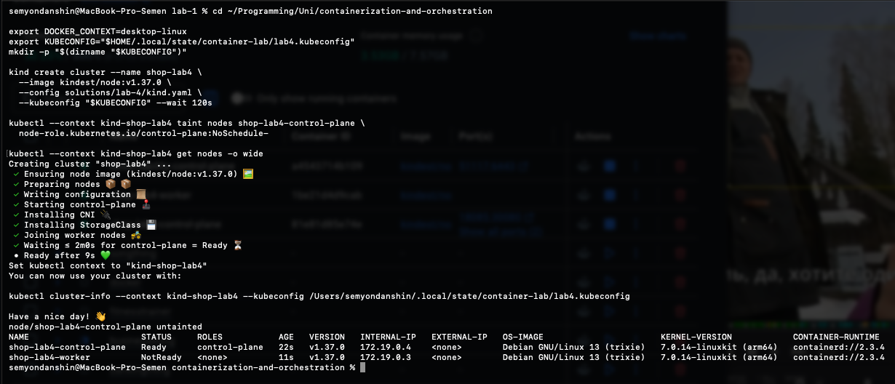
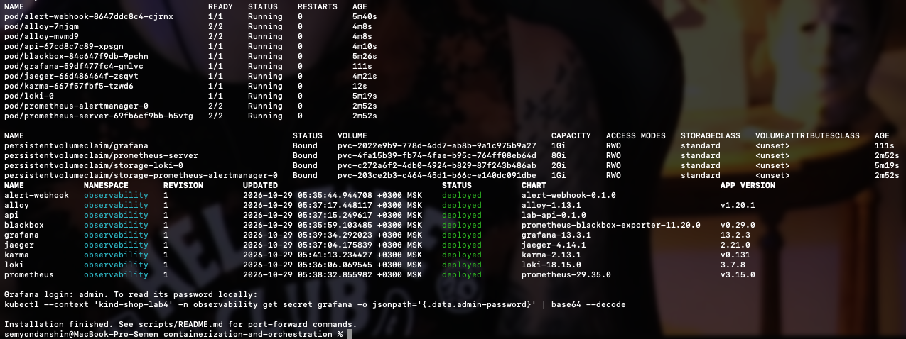
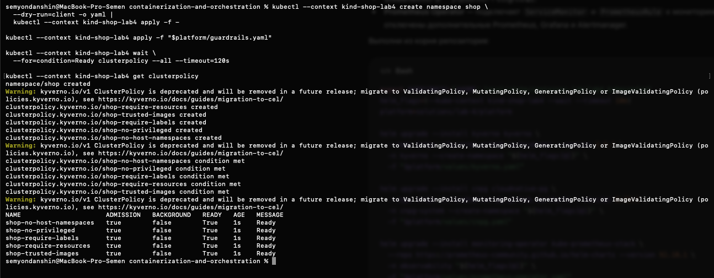
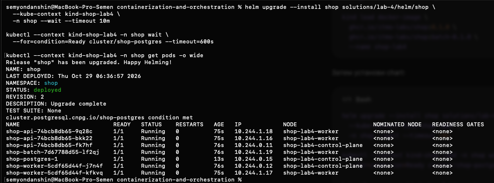
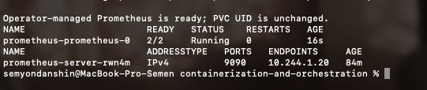
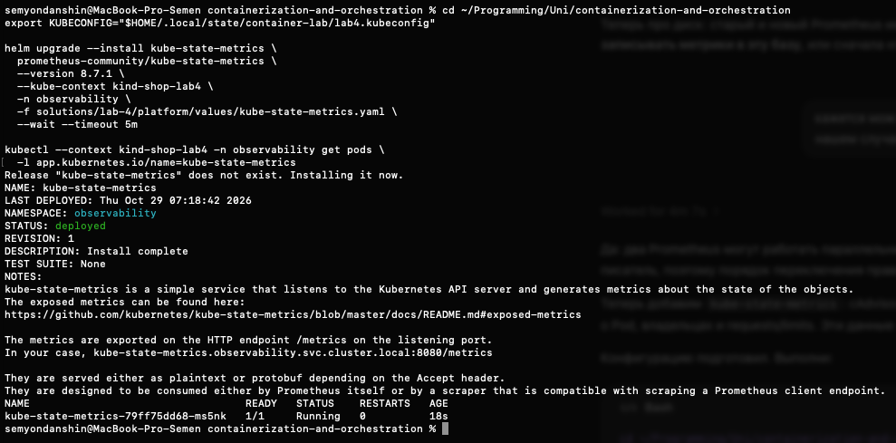
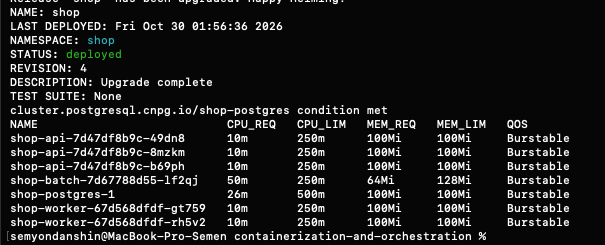
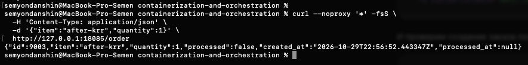
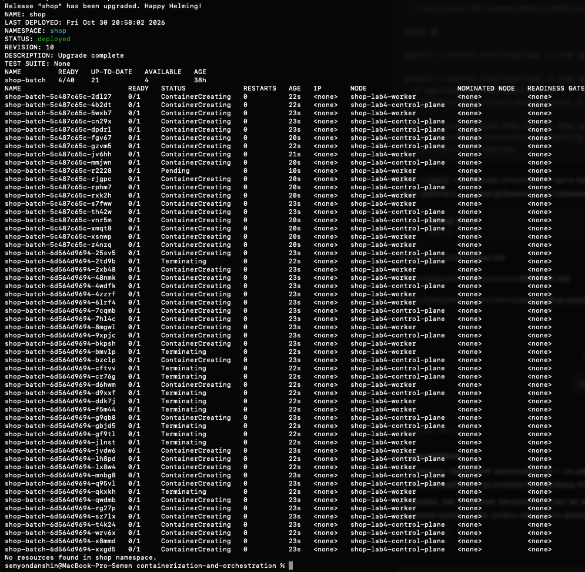
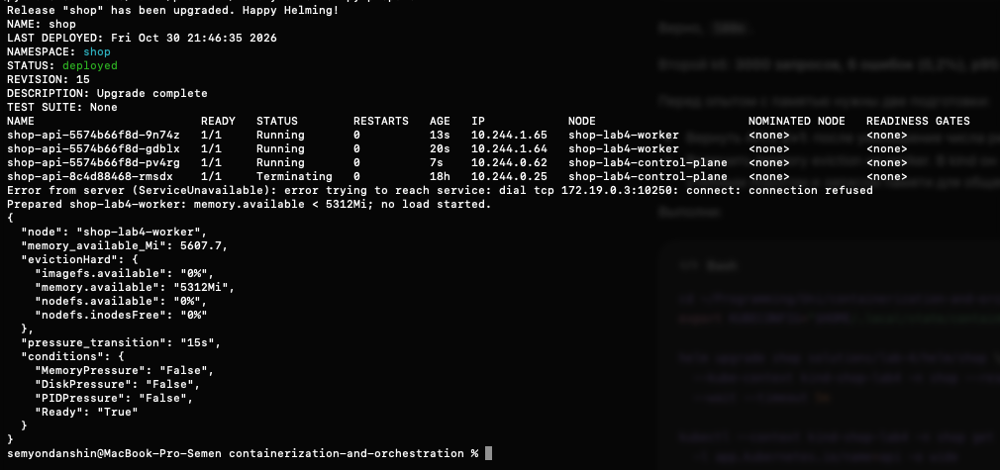

# Основа ЛР4

Исходный chart `helm/shop` скопирован из архива Тимура `lecture-3-kubernetes-control-plane.zip`, полученного 28 октября 2026 года. Изменения ЛР4 описаны ниже; оригинал chart ЛР3 сохранён отдельно.

Оригинал архива распакован отдельно в рабочем каталоге задачи. `.local`, `.DS_Store` и `__MACOSX` в материалы ЛР4 не переносились. Установщик ЛР3 пока не запускался.

Сервис `batch/` подготовлен для части 0. Результаты инфраструктурных опытов будут записываться по мере выполнения; готовый отчёт заранее не создаётся.

## Часть 1. Выбор распределения API

Выбрали `topologySpreadConstraints`: на двух подходящих нодах три реплики API могут распределиться как 2+1, сохраняя разницу не больше одной. Жёсткая `podAntiAffinity` по hostname запрещает совместное размещение API на одной ноде, поэтому для третьей реплики в таком кластере не нашлось бы места.

В `values.yaml` добавлен переключатель `api.spreading.mechanism`: `topologySpreadConstraints` или `podAntiAffinity`. Для выбранного варианта используются `maxSkew: 1`, `whenUnsatisfiable: DoNotSchedule` и `topologyKey: kubernetes.io/hostname`. Selector учитывает только API текущего Helm release, а не worker и соседние приложения.

На исходном замере `api.spreading.enabled: false`. Включение правила и проверка размещения выделены в часть 4: сам шаблон ещё не доказывает распределение Pod на живом кластере.

## Часть 2. Создание стенда

Создан отдельный kind-кластер `shop-lab4` на Kubernetes v1.37.0: одна control-plane нода и одна worker. На исходном снимке worker ещё `NotReady`; при последующей проверке обе ноды уже `Ready`, taints отсутствуют, MemoryPressure/DiskPressure/PIDPressure — False.

С control-plane снят `NoSchedule`, чтобы обычные Pod могли размещаться на обеих нодах. Это разрешение размещения, а распределение API между нодами ещё предстоит проверить. Старый кластер `observability` сохранён.

На новом стенде повторно использованы конфигурации мониторинга из ЛР2. По результату установки 29 октября все 11 Pod готовы (Alloy запущен на каждой из двух нод), четыре PVC в Bound, девять Helm releases в deployed. Старый контейнер `observability-control-plane` остановлен с сохранением данных. Проверка прохождения метрик shop будет выполнена после его установки.

Файлы `platform/values/`, `platform/guardrails.yaml` и `platform/valid.yaml` взяты без изменений из архива ЛР3 Тимура. На стенде установлены CloudNativePG, Kyverno и отдельный Prometheus Operator. CRD Cluster, ServiceMonitor, PrometheusRule и Prometheus зарегистрированы с Established=True.

Namespace `shop` создан до приложения. Все пять политик Kyverno имеют Ready=True, admission включён, background выключен; в файле задан режим Enforce. Это готовность политик, а не отдельное доказательство отказа конкретному нарушающему Pod.

При применении получено предупреждение об устаревании ClusterPolicy. В закреплённой версии Kyverno этот тип работает; миграцию на CEL-типы в рамках установки не выполняли.

## Часть 2. Начальная конфигурация shop и batch

Исходники `api/` скопированы без изменений из архива Тимура: один бинарник запускается в роли API или worker. Для фоновой нагрузки добавлен отдельный Deployment `shop-batch` в chart, с теми же labels и ограничениями привилегий, что у приложения.

Для первой установки выбраны следующие ресурсы на контейнер; это исходные предположения до рекомендаций krr:

| Компонент | Реплики | CPU request / limit | Memory request / limit |
| --- | ---: | --- | --- |
| API | 3 | 25m / 250m | 32Mi / 128Mi |
| Worker | 2 | 25m / 250m | 32Mi / 128Mi |
| PostgreSQL | 1 | 100m / 500m | 128Mi / 512Mi |
| Batch | 1 | 50m / 250m | 64Mi / 128Mi |

Batch удерживает буфер 32 MiB и имеет одного CPU-работника. Это параметры нагрузки, а не Kubernetes requests/limits: весь процесс дополнительно расходует память на Go runtime, а CPU ограничен 250m. Все настройки заданы в values; распределение API пока выключено для исходного замера.

После установки все семь Pod готовы: API ×3, worker ×2, PostgreSQL ×1 и batch ×1. БД имеет condition Ready. Исходно два API размещены на worker-ноде, один — на control-plane; все семь Pod имеют QoS Burstable. В живых Helm values `api.spreading.enabled=false`, поэтому это наблюдаемое размещение без нашего обязательного ограничения.

Через NodePort создан заказ №1 (`item=baseline`, `quantity=1`). POST вернул `processed=false`; последующий GET `/orders` показал `processed=true` и заполненный `processed_at`. Так проверен путь создания, сохранения и обработки заказа, а не только `/health`.

Объекты ServiceMonitor и PrometheusRule `shop` созданы chart. На момент установки приложения Prometheus CR ещё отсутствовал; подключение этих объектов выполнено следующим шагом.

## Подготовка подключения метрик shop

Для передачи Prometheus под управление оператора переиспользованы манифесты и порядок миграции из ЛР3 Тимура. Они находятся в `platform/prometheus/`; отдельный скрипт `platform/migrate-prometheus.sh` выполняет только этот переход, сохраняя прежние scrape jobs, правила ЛР2, образ, Service и PVC. Описание порядка и возврата при ошибке — в [руководстве](platform/prometheus-migration.md).

Переход выполнен: Pod `prometheus-prometheus-0` готов 2/2, UID исходного PVC сохранился, прежний Service получил новый endpoint. Конфигурация и метаданные сохранены вне Git; данные TSDB остаются на исходном PVC. Одновременное использование PVC двумя процессами исключается порядком остановки и запуска.

Через Prometheus API подтверждён сбор всех пяти endpoint приложения: `shop-api=3`, `shop-worker=2`. Node и cAdvisor jobs успешно опрашивают обе ноды; CPU-ряды присутствуют для всех семи Pod shop. Загружены прежние три алерта ЛР2 и три алерта shop, все с health=ok. [Запросы и результаты](evidence/part-2-prometheus-scrape.md).

## Подготовка данных для krr

Потребление CPU и памяти собирается через cAdvisor. Для метаданных Pod, их владельцев и заданных requests/limits подготовлены values kube-state-metrics: chart 8.7.1, приложение 2.20.0, namespace наблюдения `shop`.

ServiceMonitor помечен `monitoring: lab2`, чтобы его выбрал существующий Prometheus CR. `honorLabels: true` сохраняет namespace и другие labels наблюдаемого приложения; exporter сам размещён в `observability`. Scrape по аннотациям выключен, чтобы не дублировать сбор через ServiceMonitor.

Exporter установлен и готов 1/1. Через Prometheus API подтверждены `up{service="kube-state-metrics"}=1`, семь владельцев Pod в `shop`, три владельца ReplicaSet и семь работающих Pod. Есть 14 рядов requests контейнеров (CPU и память для семи контейнеров) и семь рядов `container_memory_working_set_bytes`.

Выполнен [исходный замер k6](load/README.md): POST `/order`, 10 запросов в секунду в течение 15 минут. Создан 9001 заказ, ошибок и пропущенных итераций нет; HTTP p95 — 6,33 мс, p99 — 30,04 мс. Очередь на конец замера пуста, ошибок worker нет.

krr `simple` рассчитала рекомендации для API, worker и PostgreSQL по часовому окну, включающему нагрузку. Для обнаружения CloudNativePG добавлен адаптер, сам расчёт не менялся. Рекомендованные CPU requests — 10m, 10m и 26m соответственно; память request/limit — 100Mi для каждого, с учётом стандартного нижнего порога. CPU limits стратегия предлагает не задавать, что требует отдельного решения из-за guardrails. [Результаты и сравнение](evidence/part-3-results.md), [воспроизведение](platform/krr.md).

Requests CPU и request/limit памяти по рекомендациям krr применены через Helm upgrade, revision 4. Из-за обязательных guardrails CPU limits оставлены прежними: 250m для API/worker, 500m для PostgreSQL. Параметры batch не менялись. [Исходные values](evidence/part-3-values-before.yaml) сохранены для сравнения.

PostgreSQL имеет condition Ready. В Pod подтверждены новые ресурсы; QoS всех семи Pod — Burstable. Создан заказ №9003 `after-krr`, последующий GET `/orders` подтвердил `processed=true` и заполненный `processed_at`: путь API → PostgreSQL → worker работает после изменения ресурсов. Это функциональная проверка одного заказа, не повторный нагрузочный замер.

## Часть 4. Распределение API между нодами

В values включён `api.spreading.enabled: true`. Для API текущего release добавляется `topologySpreadConstraints` с `maxSkew: 1`, `whenUnsatisfiable: DoNotSchedule` и доменами по `kubernetes.io/hostname`. При двух подходящих нодах и трёх репликах ожидаем 2+1. Если размещение нового Pod нарушит ограничение, scheduler не назначит его на такую ноду.

Правило применено через Helm upgrade, revision 5. Изменение шаблона запустило rolling update API. Уже размещённые Pod само правило не переселяет; нужное состояние получено при создании новых Pod в rollout. [Values после части 3](evidence/part-3-values-applied.yaml) сохранены отдельно.

После завершения обновления `updatedReplicas=readyReplicas=availableReplicas=3`, observedGeneration совпадает с generation. Два API находятся на `shop-lab4-control-plane`, один — на `shop-lab4-worker`. Все три Running и Ready, старых Pod в последующей проверке нет. [Снимок состояния](evidence/part-4-api-spread.json).

При потере одной ноды часть реплик API останется на другой. Это защита от одновременной потери всех API на одной ноде; отдельного резерва PostgreSQL или физического хоста такое распределение не создаёт.

## Часть 5. Приоритеты, QoS и PDB

Через chart созданы классы `shop-critical` (100000, PreemptLowerPriority) и `shop-batch` (-1000, Never). API и PostgreSQL используют высокий приоритет, batch — низкий, worker остаётся с обычным приоритетом. `Never` у batch запрещает ему инициировать preemption, но не защищает его от вытеснения более приоритетным Pod.

Первый вариант уравнивал CPU request и limit по запросу krr: API — 10m, PostgreSQL — 26m, память — 100Mi. После применения PostgreSQL получил Guaranteed, но не смог завершить startup: Helm не дождался Ready. У контейнера 11762 throttled-периода из 11784, в логах timeout startup probe и instance manager; `oom=0`, `oom_kill=0`. Память при этом близка к лимиту: 104370176 из 104857600 байт. [Счётчики cgroup](evidence/part-5-pg-low-cpu-cgroup.json), [фрагмент лога](evidence/part-5-pg-startup-timeout.log).

Рекомендация CPU request по преимущественно установившейся работе не подошла в качестве жёсткой квоты запуска PostgreSQL и instance manager. Через chart возвращены прежние рабочие CPU limits: API — 250m, PostgreSQL — 500m; для Guaranteed requests подняты до тех же значений. Это обоснованное отступление от CPU request krr, а не новая рекомендация алгоритма. Память сохранена 100Mi request/limit. При проверке PostgreSQL подтверждено, что init-контейнер `bootstrap-controller` получает те же ресурсы, что основной контейнер.

API получил отдельный блок resources в values, worker продолжает использовать общий блок с CPU 10m/250m и памятью 100Mi/100Mi. Batch сохраняет CPU 50m/250m и память 64Mi/128Mi, то есть Burstable.

Добавлены chart-шаблоны PDB: для трёх API `minAvailable: 2`, для единственного primary PostgreSQL `minAvailable: 1`. До обновления PDB `shop-postgres-primary` принадлежал CloudNativePG. В values выбран `postgres.pdb.mode: chart`: Cluster передаёт оператору `enablePDB: false`, а chart создаёт собственный объект `shop-postgres-budget`. После применения старый операторский PDB удалён. Другие допустимые режимы — `operator` и `disabled`; так выбор управляющего механизма остаётся явным и не создаёт постоянного перекрытия бюджетов.

PDB ограничивает добровольные выселения через eviction API. Для единственного PostgreSQL бюджет не разрешит такое выселение; запасной экземпляр от этого не появится. PDB не запрещает OOM, отказ ноды, node-pressure eviction или прямое удаление Pod. Во время preemption scheduler учитывает PDB по возможности, но это не абсолютный запрет вытеснения.

[Values до части 5](evidence/part-4-values-applied.yaml) и [неудачный вариант с низкими CPU-квотами](evidence/part-5-values-low-cpu.yaml) сохранены. Исправленные значения применены через Helm, revision 9, status deployed. Оператор ждал ответа от неготового старого primary и не обновлял его ресурсы, поэтому выполнен адресный перезапуск этого Pod с проверкой UID, сохранением PVC и grace period 60 секунд. Новый PostgreSQL выполнил автоматическое восстановление WAL и стал Ready.

Все семь Pod готовы. API и PostgreSQL имеют Guaranteed и приоритет 100000; batch — Burstable и -1000, worker — Burstable и 0. API остаётся распределён 2+1. Для PDB API `currentHealthy=3`, `desiredHealthy=2`, `disruptionsAllowed=1`; для PostgreSQL — 1, 1 и 0 соответственно.

Прежний заказ №9003 сохранился. После восстановления создан заказ №9004 `after-cpu-recovery`, worker обработал его. [Снимок ресурсов, PDB и проверки заказов](evidence/part-5-recovered.json). Это проверка восстановления и работоспособности, без заявления о выполнении SLA под перегрузкой.

## Часть 6. Нехватка ресурсов для scheduler

Подготовлен отдельный [override](experiments/scheduling-pressure.yaml): 40 batch с CPU request 500m каждый, всего 20 CPU. На обеих нодах allocatable CPU равен 8, то есть даже без остальных сервисов все 40 Pod не поместятся. У batch сохранены limits, Burstable и низкий приоритет. В namespace отсутствуют ResourceQuota и LimitRange.

Для этого опыта вычислительные работники batch и его удерживаемый буфер выключены. Небольшие расходы runtime остаются, но основной предмет проверки — резервирование CPU по requests. Исходная рабочая конфигурация остаётся в defaults chart; [снимок после части 5](evidence/part-5-values-applied.yaml) сохранён отдельно.

Применён override, Helm revision 10. На первом скриншоте большинство Pod ещё в ContainerCreating и уже имеют назначенную ноду; это переходное состояние rollout. При последующей проверке найдены 15 неназначенных batch с `PodScheduled=False`, reason Unschedulable и сообщением `0/2 nodes are available: 2 Insufficient cpu. preemption: not eligible due to preemptionPolicy=Never.`

У batch первоначальный RollingUpdate удерживал пять старых Pod ради минимальной доступности. Для опыта у batch разрешён RollingUpdate с maxUnavailable 100% и maxSurge 0, чтобы завершить замену и оставить процессы с выключенными вычислениями. Подготовлен второй override: увеличение API с трёх до семи при прежних ресурсах на контейнер, чтобы наблюдать preemption со стороны высокого приоритета.

После завершения замены — 26 новых batch Running и 14 Pending, старых Pod больше нет. [Состояние Pod и причины отказа](evidence/part-6-pending.json).

Первый k6 POST `/order`, 10 запросов/с на 10 минут, завершён: 5977 запросов, 5132 успешно созданных заказа, доля ошибок 14,14%, p95 3010,33 мс, p99 3532,26 мс, пропущены 24 итерации. [Полный summary](evidence/part-6-load-summary.json). В это окно попало массовое создание и обновление batch, включая старые экземпляры с включёнными вычислениями. Это не успешное доказательство SLA и не изолированный замер только установившихся CPU reservations.

При проверке после замера все критические Pod готовы. У PostgreSQL два перезапуска; последний закончился с reason Completed и exitCode 0, в логах отмечены timeout обращений к API server. Точную причину ошибок запросов не подменяем предположением. Для preemption запущен отдельный пятиминутный замер с другим именем summary. [Команды опыта и возврата](experiments/README.md).

Второй override применён, Helm revision 13: число API увеличено с трёх до семи, ресурсы каждой реплики сохранены 250m/100Mi request=limit. Все семь Running и Ready, распределение — три на control-plane и четыре на worker. Приоритет API 100000, класс Guaranteed.

Зафиксированы три события Preempted для двух уникальных batch Pod: `shop-batch-5c487c65c-rbtp8` и `shop-batch-5c487c65c-xmbkn`. Один и тот же UID первого batch фигурирует в сообщениях о двух новых API, поэтому число строк событий не равно числу жертв. UID вытесняющих Pod в каждом сообщении сопоставлен с реально запущенным API. После вытеснения batch — 24 Running и 16 Pending, вместо прежних 26 и 14. [Снимок Pod, UID и событий](evidence/part-6-preemption.json).

Таким образом, scheduler освободил CPU reservations за счёт двух batch с приоритетом -1000 для новых API с приоритетом 100000. `Never` у жертв не запретил их вытеснение.

Второй k6 завершён: 3000 запросов, создано 2994 заказа, шесть ошибок (0,2%), p95 93,97 мс, p99 244,91 мс, пропущенных итераций нет. [Полный summary](evidence/part-6-preemption-load-summary.json). Ошибки присутствуют; успешную доступность 100% по этому замеру не заявляем.

После опыта выполнен возврат defaults chart, Helm revision 14 deployed: API ×3, worker ×2, batch ×1. При уменьшении API с семи до трёх оставшиеся реплики оказались на control-plane. Spread-правило действует при назначении новых Pod, а не при выборе Pod для удаления. Для восстановления 2+1 перед следующим опытом подготовлена rollout-аннотация в API values; она запустит обновление через chart.

## Часть 7. Подготовка memory eviction

В действующем configz kubelet worker `evictionHard` содержит только три дисковых сигнала со значениями 0%, `mergeDefaultEvictionSettings=false`; memory eviction выключен. Обе kind-ноды работают в одной Docker VM с 8319770624 байт памяти, лимит памяти контейнеров kind не задан. Для опыта выбран явно обозначенный учебный порог `memory.available`, чтобы не исчерпывать память общей VM.

Применён [скрипт изменения и возврата конфигурации kubelet](platform/memory-eviction.md). Выбран порог `memory.available < 5312Mi`, исходный файл сохранён вне Git. В configz подтверждены этот порог и transition period 15s. До нагрузки worker Ready=True, MemoryPressure=False; available около 5558 MiB. API после нового rollout снова размещены 2+1: два на worker, один на control-plane.

Для опыта подготовлен отдельный override: один batch на worker, буфер 512Mi, request 64Mi, limit 768Mi, CPU workers 0. Скрипт ограничивает наблюдение 120 секундами и после первой жертвы останавливает pressure, затем возвращает defaults chart и исходный конфиг kubelet. Состояния и события сохраняются отдельно.

В первом запуске MemoryPressure=True и memory eviction подтверждены. Выбранный Pod `shop-batch-f48ccb46-kxpvj` завершён с reason Evicted: kubelet сообщил available 5363336Ki при пороге 5312Mi, потребление batch 531148Ki (около 518,7Mi), request 64Mi и limit 768Mi. Exit code контейнера 137 сопровождается reason Error, а Pod имеет Evicted; это действие kubelet по давлению на ноде, а не доказательство OOMKilled по одному коду завершения. [Состояния и события первого опыта](evidence/part-7-eviction.json).

Однако защита критического пути в этом запуске полностью не получилась: API сохранили готовность, PostgreSQL на control-plane потерял Ready во время опыта и после него. Его Pod не был эвикчен; счётчик рестартов в снимках не менялся, а позже kubelet начал перезапуск из-за liveness timeout. Итог k6 — 3000 запросов, 2994 созданных заказа, шесть ошибок (0,2%), p95 97,51 мс, p99 220,67 мс, пропущенных итераций нет. [Summary](evidence/part-7-load-summary.json).

При диагностике cgroup PostgreSQL почти заполнен: memory.current=104497152 при memory.max=104857600, max=3363, oom=0 и oom_kill=0; присутствуют memory PSI и интенсивный direct reclaim. Это указывает на тесный собственный лимит БД и постоянное вытеснение страниц. [Диагностика](evidence/part-7-pg-memory-pressure.json). Короткая рекомендация krr по working set не стала достаточным бюджетом для прогретой БД и instance manager.

Через chart память PostgreSQL увеличена до 256Mi request=limit, CPU сохранён 500m request=limit, shared_buffers явно задан 64MB. Guaranteed сохраняется. Это дополнительная корректировка по наблюдению, а не исходная цифра krr. [Предыдущие values](evidence/part-7-values-before-pg-memory-fix.yaml) сохранены. Новый Pod стал Ready, фактический SHOW shared_buffers вернул 64MB; исправление применено Helm revision 19.

Повтор проведён с новым учебным порогом memory.available < 5568Mi и тем же batch-буфером 512Mi. Зафиксированы MemoryPressure=True и событие Evicted для `shop-batch-f48ccb46-xhjlb`. Все три API и PostgreSQL сохраняли Ready во всех снимках, UID критических Pod не менялись, рестартов не добавилось. После опыта исходный конфиг kubelet и defaults Helm возвращены, MemoryPressure=False, cleanup_errors пуст. [Состояния и события повтора](evidence/part-7-eviction-retry.json), [лог запуска](evidence/part-7-retry-console.log).

Трёхминутный k6 при 10 запросах/с: 1800 запросов и созданных заказов, ноль ошибок, p95 15,50 мс, p99 147,32 мс, пропущенных итераций нет. [Summary повтора](evidence/part-7-retry-load-summary.json). Эти результаты относятся к конкретному короткому профилю нагрузки.

После повтора PostgreSQL Ready, restartCount=0. Пик памяти нового контейнера 156327936 байт (149,1 MiB), выше прежнего лимита 100Mi; текущий лимит — 256Mi, memory.events max/oom/oom_kill равны нулю. [Счётчики после исправления](evidence/part-7-pg-memory-recovered.json). Изначальный krr-отчёт сохранён, а отличие выбранных ресурсов от рекомендации объясняется измеренными проблемами.

## Часть 8. Контроль SLA под перегрузкой

До контрольных прогонов зафиксировали критерии: при 10 запросах/с p95 POST `/order` не больше 300 мс, успешных заказов не меньше 99,5%, пропущенных итераций k6 нет. Успех — HTTP 201 с положительным целочисленным ID. Проверяется создание заказа через API и PostgreSQL; время последующей обработки worker сюда не входит. Границы добавлены в thresholds k6 до запуска.

Оба опыта повторены с исправленными ресурсами PostgreSQL. Каждый контроль длился три минуты и включал исходное состояние, перегрузку и возврат обычной конфигурации.

| Опыт | Запросов / созданных заказов | Успех | p95 | p99 | Пропусков | Результат |
| --- | --- | --- | --- | --- | --- | --- |
| Preemption | 1800 / 1800 | 100% | 6,85 мс | 38,21 мс | 0 | SLA выполнен |
| Memory eviction | 1800 / 1800 | 100% | 5,66 мс | 13,38 мс | 0 | SLA выполнен |

В контроле preemption сначала наблюдались 25 готовых batch и 15 Pending. После увеличения API до семи появился новый Preempted для одного batch; вытесняющий UID сопоставлен с API. Число жертв отличается от первого опыта: оно зависит от свободных requests и размещения. [События и снимки](evidence/part-8-preemption.json), [summary k6](evidence/part-8-preemption-load-summary.json).

В memory-контроле использован учебный порог 5696Mi, наблюдался MemoryPressure и событие Evicted для batch. Все три API и PostgreSQL оставались Ready во всех снимках. Скрипт вернул исходный конфиг kubelet и обычные Helm values; cleanup_errors пуст. [События и снимки](evidence/part-8-memory.json), [summary k6](evidence/part-8-memory-load-summary.json).

Графики построены из Prometheus: latency и ошибки показаны в скользящем минутном окне, пунктир отмечает событие вытеснения. p95 из histogram — оценка; итоговое решение принимает клиентский k6, который также учитывает неудачные запросы и некорректные ответы. В memory-графике крестик показывает available непосредственно из события Evicted: редкий scrape может пропустить минимум памяти. Исходные запросы и ответы сохранены для [preemption](evidence/part-8-preemption-sla.sources.json) и [memory](evidence/part-8-memory-sla.sources.json); рядом лежат SVG для экспорта.

Оба коротких контрольных испытания прошли выбранные границы. Это не доказательство месячной доступности. Прежние неудачные замеры сохранены и не заменены удачными.

## Часть 9. Мониторинг и проверка алерта

В chart используются ServiceMonitor и три правила: `ShopAPIUnavailable` замечает исчезновение всех API targets или ошибки их scrape; `ShopDatabaseUnavailable` — неуспешные операции БД у всех worker либо отсутствие метрик; `ShopOrderBacklog` — очередь больше десяти заказов. Каждое условие должно сохраняться минуту. Очередь агрегируется через max: worker показывают одну и ту же очередь, складывать их значения нельзя. [Обоснование и команды](monitoring/README.md).

В chart добавлен дашборд из восьми панелей: p95 и ошибки с границами SLA, частота запросов, очередь, готовность критического пути, состояние batch, MemoryPressure и состояния алертов. JSON хранится в chart, ConfigMap монтируется отдельным provider Grafana рядом с дашбордом ЛР2. Сохранён снимок за 30 октября, 22:40–23:27 по Москве: оба контрольных прогона, Pending batch, MemoryPressure и демонстрация алерта с восстановлением API видны в одном окне. Границы SLA отдельно показаны на экспортированных графиках части 8.

30 октября в 23:23–23:25 по Москве выполнен управляемый отказ API: через Helm применено api.replicas=0. Алерт перешёл из inactive в pending, затем в firing; Firing зафиксирован в 23:25:03. После возврата обычных values все три API готовы, алерт снят, ошибок восстановления нет. Прямое изменение числа реплик не использует Eviction API, поэтому PDB с minAvailable=2 не блокирует такой опыт. [Ответы Prometheus и состояние после восстановления](evidence/part-9-alert-demo.json).

